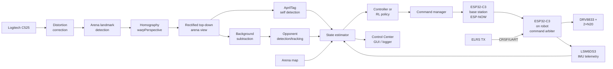
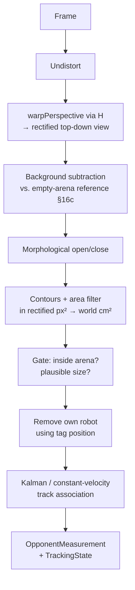
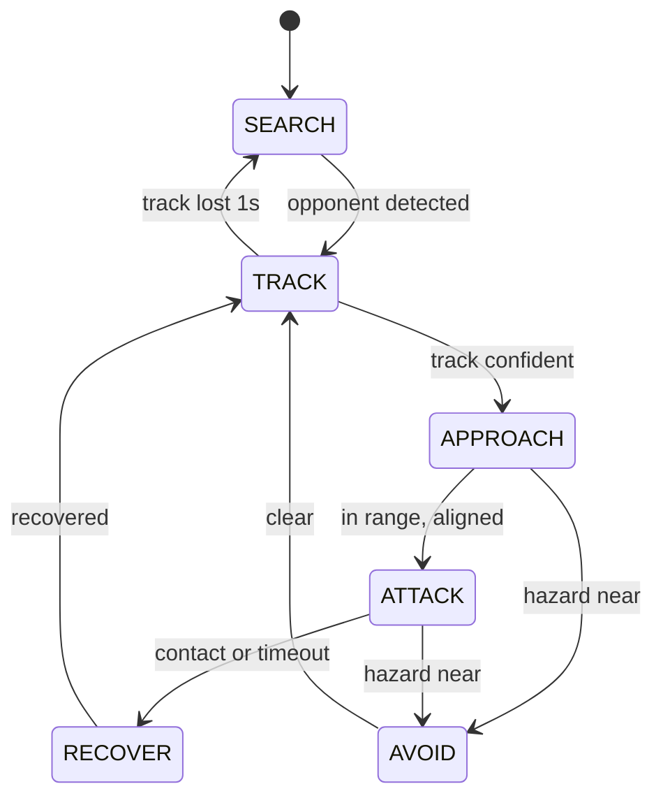
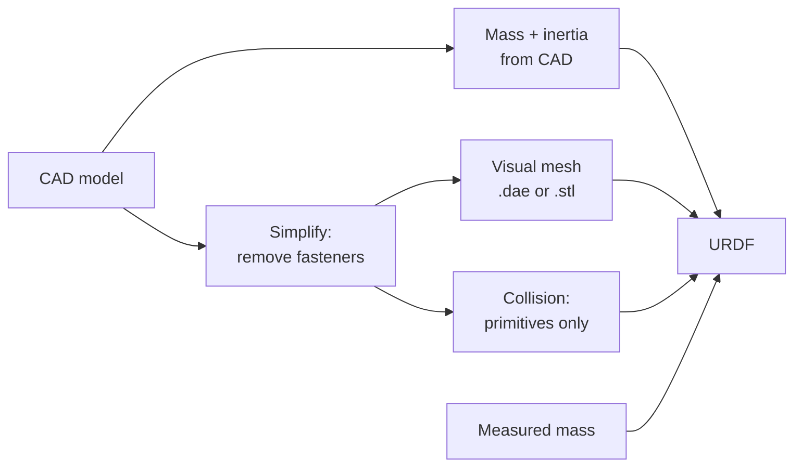
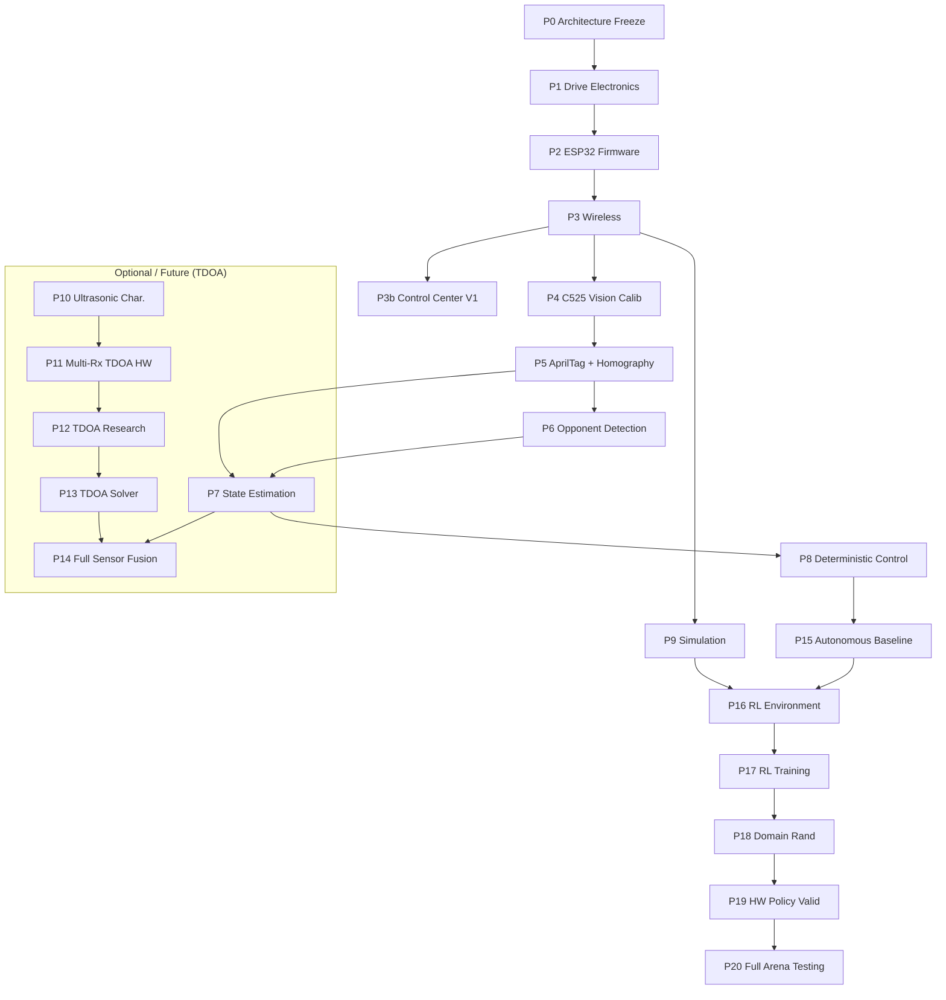

# Autonomous Antweight Combat Robot — Project Handbook

2026-09-19 · @Someone

## 0. How to read this handbook

This is a working reference, not a finished specification. Nothing here is presented as settled unless it genuinely is.

### Confidence labels

| Label | Meaning |
| --- | --- |
| **\[CONFIRMED\]** | A decision already made, or a physical fact you stated. Changing it means re-planning. |
| **\[WORKING IDEA\]** | The current plan. Reasonable, not yet validated by measurement. Expect some to change. |
| **\[NEEDS TEST\]** | Cannot be decided from a datasheet. A specific measurement is required first. |
| **\[ALTERNATIVE\]** | A fallback, recorded so you do not have to re-derive it later. |
| **\[RISK\]** | A named failure path, with the symptom you would actually observe. |
| **\[TODO-MEASURE\]** | A number you do not have yet. All collected in §42. |

### The decision block format

Where a design choice is uncertain, it is written like this:

```
CURRENT PLAN:   what to do now
WHY:            the physical or engineering reason
RISK:           how it fails
VALIDATE BY:    the experiment that settles it
ALTERNATIVE:    what to do if it fails
```

### Architecture status — confirmed vs genuinely unresolved

**\[CONFIRMED\] — committed decisions, changing them means re-planning:**

| Item | Decision |
| --- | --- |
| Onboard MCU | ESP32-C3 Super Mini (RISC-V, BLE5, ESP-NOW) |
| Motor driver | DRV8833 (10 modules ordered). Gate 1 applies — validate stall current |
| IMU | LSM6DS3 (preferred if available through university), SPI accessible |
| AI command wireless | ESP-NOW, ESP32-C3 base station |
| Manual override wireless | ELRS receiver onboard → CRSF/UART → ESP32-C3. Independent of laptop |
| Camera | Logitech C525, manual exposure confirmed working |
| Primary localization | External C525 camera + arena landmarks + homography + AprilTag |
| Motors | N20 geared, 6 V class (10 wheels ordered) |
| Battery | 6 V NiMH, 5-cell |
| No onboard FPV camera | Confirmed removed |
| No L298N in build | Existing hardware, bench diagnostic only |

**GENUINELY UNRESOLVED — requires measurement before committing:**

| Item | Unresolved question | Decided in |
| --- | --- | --- |
| DRV8833 stall survivability | Does it stay below thermal shutdown under real dual-stall conditions? | Phase 1, Gate 1 |

### The single biggest risk to this project

Not any one subsystem — it is **debugging four systems at once**. A homography with a transposed axis, a background model captured under wrong lighting, a motor driver browning out the ESP32, and a controller with a sign error will together produce behaviour that looks like possession and cannot be reasoned about. The phase structure in §37 exists to prevent that. The gates in §39 exist to stop you skipping it.

## 1. Project Overview

An antweight combat robot that drives itself. The robot has two independent control paths: an autonomous AI path from the laptop over ESP-NOW, and a manual supervisory override path from an ELRS transmitter directly to the robot. All high-level intelligence lives off-board on a laptop PySide6 Control Center application.

```
                ARENA  (1.15 m × 1.15 m, acrylic walls)
     ┌───────────────────────────────────────────────────────┐
     │                                                       │
     │     [MY BOT]  ← AprilTag on top                       │
     │       │                                               │
     │       │                        [OPPONENT]             │
     │       │                        (no markers allowed)   │
     └───────┼───────────────────────────────────────────────┘
             │                                     ▲
             │                                     │
             │                              ┌──────┴──────┐
             │                              │ Logitech    │
             │                              │ C525,       │
             │                              │ elevated,   │
             │                              │ angled down │
             │                              └──────┬──────┘
             │                                     │ USB
             ▼                                     ▼
      ╔══════════════════════════════════════════════════════╗
      ║              LAPTOP — CONTROL CENTER                  ║
      ║  vision → arena landmarks → homography → state       ║
      ║  AprilTag self-tracking + opponent foreground detect  ║
      ║  LSM6DS3 IMU telemetry → state estimator → controller║
      ║  PySide6 GUI: camera view, minimap, telemetry panels ║
      ╚═════════════════════════╦════════════════════════════╝
                                │ USB serial          ↑ telemetry
                                ▼
                        ESP32-C3 base station
                                │ ESP-NOW (AI commands)
                                ▼
                     ┌──────────────────────┐
   ELRS TX ))))))))));  ELRS RX │            │
                     │          ▼            │
                     │    ESP32-C3 on robot  │
                     │    command arbiter    │
                     └──────────┬────────────┘
                                │
                        DRV8833 → 2 × N20
```

### 1.1 Three parallel projects hiding inside one

Be honest about this, because it drives scheduling.

1. **A working remote-controlled antweight bot.** Mostly electrical and mechanical. Days.
2. **A localization and perception stack.** Camera calibration, arena landmark detection, homography, AprilTag self-tracking, background-based opponent detection and tracking, IMU integration. Weeks, and the hardest engineering here.
3. **An autonomy and learning stack.** Simulation, deterministic controllers, RL, sim-to-real. Weeks — but only useful once (2) produces trustworthy state.

The classic failure is to spend all the enthusiasm on (3), find that (2) gives noisy, laggy, occasionally wrong state, and conclude RL does not work. RL works fine. The state was garbage.

### 1.2 Localization architecture: vision-primary, TDOA optional

The primary world-state source is the external Logitech C525 camera, using:

- Arena landmark detection (pits, white flipper base, outer boundary)
- Homography / perspective rectification to a normalised top-down arena view
- AprilTag detection for own robot x, y, heading
- Universal background/change-based opponent detection — no training required
- Kalman-filtered temporal opponent tracking
- LSM6DS3 IMU for angular velocity, short-term heading propagation, and motion continuity during tag dropout

The robot does not depend on raw image pixel coordinates. Everything is converted to world/arena coordinates before the controller or state estimator uses it.

**Ultrasonic TDOA has been moved to the Optional / Future section (§17–23).** It is no longer part of the required final build. The camera system is expected to be sufficient for self-localization. TDOA may be revisited only if vision proves insufficient in practice.

> **Reframe worth internalising:** the external camera is very likely *sufficient*. If it is, TDOA's honest role is (a) a research exercise, (b) redundancy for heavy occlusion scenarios, and (c) independent measurements that validate the camera. All three are legitimate. "Necessary for the robot to function" probably is not. Pursue TDOA only if the vision-primary stack fails a defined criterion.

## 2. Goals and Non-Goals

### 2.1 Primary goals, in measurable form

| # | Goal | Measurable form |
| --- | --- | --- |
| G1 | Reliable wireless drive | 5 min teleop, zero unintended stops; end-to-end latency < 30 ms, jitter < 10 ms |
| G2 | Self-localization in arena coordinates | Position error < 2 cm RMS, heading error < 5°, at ≥ 20 Hz |
| G3 | Opponent tracking without cooperation | Detection rate > 90 % while opponent moves; position error < 5 cm |
| G4 | Simulation matching reality | Sim and real agree within 15 % on the §29 characterization metrics |
| G5 | Deterministic autonomy | Bot chases and contacts a slow target, avoids walls and pits, 60 s unattended |
| G6 | RL policy trained in sim running on the real bot | Transfers without catastrophic behaviour; degradation quantified, not zero |
| G7 | Understand the engineering | You can derive each subsystem from first principles |

G7 is not filler. It is why several sections below explain physics instead of giving a recipe.

### 2.2 Explicit non-goals

- **Winning a competition.** If that becomes the goal, the right answer is a good human driver and a nasty weapon. Autonomy is the point here.
- **Onboard perception.** No FPV camera, no onboard vision compute. The ESP32-C3 executes motor commands and returns telemetry. \[CONFIRMED\]
- **Training from raw pixels.** RL operates on estimated state vectors. \[CONFIRMED\]
- **A general-purpose robotics framework.** Build the smallest thing that supports §23 and §37.
- **Onboard autonomy.** All high-level control is on the laptop — which has a hard consequence: loss of the radio link must mean loss of motion, so the failsafe in §10.7 is not optional.

### 2.3 Goals often mistaken for non-goals

- **Logging** (§33). If you cannot replay a run offline you cannot debug perception. Build it in Phase 3, not Phase 15.
- **Coordinate frame discipline** (§6). Sign and axis errors are the single largest time sink in projects of this exact shape.
- **Characterizing the real robot** (§29). Simulation is worthless until mass, wheel radius, track width, free speed and friction are measured.

## 3. Current System and Existing Hardware

### 3.1 Inventory, with what you actually know about each item

| Item | Qty | What is known | What is unknown — and why it matters |
| --- | --- | --- | --- |
| N20 brushed geared motor | 2 | Form factor, 6 V-ish class | Gear ratio, free speed, **stall current**, no-load current. Stall current sets the H-bridge choice (§8.2) |
| NiMH pack | 1 | 6 V nominal → 5 cells | Capacity (mAh), internal resistance, actual charged voltage (≈ 6.5–7.0 V off charge), sag under stall |
| Chassis / body | 1 | Exists, antweight class | Mass, wheel diameter, track width, COM. All required for simulation (§29) |
| Random dual brushed ESC | 1 | Drove both N20s previously | Interface (PWM servo pulses? PPM? proprietary?), current rating. Probably retired |
| L298N module | 1 | **Existing hardware. Not part of intended architecture.** \~1.4–2 V drop on 6 V pack (Darlington, not MOSFET); kept only as bench diagnostic tool | Not used in any build phase |
| ESP32-C3 Super Mini | 4 (ordered) | RISC-V, BLE 5, Wi-Fi, ESP-NOW, \~11 usable GPIO | Which pins are strap pins on your specific board revision |
| Laptop | 1 | Runs vision, fusion, control, sim | CPU/GPU class, USB bandwidth for the webcam |
| Logitech C525 webcam | 1 | **\[CONFIRMED\]** 720p, USB, manual exposure confirmed working; tested vs iPhone 13 via Camo — C525 won on AprilTag detection consistency | Rolling vs global shutter (likely rolling); actual capture latency \[TODO-MEASURE C1\] |
| D-shaft N20 wheels | 10 (ordered) | Compatible with N20 motors | |
| DRV8833 dual H-bridge modules | 10 (ordered) | Current motor driver plan | Gate 1 applies — validate stall current |
| 3D printer, electronics bench | — | Available | — |

**Everything in the "unknown" column is a \[TODO-MEASURE\].** Several of them block purchasing decisions. §42 collects them all in one place with the phase where each becomes blocking.

### 3.2 The N20 stall current question, because it blocks the most

The N20 is not one motor — it is a form factor. The same 12 mm × 10 mm can contains motors whose stall current at 6 V ranges from roughly 0.5 A to well over 1.5 A, depending on the winding.

Stall current follows directly from the winding resistance:

$$
I_{stall} = \frac{V_{supply}}{R_{winding}}
$$

You can measure R with a multimeter across the terminals, rotating the shaft slightly between readings and taking the **minimum** (brush contact geometry changes the reading). A more honest measurement is to stall the motor at the real battery voltage with a current meter in series, for under a second.

> **Why the difference matters:** DRV8833 is rated 1.5 A RMS per channel, \~2 A peak, and it has no current limiting unless you add sense resistors. If your motors stall at 1.8 A, DRV8833 will work at idle and shut down under exactly the conditions a combat bot lives in — pushing, pinned against a wall, weapon contact. See the motor driver gate in §39.

### 3.3 What is being retired and why

| Retired | Reason |
| --- | --- |
| RC receiver + dual ESC | The whole point is a computer in the loop. An RC ESC takes servo pulses and gives no telemetry, no failsafe you control, no packet-level visibility |
| Onboard FPV camera | \[CONFIRMED\] removed from the architecture. It adds video latency, analogue interference, weight and a second failure surface, for perception you can do better externally |
| L298N in the final build | \~1.4–2 V drop per side (Darlington, not MOSFET). On a 6 V pack that is 25–30 % of your voltage burned as heat before the motor sees it |

## 4. Constraints and What They Actually Force

This section exists because most of the hard architectural decisions are downstream of constraints, not preferences.

### 4.1 The constraint table

| Constraint | Status | Direct consequence |
| --- | --- | --- |
| Arena ≈ 1.15 m × 1.15 m | \[CONFIRMED\] | Everything is close. Acoustic path 0–1.63 m → 0–4.8 ms. Camera can cover it with one view. Speeds are high relative to arena size |
| Enclosed with acrylic walls | \[CONFIRMED\] | Hard, flat, acoustically reflective on all four sides. Optically: glare, reflections, scratches. This is the root cause of most of §22 |
| Cannot modify the arena | \[CONFIRMED\] | No AprilTags on walls or floor, no wall-mounted receivers inside, no reference markers. Calibration must use existing arena geometry (§13) |
| Cannot modify the opponent | \[CONFIRMED\] | Opponent tracking must be fully non-cooperative — appearance/motion based, never marker based (§15) |
| Can place equipment outside | \[CONFIRMED\] | Camera, RX stations, base-station ESP32 all live outside. Acoustic receivers must then look **through** the acrylic, or through a gap (§4.3) |
| Can modify my own robot | \[CONFIRMED\] | AprilTag on top, ultrasonic TX, IMU, ESP32-C3 all fair game — subject to weight class |
| Overhead camera impractical | \[CONFIRMED\] | Oblique view → perspective distortion → homography required → parallax error scales with robot height (§13.5) |
| Arena blueprint known, incl. pits | \[CONFIRMED\] | Static hazards go into a stored map, never re-detected per frame (§16). Big simplification — take it |
| Announcers, PA, crowd | \[CONFIRMED\] | Audible-band noise mostly irrelevant at 40 kHz, but switching supplies, PA tweeters, LED drivers and impacts all emit ultrasonic energy (§22) |
| Brushed motors, violent impacts | \[CONFIRMED\] | Electrical noise on the receiver front ends, broadband acoustic energy on impact, mechanical shock on the IMU |

### 4.2 The most consequential single constraint

**No markers on the arena.** This drives camera calibration entirely. You cannot lay a checkerboard on the floor and compute a homography in five seconds. Instead you must:

1. Take the blueprint's known metric coordinates for identifiable physical features — wall base corners, pit edges, floor panel joins, bolt heads.
2. Click those features in the camera image.
3. Solve the homography from ≥ 4 correspondences (§13.2).

This works, but it is **manual, error-prone, and must be redone every time the camera moves**. Two practical consequences:

- The camera mount must be genuinely rigid. A tripod someone can bump invalidates your calibration silently — the system will not throw an error, it will just be wrong by a few centimetres. \[RISK\]
- Build a re-calibration workflow that takes under two minutes, because you will run it far more often than you expect. Store every calibration with a timestamp and a photo of the scene so you can tell which one you were using.

### 4.3 The acrylic question, which you must answer early

&#91;TODO-MEASURE, blocking Phase 10\] Is there a clear acoustic path from inside the arena to your receivers, or must 40 kHz sound cross an air–acrylic–air boundary?

This matters enormously. The acoustic impedance mismatch is severe:

| Medium | Acoustic impedance Z (rayl) |
| --- | --- |
| Air | ≈ 410 |
| Acrylic (PMMA) | ≈ 3.2 × 10⁶ |

The pressure transmission coefficient at a single boundary is:

$$ T = \frac{2 Z_2}{Z_1 + Z_2} $$

and the **intensity** transmission across an air–solid interface is governed by:

$$
T_I = \frac{4 Z_1 Z_2}{(Z_1 + Z_2)^2}
$$
Plugging in air and PMMA gives Tᵢ ≈ 5 × 10⁻⁴, i.e. about −33 dB at *one* boundary. You have two boundaries (air→acrylic→air). Thin-plate resonance effects can improve this at particular frequency/thickness combinations, so the real number is not simply −66 dB — but the honest expectation is **tens of dB of loss**, with strong dependence on plate thickness and frequency.

```
CURRENT PLAN:   Find a physical gap — wall top edge, cable pass-through, door seam,
                lid gap — and site receivers so they have air line-of-sight.
WHY:            Tens of dB through acrylic is likely fatal for a 40 kHz piezo link
                already working with small signals.
RISK:           There may be no usable gap, and the arena may have a roof.
VALIDATE BY:    Experiment 2 (§23) — measure received amplitude with and without
                an acrylic sheet of the arena's real thickness in the path.
ALTERNATIVE:    (a) Receivers above the wall line looking down over the top edge;
                (b) contact/structure-borne pickup on the acrylic itself — different
                physics, much worse timing, probably not viable;
                (c) abandon TDOA and treat the camera as the sole localizer.
```

### 4.4 Constraints you have not yet checked

These are rules and logistics questions, not physics, but any one of them can invalidate a subsystem. Answer them before Phase 10.

- [ ] Do competition rules permit external electronics beside the arena? \[TODO\]
- [ ] Do rules permit autonomy at all, or require a human failsafe on a dead-man switch? \[TODO\]
- [ ] Which RF bands are allowed? Some events restrict 2.4 GHz use to registered receivers. \[TODO\]
- [ ] Is there a roof/lid over the arena? Determines camera placement and acoustic access. \[TODO\]
- [ ] How much setup time before a match? Determines whether a 2-minute recalibration is even feasible. \[TODO\]
- [ ] Is there an "external equipment" size limit beside the arena? \[TODO\]

> **Worth separating in your head:** the *competition* arena and the *development* arena may differ. If you can build or borrow a 1.15 m practice box you control, you can put markers, receivers and cameras anywhere for development, and only then port to the constrained competition setup. That is a legitimate and much faster path, and it is how most of the experiments in §23 should be run.

## 5. Full System Architecture

The architecture is a **fast inner loop on the robot** and a **slow-but-smart outer loop on the laptop**, joined by a lossy radio link. Everything that must survive link loss lives on the robot; everything that needs to think lives on the laptop.

### 5.1 Data flow



### 5.2 The three loops, and their rates

| Loop | Where | Target rate | What it does | What happens if it stops |
| --- | --- | --- | --- | --- |
| Motor loop | ESP32-C3 | 100–1000 Hz | Apply last commanded PWM, run slew limiting, check watchdog | Watchdog fires → motors stop (§10.7) |
| Estimation loop | Laptop | 30–100 Hz | Predict state forward, fold in whatever measurements arrived | State goes stale → controller must detect and stop |
| Control loop | Laptop | 20–50 Hz | State → motor commands | Bot coasts, then watchdog stops it |

> **Design rule:** the robot never decides anything except *stop*, and which command source has authority. The onboard command arbiter (§10.10) enforces priority: ELRS manual override > laptop GUI request > autonomous ESP-NOW command. A laptop crash cannot prevent ELRS manual control.

### 5.3 Latency budget

This is the number that governs how aggressively you can control. Measure each row; do not assume.

| Stage | Expected | How to measure |
| --- | --- | --- |
| Camera exposure + sensor readout | 5–30 ms | Film an LED you toggle from code; count frames |
| USB transfer + driver | 5–20 ms | Timestamp at `cap.read()` return vs LED toggle |
| Detection (AprilTag + opponent) | 3–15 ms | Wall-clock around the detector call |
| Estimator + controller | < 2 ms | Wall-clock |
| Laptop → base ESP32 over USB serial | 1–5 ms | Round-trip echo test |
| ESP-NOW transmission | 1–4 ms | Robot echoes sequence number; measure RTT/2 |
| ESP32-C3 → PWM update | < 1 ms | Scope on a GPIO toggled at command apply |
| **Total, sensing to actuation** | **20–80 ms** | End-to-end LED-to-motion test |

At 1 m/s, 50 ms of latency is 5 cm of position error — comparable to the robot's own size. Two consequences:

- The estimator must **predict forward** by the measured latency before the controller uses the state (§24.6).
- The RL environment must **simulate this latency** (§31). A policy trained with zero latency will oscillate on the real bot.

### 5.4 Module boundaries, and the one rule that keeps them clean

Every module communicates through **timestamped measurement objects**, never by calling into another module's internals.

```
CameraMeasurement { t_capture, self_xy, self_theta, opp_xy, opp_tracking_state, quality }
ImuMeasurement    { t_sample, gyro_z, accel_xy, quality }
            ↓
       StateEstimator
            ↓
 WorldState { t, self{x,y,theta,vx,vy,omega}, opp{x,y,vx,vy,confidence,tracking_state}, vision{...}, ... }
            ↓
      Controller / Policy
            ↓
 MotorCommand { t_issue, left, right, mode, enable }
```

The `quality` field on every measurement is what makes the estimator robust. Never let a module silently emit a bad value — make it emit a bad value *with low quality*, and let the estimator decide (§24.4).

### 5.5 Laptop Control Center

The laptop side is not merely a collection of scripts. The intended operator interface is a **PySide6 / Qt desktop application** — the Control Center — which is the main window open during all robot testing and autonomous operation.

```
control_center/
    app.py
    widgets/
        camera_view.py        ← live C525 feed with perception overlays
        minimap.py            ← top-down arena view, own robot + opponent positions
        robot_status.py       ← robot health, link status, ELRS status
        vision_panel.py       ← vision/arena tracking status and controls
        control_panel.py      ← ARM/AUTO/MANUAL TAKEOVER/e-stop/logging
        system_health.py      ← subsystem status indicators
        event_log.py
    backend/
        camera_worker.py      ← C525 capture + AprilTag detection thread
        vision.py             ← AprilTag tracker
        command_manager.py    ← §10.10 requests to onboard arbiter + vision commands
        robot_link.py         ← ESP-NOW bridge serial interface
        state_store.py        ← central typed state store
        logging_manager.py
        tdoa.py               ← [OPTIONAL/LEGACY] Placeholder for future TDOA integration
    models/
        state.py              ← typed state contract
```

**Data flow principle:** The GUI consumes the same `WorldState` produced by the state estimator. It must NOT independently reconstruct a second state from raw sensors. The same `WorldState`/`RobotState` types are used by the deterministic controller, RL policy, logger, Control Center, and simulator (§25).

**Main camera view (central panel):** Live C525 feed with overlays — my robot bounding box/outline, AprilTag ID, robot centre, heading arrow, opponent bounding box and centre, opponent velocity arrow, arena/hazard overlays, detection confidence, tracker status. Status indicators: `MY ROBOT: DETECTED / LOST`, `OPPONENT: TRACKED / LOST`. Minimal text on the camera view; detail in side panels.

**Top-down arena minimap (compact panel):** Arena boundary, pits/hazards, my robot position + heading arrow, opponent estimated position (symbol ○), own robot camera-only estimate (symbol △), fused estimate (symbol ×). Uses physical arena coordinates — never raw pixel positions.

**VISION / ARENA panel (replaces TDOA panel):** Camera state, arena calibration status, homography valid/invalid, background reference loaded/not loaded, own robot detection status, opponent tracking state (TRACKED/PREDICTED/LOST), opponent confidence, calibration error if available. Controls: RECALIBRATE ARENA, CAPTURE BACKGROUND, AUTO ACQUIRE OPPONENT, SELECT OPPONENT, CLEAR TRACK.

**Robot health/telemetry panel:** Battery voltage, IMU status, onboard loop rate, ESP-NOW status (RTT/packet age/loss), ELRS status (RSSI, link quality from CRSF), current ARM state, control mode, failsafe state, last command values. Status categories: `OK / DEGRADED / LOST / FAILSAFE` — text labels, not colour alone.

**Operator controls panel:** ARM / DISARM, AUTO enable, MANUAL TAKEOVER button, software emergency stop, max-speed slider, start/stop logging, arena recalibration shortcut, background capture, opponent acquisition controls (also in VISION/ARENA panel), IMU re-bias, controller mode selection.

### 5.6 Vision / localization control separation

**Calibration** (homography, arena landmark detection) and **background model** (empty-arena reference image) are separate state objects from live tracking. The operator workflow is:

1. Mount camera and run RECALIBRATE ARENA to establish the homography.
2. Ensure arena is empty and run CAPTURE BACKGROUND to build the reference.
3. Begin tracking — opponent detection runs against the stored background.

Either step can be repeated independently. Camera movement only requires repeating step 1; a lighting change only requires repeating step 2. The acquire/display/fuse separation principle still applies to any optional sensor (e.g. TDOA if ever added).

### 5.7 GUI Manual Takeover vs ELRS Override — the crucial distinction

The Control Center has a prominent **MANUAL TAKEOVER** button. Its purpose is to disable autonomous output from the laptop and request that the robot enters manual mode, after which the operator controls it via the ELRS transmitter.

**However, this button is NOT the highest-priority safety override.**

If the laptop freezes, crashes, or OpenCV hangs, the GUI button becomes unreachable. The ELRS transmitter manual override (§10.10) must remain independent of laptop state. Flipping the ELRS AUTO/MANUAL switch overrides autonomous mode regardless of what the laptop is doing.

- **ELRS manual override:** real, independent safety override — works even if the laptop is dead
- **GUI MANUAL TAKEOVER button:** convenience operator control — requires the laptop to be alive

This distinction must be reflected in the safety section (§35) and in operator training.

## 6. Coordinate Frames

Define these on day one and never renegotiate them. Sign-convention mistakes are the most common and most demoralising class of bug in this project.

### 6.1 Frame definitions \[CONFIRMED — decide now, write it on the wall\]

| Frame | Origin | Axes | Units | Notes |
| --- | --- | --- | --- | --- |
| `world` | One chosen arena corner | x right, y forward (away from camera), z up | metres, radians | Right-handed. θ measured CCW from +x |
| `image` | Top-left pixel | u right, v **down** | pixels | OpenCV convention. v-down is the classic sign trap |
| `rect` | Top-left of warped top-down image | u right, v down | pixels, with known m/px | Purely a debug/visualization frame |
| `body` | Robot centre of rotation (midpoint of wheel axle) | x forward, y left, z up | metres | ROS REP-103 convention. Keep it |
| `rx_k` | Receiver k position | — | metres in `world` | Receivers may be outside arena → negative or > 1.15 coordinates are normal |
| `sim` | Identical to `world` | Identical | Identical | Non-negotiable. Any difference will cost you a week |

### 6.2 Which corner is the origin?

Put the origin at the arena corner **nearest the camera and to the camera's left**, so that most of the arena has positive x and y and the camera's view roughly increases y with depth. Then:

```
                 y
                 ↑
   (0,1.15) ┌────────────────┐ (1.15,1.15)
            │                │
            │   θ = 0 points │
            │   along +x  ──▶│
            │                │
     (0,0)  └────────────────┘ (1.15,0) → x
                  ▲ camera roughly here, elevated, looking +y
```

### 6.3 Transformations you will write

**Image → world (the homography).** For a point on the arena floor plane:

$$
\begin{bmatrix} x' \\ y' \\ w \end{bmatrix} = H \begin{bmatrix} u \\ v \\ 1 \end{bmatrix}, \quad x = \frac{x'}{w},\; y = \frac{y'}{w}
$$

H is 3×3, defined up to scale, so it has 8 degrees of freedom — hence ≥ 4 point correspondences. Critically, **this is only valid for points on the floor plane**; anything at height h is projected wrongly (§13.5).

**Body → world.**

$$
\begin{bmatrix} x_w \\ y_w \end{bmatrix} = \begin{bmatrix} \cos\theta & -\sin\theta \\ \sin\theta & \cos\theta \end{bmatrix} \begin{bmatrix} x_b \\ y_b \end{bmatrix} + \begin{bmatrix} x \\ y \end{bmatrix}
$$

**Bearing to a target, in body frame** — the quantity your controllers and policy actually use:

$$
\beta = \mathrm{atan2}(y_{opp} - y_{self},\; x_{opp} - x_{self}) - \theta_{self}
$$

wrapped to (−π, π\]. Positive β means the target is to the robot's **left**, because y is left in body frame. Write that sentence in a comment above the function.

### 6.4 Sign-convention disaster prevention

These are the specific traps, in the order you will hit them.

1. **Image v-axis points down.** Angles computed in image space run clockwise while world angles run counter-clockwise. Never compute a heading in image space — convert to world first, then compute.
2. **AprilTag yaw is not robot heading.** The tag has its own frame and an arbitrary mounting rotation. Measure the mounting offset once and store it in config as `tag_to_body_yaw` (§34.5).
3. **Motor polarity vs command sign.** "Positive command = forward" is a per-motor convention that depends on how you soldered the wires. Store `left_invert` and `right_invert` booleans in config; never fix polarity by flipping wires after software exists.
4. **Angle wrapping.** Every heading subtraction must be wrapped. An unwrapped error of +359° instead of −1° makes a PID controller spin the robot the long way round at full speed. Write `wrap_pi()` once, use it everywhere.
5. **Degrees vs radians.** Pick radians internally, degrees only in display and logs. Suffix every variable: `theta_rad`, `theta_deg`.
6. **TDOA sign** *(only relevant if TDOA optional track is started).* Δt₁₂ = t₁ − t₂ means receiver 1 heard it *later* when positive, so the robot is *further* from receiver 1. Getting this backwards produces a position solution mirrored about the arena centre — which looks plausible and will waste a day.

### 6.5 The frame-sanity test, to run after any calibration

Place the robot at four known positions (measured with a tape, arena corners inset 15 cm) and one known heading each. The system must report all four within tolerance. Automate this as `scripts/frame_check.py`. Run it every session before anything else. If it fails, nothing downstream is worth debugging.

## 7. Robot Electrical Architecture

### 7.1 Target topology \[WORKING IDEA\]

```
  NiMH 5×AAA/AA, 6.0 V nom (6.5–7.0 V charged, 5.0 V sagged)
        │
        ├──► [MASTER SWITCH / REMOVABLE LINK]  ◄── physical kill (§35)
        │
        ├──► BULK CAP 470–1000 µF  ──► MOTOR BRANCH
        │                              │
        │                              └─► DRV8833 H-bridge ──► M_L (N20), M_R (N20)
        │                                   (100 nF across each motor,
        │                                    100 nF motor case→each terminal)
        │
        └──► LOGIC BRANCH
                │
                ├─► Buck or LDO ──► 3.3 V rail
                │     ↑ 10–47 µF in, 10–22 µF out, 100 nF close to every IC
                │
                ├─► ESP32-C3 Super Mini
                ├─► LSM6DS3 IMU (SPI, §11)
                └─► Battery sense divider → ADC

  GROUND: motor return and logic return meet at ONE point, at the battery
          negative terminal. Nowhere else.
```

### 7.2 Why the split matters more than it looks

A brushed motor is an electrically violent load. Three separate mechanisms put noise on your rail:

1. **Commutator arcing** — brushes break contact tens to hundreds of times per revolution, generating broadband RF and voltage spikes. This is why the 100 nF ceramics go *at the motor terminals*, not at the driver.
2. **Inductive kick at PWM switching** — every PWM edge interrupts current in the motor inductance. The H-bridge body diodes handle it, but the current step lands on your supply.
3. **Inrush and stall current** — the DC load itself, pulling the rail down through the battery's internal resistance.

On a 6 V NiMH pack with maybe 100–200 mΩ internal resistance, a 2 A stall pulls the rail down by 0.2–0.4 V, and a dual stall doubles it. Add connector and wire resistance and you can dip below the regulator's dropout. The ESP32 browns out, reboots, stops sending PWM — and because the motors then stop, the rail recovers and it all looks fine on a multimeter. \[RISK\] **Symptom: the robot resets under acceleration but tests perfectly on the bench.**

### 7.3 Regulator choice

```
CURRENT PLAN:   A small synchronous buck (e.g. MP1584, TPS62203-class) at 3.3 V,
                fed from the raw battery, with generous input capacitance.
WHY:            An LDO from 6 V to 3.3 V wastes (6−3.3) × I as heat and, worse,
                has no headroom left when the pack sags to 5 V under stall.
                A buck holds 3.3 V down to ~4 V input.
RISK:           Buck switching noise (several hundred kHz) can couple into the
                ultrasonic receiver chain — though those are outside the arena,
                so the risk is mainly to the IMU and ADC.
VALIDATE BY:    Scope the 3.3 V rail during the stall test in §34.2. Ripple should
                be < 50 mV pk-pk. Then repeat with the buck vs an LDO and compare.
ALTERNATIVE:    A low-dropout LDO (e.g. 250 mV dropout) is acceptable IF measured
                sag never takes the pack below ~3.8 V. Simpler, quieter, but
                you must prove the sag number first. [NEEDS TEST]
```

> **Common mistake:** powering the ESP32-C3 Super Mini through its 5 V pin from the raw 6 V pack. Check your board revision — the on-board regulator's absolute maximum may be 6 V, which a freshly charged NiMH pack exceeds. Feeding a regulated 3.3 V directly to the 3V3 pin bypasses the on-board LDO entirely and is usually the cleaner path, but then **never** also connect USB while the battery is live unless you have a diode-OR.

## 8. Motor Control

### 8.1 What the driver must do

| Requirement | Mechanism |
| --- | --- |
| Forward / reverse | Full H-bridge per motor |
| Independent L/R speed | Two independent channels |
| Coast | Both half-bridges high-Z (`IN1=0, IN2=0` on DRV8833-style) |
| Active brake | Both low-side FETs on, shorting the motor (`IN1=1, IN2=1`) |
| Failsafe | Coast or brake asserted by the ESP32's own watchdog (§10.7) |
| Survive stall | Continuous current rating ≥ measured stall, or accept thermal shutdown |

### 8.2 Driver comparison

| Driver | Technology | Cont. / peak per ch | V\_drop at 1 A | Verdict |
| --- | --- | --- | --- | --- |
| L298N | Darlington BJT | 2 A / 3 A | \~1.4–2.0 V | Bench only. Burns \~25 % of a 6 V pack as heat. \[CONFIRMED retire\] |
| DRV8833 | MOSFET | 1.5 A / 2 A | \~0.36 V (R\_DS(on) \~0.36 Ω total) | **\[CONFIRMED CURRENT PLAN — already ordered.\]** Gate 1: validate stall current before relying at events |
| DRV8871 (×2) | MOSFET | 3.6 A peak, single ch | \~0.15 V | Fallback only, if Gate 1 shows DRV8833 insufficient. Do NOT buy speculatively |
| TB6612FNG | MOSFET | 1.2 A / 3.2 A | \~0.5 V | Fallback only. Lower continuous rating than DRV8833. Do NOT buy speculatively |
| DRV8876 / DRV8256 | MOSFET | 3.5–6 A | low | Overkill for N20s unless stall is surprisingly high |
| Discrete FET H-bridge | Custom | anything | very low | Only if you want the exercise. More ways to blow things up |

```
CURRENT PLAN:   DRV8833. [CONFIRMED as current plan — 10 modules already ordered.]
                Gate 1 still applies: measure dual stall current at real pack
                voltage before relying on it at events.
                If stall persistently exceeds DRV8833's continuous 1.5 A rating,
                select a stronger compact H-bridge at that point.
WHY:            DRV8833 covers the most likely N20 stall range at 6 V, uses MOSFET
                switches (~0.36 V drop vs L298N's 1.4–2 V), and has thermal + OCP
                protection. The modules are in hand — no new purchase needed.
RISK:           Thermal shutdown mid-match if stall current persistently exceeds
                1.5 A RMS. Symptom: one side cuts out and recovers seconds later,
                which looks like a radio fault.
VALIDATE BY:    Stall both motors at charged pack voltage for 5 s with a current
                clamp or shunt. Record peak and 1-s-average. If average > 1.5 A
                per motor, select a stronger driver before the next session.
ALTERNATIVE:    If DRV8833 fails the gate: select a stronger compact H-bridge
                based on the measured current. Do NOT preemptively buy DRV8871
                or TB6612 — buy on evidence after the stall measurement.
```

### 8.3 PWM configuration

| Parameter | Recommendation | Reason |
| --- | --- | --- |
| Frequency | 20–25 kHz | Above audible; below the frequency where switching losses and driver rise-time dominate |
| Resolution | 10 bit (ESP32 LEDC) | 1024 steps is far finer than the motor's usable dynamic range |
| Mode | Sign-magnitude (PWM one input, hold the other) or locked-antiphase | Sign-magnitude is simpler and lower-loss; locked-antiphase gives better low-speed linearity but always draws current |
| Slew limiting | ≤ full-scale change per 100 ms | Protects gears and the battery rail; also makes sim-to-real easier because acceleration is bounded |

> **Note:** PWM frequency has no interaction constraint with the vision-primary localization system. 20–25 kHz is chosen purely on audibility and switching-loss grounds. TDOA ultrasonic harmonics are no longer a design constraint.

### 8.4 Deadband and the motor command curve

A geared N20 does not move at all below some PWM threshold, because static friction in the gearbox exceeds the torque produced. Below that, you are just heating the winding.

```
      speed
        │          ____________/
        │         /
        │        /
    ────┼───────/────────────── PWM
        │  ◄────►
        │  deadband (measure it — typically 10–25 % on N20s)
```

Remap commands so that a command of 0.01 produces motion:

$$
PWM = \mathrm{sign}(u) \cdot \left( D + (1 - D)\,|u| \right), \quad u \in [-1, 1]
$$

where D is the measured deadband fraction. Do this **once, in firmware**, so that the controller, the simulator and the RL policy all see the same linear-ish command space. If the simulator does not model the same deadband, sim-to-real will fail at exactly the low speeds where fine positioning matters. \[Link to §29\]

### 8.5 Braking versus coasting

| Mode | Electrical | Behaviour | Use when |
| --- | --- | --- | --- |
| Coast | Both sides high-Z | Robot rolls on, decelerating by friction only | Default failsafe if the bot might be in a pit-adjacent position and you prefer no sudden weight transfer |
| Brake | Both low sides on | Motor back-EMF drives current through the short → strong deceleration | Precise stopping, holding position, fast direction changes |

Braking is usually what you want for control, but measure both: the **coast distance** from full speed is a direct characterization input for simulation (§29), and the difference between coast and brake distance tells you how much of your deceleration authority is electrical.

### 8.6 Firmware structure on the ESP32-C3

The onboard ESP32-C3 has two incoming control paths (see §10.9) and a command arbitration layer that selects between them (see §10.10).

```
setup():
  init LEDC PWM channels (4 pins: AIN1 AIN2 BIN1 BIN2)
  init ESP-NOW, register recv callback
  init UART for CRSF (ELRS receiver) at 420000 baud
  init IMU over SPI (LSM6DS3)
  set outputs to COAST
  arm_state = DISARMED
  control_mode = AUTONOMOUS

crsf_isr() / UART task:           # parse incoming CRSF frames from ELRS RX
  validate CRSF frame CRC
  extract RC channels
  update crsf_channels[], last_crsf_us = micros()

espnow_recv_callback(packet):     # runs fast, does almost nothing
  validate CRC and sequence
  store autonomous_cmd (left, right, mode, flags)
  last_espnow_us = micros()

loop() @ 200 Hz:
  # ── ELRS/CRSF parse ────────────────────────────────────────────────
  elrs_fresh = (micros() - last_crsf_us) < CRSF_TIMEOUT_US   # e.g. 300 ms
  elrs_armed = (crsf_channels[ARM_CH] > THRESHOLD_HIGH)
  elrs_manual = (crsf_channels[MODE_CH] > THRESHOLD_HIGH) and elrs_fresh

  # ── Command arbitration (§10.10) ───────────────────────────────────
  if not elrs_armed:
      arm_state = DISARMED
      apply COAST
  elif elrs_manual:
      arm_state = ARMED
      control_mode = MANUAL_ELRS
      left, right = sticks_to_drive(crsf_channels)
      slew-limit and apply
  elif (micros() - last_espnow_us) < FAILSAFE_US and autonomous_cmd.enable:
      arm_state = ARMED
      control_mode = AUTONOMOUS_ESPNOW
      slew-limit toward autonomous_cmd.left, autonomous_cmd.right
      apply deadband remap, write PWM
  else:
      arm_state = ARMED
      control_mode = WAITING
      apply COAST

  # ── Telemetry uplink ───────────────────────────────────────────────
  every 20 ms: send telemetry (V_batt, gyro, loop_hz, rx_count, last_seq,
               arm_state, control_mode, elrs_rssi, elrs_lq, last_crsf_age_ms)
```

**The failsafe check must be in the main loop, not the callback.** If it lives in the callback it can only run when packets arrive — which is precisely the condition that has failed. This is a mistake people make once.

**Both control paths run simultaneously.** The CRSF parser always runs. The command arbiter evaluates both sources every loop cycle. Switching between ELRS manual and autonomous mode is instantaneous — just flip the transmitter switch.

## 9. Power System

### 9.1 What you need to know about your pack

A 5-cell NiMH pack nominally 6.0 V has a much wider real range:

| State | Approximate voltage | Notes |
| --- | --- | --- |
| Off charger, rested | 6.5–7.0 V | Peak, decays in minutes |
| Nominal / most of discharge | 5.8–6.2 V | The flat part of the NiMH curve — which is why voltage is a poor fuel gauge |
| Under 2 A load | nominal − I·Rₘ ≈ 5.5–5.8 V | \[TODO-MEASURE\] Rₘ |
| Under dual stall | can dip below 5.0 V | The brownout scenario |
| Discharged | < 5.0 V rested | Stop — NiMH cell reversal damages packs |

### 9.2 Characterization procedure — do this before designing anything final

This is the highest-value hour of bench work in the whole electrical section.

1. **Open-circuit voltage.** Rest 30 min off charge. Record.
2. **Internal resistance.** Apply a known load (e.g. 2 Ω power resistor ≈ 3 A). Measure V loaded and unloaded within a second. Rₘ = (V\_oc − V\_load) / I.
3. **Single-motor stall.** Motor clamped, series shunt (0.1 Ω, measure across it) or current clamp. Record peak and steady current, and pack voltage during.
4. **Dual stall.** Both motors, same measurement. This is your worst case.
5. **Rail during a reversal.** Scope on the 3.3 V rail, AC-coupled, while commanding full forward → full reverse. Record the dip and any ringing.
6. **Runtime.** Drive a repeatable pattern until the pack hits 5.0 V. Record minutes. This tells you how many experiment runs fit in a charge, which matters more than you expect during a long test session.

**Record all six results in a table in this document.** They feed the driver choice (§8.2), the regulator choice (§7.3), and the simulation's battery-sag model (§29).

### 9.3 Decoupling checklist

- [ ] 100 nF ceramic across each motor's two terminals, soldered **at the motor**
- [ ] Optionally 100 nF from each terminal to the motor can (helps with commutator RF; skip if the can is not grounded)
- [ ] 470–1000 µF electrolytic across the H-bridge supply pins, short leads
- [ ] 100 nF ceramic on every IC supply pin, within a few mm
- [ ] 10–22 µF on the 3.3 V rail near the ESP32
- [ ] Twisted motor leads, kept away from the IMU and any analogue signal
- [ ] Single-point ground at the battery negative
- [ ] Wire gauge: 22–24 AWG for motor runs at these currents; the connectors matter more than the wire at 10 cm lengths

### 9.4 Battery monitoring \[WORKING IDEA\]

A simple resistive divider (e.g. 100 kΩ / 47 kΩ) into an ESP32-C3 ADC pin gives you battery voltage in telemetry. Worth doing, for three reasons beyond the obvious:

1. **Motor performance drifts with pack voltage.** Your "full speed" at 6.8 V is not your full speed at 5.6 V. If you log V\_batt alongside commanded and actual speed, you can either compensate in firmware or include voltage in the RL domain randomization (§31).
2. **Sag is a proxy for load.** A deep sag with no commanded acceleration means something is jammed.
3. **Experiment validity.** A run at 5.4 V and one at 6.8 V are not the same experiment. Log it so you can tell them apart afterwards.

ESP32-C3 ADC is noisy and non-linear near the rails — use multi-sample averaging and calibrate the divider against a multimeter at two known voltages.

## 10. Wireless Communications

### 10.1 Requirements, stated as numbers

| Requirement | Target | Why this number |
| --- | --- | --- |
| One-way latency | < 5 ms | Must be small relative to the 20–80 ms perception latency (§5.3) |
| Jitter | < 3 ms | Jitter is worse than latency. Constant latency can be compensated; variable latency cannot |
| Update rate | 50–100 Hz | Above control loop rate, so the link is never the bottleneck |
| Range | 5–10 m | Trivially satisfied by everything |
| Packet loss tolerance | Survive 100 ms outage | Failsafe timeout must be longer than realistic bursts, shorter than dangerous |
| Payload | ≤ 32 bytes | Tiny. Bandwidth is irrelevant; overhead is everything |
| Telemetry | 20–50 Hz upstream | Battery, gyro, loop health, packet stats |

### 10.2 Candidate comparison

| Option | Typical one-way latency | Jitter | Connection model | Verdict |
| --- | --- | --- | --- | --- |
| **ESP-NOW** | 1–4 ms | Low, but rises with channel congestion | Connectionless, MAC-addressed, no association | **Recommended.** Minimal stack, no DHCP, no handshake, reconnects instantly |
| **BLE (GATT notify)** | 7.5–30 ms, set by connection interval | Moderate; interval is negotiated and the peripheral can be overridden by the host | Connection-oriented | Workable but the connection interval quantises your latency. Reconnection after loss takes hundreds of ms |
| **Wi-Fi UDP** | 2–10 ms, occasionally much worse | Poor in congested RF | Requires AP/association; DHCP on reconnect | Avoid for control. Fine for bulk telemetry or video if ever needed |
| **Wi-Fi TCP** | variable, retransmits | Bad | — | Never for control. TCP's retransmission is the opposite of what you want — a stale command arriving late is worse than a lost one |
| **ELRS / CRSF** | 2–4 ms, excellent | Excellent | Purpose-built | **\[CONFIRMED\]** ELRS is onboard as the manual supervisory override path (§10.9). NOT replacing ESP-NOW — both coexist. ELRS receiver is a required purchase; see §36.3 |

```
CURRENT PLAN:   Laptop → USB serial → base-station ESP32 → ESP-NOW → ESP32-C3.
WHY:            ESP-NOW is connectionless, so link recovery is automatic and
                fast. No association state to lose during an impact-induced
                brownout. Deterministic enough for 50–100 Hz control.
RISK:           A crowded 2.4 GHz environment at an event (dozens of bots,
                phones, Wi-Fi APs) raises jitter and loss. ESP-NOW rides on the
                Wi-Fi PHY and contends with everything else on that channel.
VALIDATE BY:    §34.7 link stress test — log inter-packet arrival at the robot
                over 10 min in the noisiest environment you can find. Plot
                histogram and worst-case gap.
ALTERNATIVE:    (a) Lock both ends to a quieter channel found by scanning;
                (b) ESP-NOW long-range mode (lower rate, better sensitivity);
                (c) ELRS manual override is already onboard (§10.9) — if
                    ESP-NOW consistently fails in a crowded venue, you can
                    drive manually via ELRS while diagnosing. ELRS for AI
                    commands is a separate architecture decision if needed.
```

### 10.3 Why the base-station ESP32 instead of BLE from the laptop

A laptop's BLE stack is a shared OS resource with a scheduler you do not control. Its timing is at the mercy of other Bluetooth devices, power management and driver behaviour. A dedicated ESP32 on USB gives you:

- Deterministic, measurable timing you own end to end
- No OS Bluetooth stack in the control path
- A convenient place to put a hardware arm/disarm switch or indicator LED
- The same radio stack on both ends, so debugging is symmetric

The cost is one extra board and a USB serial hop of 1–5 ms. Worth it.

### 10.4 Packet design

**Downlink (laptop → robot), 16 bytes:**

```
Offset  Size  Field         Notes
0       1     magic         0xA5, catches framing errors on the serial hop
1       1     version       bump when you change the layout, refuse mismatches
2       2     seq           uint16, wraps. Loss and reorder detection
4       4     t_issue_us    uint32, laptop micros. For latency measurement
8       1     left          int8, −127..127 → −1.0..1.0
9       1     right         int8
10      1     mode          0=disarmed 1=teleop 2=auto 3=test
11      1     flags         bit0 enable, bit1 brake-on-stop, bit2 e-stop
12      2     reserved      keep the struct 4-byte aligned and leave room
14      2     crc16         over bytes 0..13
```

**Uplink telemetry (robot → laptop), \~28 bytes:**

```
seq_echo (2)      last downlink seq seen — gives round-trip latency for free
t_rx_us (4)       robot micros when that packet arrived
v_batt_mv (2)
gyro_z_mdps (4)   int32, milli-degrees/sec
accel_x, accel_y (4)  int16 each, milli-g
loop_hz (2)
rx_ok (2)         packets accepted since boot
rx_bad (2)        CRC failures
rssi (1)
failsafe_flags (1)
crc16 (2)
```

**Why `seq_echo` is the most valuable field in the whole protocol:** when the laptop receives telemetry with `seq_echo = N`, and it knows when it sent packet N, it gets round-trip time without clock synchronisation. Log it every packet, plot the histogram. That single plot tells you whether your link is healthy, and is the first thing to check when the robot behaves oddly.

### 10.5 Command semantics — the decision that catches people out

A control link can be **stateful** (send changes, robot holds last value) or **stateless** (send absolute values continuously, robot applies whatever arrived most recently).

Use **stateless absolute commands at a fixed rate.** \[CONFIRMED\]

Why: with stateless commands a lost packet costs you one frame of staleness — 20 ms — and self-corrects. With stateful commands a lost "stop" packet means the robot keeps driving forever. That asymmetry is the whole argument.

Corollary: **never retransmit old commands.** If a packet is lost, the next one already contains fresher information. Retransmission spends airtime delivering information that is, by definition, out of date.

### 10.6 Serial hop design

The laptop→base link is USB serial, which is byte-stream, not packet. You need framing.

- Use COBS (Consistent Overhead Byte Stuffing) or a simple magic-byte + length + CRC framing. COBS is elegant and guarantees a zero byte only appears as a delimiter.
- Set a high baud rate (921600 or native USB CDC) so serialisation time is negligible.
- **Disable the OS serial buffer's latency timer** where possible. FTDI adapters default to a 16 ms latency timer, which will quietly add 16 ms of jitter to your control loop and take you days to find. \[RISK\] Native USB CDC on the ESP32-S3/C3 avoids this entirely — prefer it.

### 10.7 Failsafe design — the non-negotiable part

Five independent layers (see also §35.1 safety hierarchy):

| Layer | Trigger | Action | Where it lives |
| --- | --- | --- | --- |
| 1. Physical battery disconnect | Human pulls the connector or flips the switch | Battery disconnected, everything off | Robot hardware (§35) |
| 2. ELRS DISARM switch | Operator flips ARM channel low | Command arbiter → DISARMED state → COAST | ESP32-C3 onboard, CRSF parser |
| 3. Robot ESP-NOW watchdog | No valid ESP-NOW packet for 250 ms | COAST (or BRAKE), set failsafe flag in telemetry | ESP32-C3 main loop |
| 4. Base station watchdog | No serial data from laptop for 250 ms | Stop transmitting entirely → triggers layer 3 | Base ESP32 |
| 5. ELRS receiver failsafe | ELRS link lost | ELRS RX outputs configured failsafe → DISARM channel goes low → layer 2 triggers | ELRS receiver hardware config |

Additional rules:

- Failsafe must be **latching for a mode change**: after a failsafe fires, require an explicit `mode=disarmed → mode=teleop` transition before motion resumes. Otherwise a momentary dropout at full throttle resumes full throttle, possibly seconds later, possibly while you are reaching into the arena. \[RISK — this is the genuinely dangerous one\]
- The e-stop bit must be honoured *before* any other processing in the receive path.
- **Configure the ELRS receiver failsafe outputs** before first flight: set the ARM channel failsafe position to low/disarmed, not hold-last. A hold-last config means losing the ELRS link leaves the robot in whatever mode it was last in — that is wrong.
- Test the failsafe deliberately at the start of every session: (a) unplug the base station mid-drive and confirm COAST; (b) power off the ELRS transmitter mid-drive and confirm DISARM → COAST. Make both checklist items (§44).

### 10.8 What to log from the link

`seq`, `t_issue_us`, `t_rx_us`, `seq_echo`, RTT, inter-arrival gap, `rx_ok`, `rx_bad`, RSSI, failsafe events. Plot RTT histogram and inter-arrival gap histogram after every significant session (§33).

Add to the standard log: `arm_state`, `control_mode` (NONE / AUTONOMOUS_ESPNOW / MANUAL_ELRS), ELRS RSSI, ELRS link quality, and any command-source transition events. See §33.2 for full logging fields.

### 10.9 ELRS manual override path — architecture

The robot has **two independent incoming control paths:**

```
Path A — Autonomous (AI commands)
    Laptop → USB serial → Base ESP32 → ESP-NOW → Onboard ESP32-C3

Path B — ELRS manual override
    ELRS transmitter (operator hand) → ELRS receiver (onboard) → CRSF/UART → Onboard ESP32-C3
```

**These paths are fully independent at the RF level.** Path B does not require the laptop to be running, the base station to be powered, or Wi-Fi to be available. The ELRS link is a dedicated RC link running on 2.4 GHz with frequency hopping and CRSF framing — it operates even if the laptop is off, crashed, or on a different continent.

**Path B is NOT for ordinary operation.** The intended flow for a typical autonomous run is:
1. Operator arms the robot via ELRS transmitter (ARM channel high)
2. Operator selects AUTO mode via MODE channel
3. Laptop sends autonomous commands via ESP-NOW (Path A)
4. Robot executes autonomously

**Path B engages the moment the operator flips the MODE channel to MANUAL.** The laptop does not need to know — the command arbiter onboard handles the transition without any laptop involvement.

### 10.10 Onboard command arbitration

The command arbiter runs in the ESP32-C3 main loop and has exclusive authority over the actuators. The laptop-side GUI can only *request* a mode change — the onboard arbiter decides whether to honour it.

**States:**

| State | Actuator output | Condition |
| --- | --- | --- |
| `DISARMED` | COAST always | ARM channel low, or ELRS link lost with failsafe active |
| `MANUAL_ELRS` | ELRS stick values | Armed AND MODE channel = MANUAL |
| `AUTONOMOUS_ESPNOW` | ESP-NOW autonomous command | Armed AND MODE channel = AUTO AND ESP-NOW fresh |
| `WAITING` | COAST | Armed AND AUTO mode AND ESP-NOW stale/disabled |

**Arbitration pseudocode (priority order):**

```python
if not elrs_armed:             # layer 1: ARM channel
    → DISARMED, COAST

elif elrs_manual:              # layer 2: MODE channel
    → MANUAL_ELRS, sticks → motors

elif gui_requests_takeover:    # layer 3: laptop GUI request
    → WAITING (or specific manual cmd if GUI sends one)

elif espnow_fresh and auto_enabled:   # layer 4: autonomous AI
    → AUTONOMOUS_ESPNOW, cmd → motors

else:
    → WAITING, COAST
```

**Critical guarantees:**
- DISARM cannot be overridden by anything except physically reconnecting the ARM channel to high
- MANUAL_ELRS takes effect within one 200 Hz loop cycle (≤ 5 ms) of the MODE channel transition
- ESP-NOW command staleness is checked every cycle; a stale command never executes
- The laptop is entirely uninvolved in the ELRS arm/disarm flow

### 10.11 ELRS channel mapping

Minimum viable ELRS mapping for this platform:

| CRSF Channel | Function | Low position | High position |
| --- | --- | --- | --- |
| CH5 (ARM) | ARM / DISARM | DISARMED — COAST always | ARMED — arbiter active |
| CH6 (MODE) | AUTO / MANUAL | AUTONOMOUS mode | MANUAL_ELRS mode |
| CH1 (throttle-like) | Used in MANUAL_ELRS only | Full reverse or zero | Full forward |
| CH4 (yaw/turn) | Used in MANUAL_ELRS only | Full left | Full right |

Notes:
- In AUTO mode, CH1 and CH4 are ignored by the arbiter. Stick movements do not reach the motors unless CH6 is flipped to MANUAL.
- ARM channel must default to LOW on the transmitter power-up. Never assign ARM to a momentary button that could bounce armed on TX boot.
- ELRS receiver failsafe output for ARM channel = LOW (disarmed). Confirm this in receiver configuration before first test.

## 11. IMU

### 11.1 What the IMU is for, and what it is not for

| Quantity | Sensor | Usable? | Notes |
| --- | --- | --- | --- |
| Angular rate ω\_z | Gyro | **Yes, excellent** | Low noise, high bandwidth, immediate. This is the IMU's real job |
| Short-term heading Δθ | Gyro integration | **Yes, for < 1–2 s** | Then bias drift dominates |
| Absolute heading θ | Gyro alone | **No** | Unbounded drift. Needs the camera to anchor it |
| Linear acceleration | Accel | Marginal | Dominated by vibration and impact on a combat bot |
| Velocity | ∫accel | **No** | Error grows as t |
| Position | ∫∫accel | **Absolutely not** | Error grows as t². See §11.3 |
| Impact detection | Accel | **Yes, as an event** | A threshold crossing is a useful discrete signal even when the magnitude is meaningless |
| Tilt / upside-down | Accel (static) | Yes, when not accelerating | Useful for "am I inverted" |

### 11.2 Gyro integration and drift, quantitatively

Heading from the gyro is:

$$
\theta(t) = \theta_0 + \int_0^t \left( \omega_{meas}(\tau) - b(\tau) \right) d\tau
$$

If you estimate the bias b imperfectly, the residual bias error ε\_b integrates linearly:

$$
\theta_{error}(t) = \varepsilon_b \cdot t
$$

Concrete numbers, so you can reason about it:

| Residual bias | Error after 1 s | After 10 s | After 60 s |
| --- | --- | --- | --- |
| 0.5 °/s (poor calibration, MPU6050-class untrimmed) | 0.5° | 5° | 30° |
| 0.05 °/s (good calibration, stable temperature) | 0.05° | 0.5° | 3° |
| 0.01 °/s (LSM6DS3 / ICM-42688-P class, well calibrated) | 0.01° | 0.1° | 0.6° |

**The engineering conclusion:** if the camera gives you an absolute heading fix at 30 Hz, the gyro only has to bridge 33 ms of gap. Even a mediocre gyro is more than good enough for that. The gyro becomes critical only when the camera *drops out* — tag occluded by the opponent, motion blur, glare. Then the question is: how long can you coast on gyro before heading is useless? With 0.05 °/s residual bias, roughly **10–20 seconds** before you exceed 1° of error. That is comfortably longer than a realistic occlusion.

This is why the expensive-IMU argument is weak here.

### 11.3 Why double integration fails for position

With an accelerometer bias ε\_a, integrating twice gives:

$$
x_{error}(t) = \tfrac{1}{2} \varepsilon_a t^2
$$

A 0.02 m/s² bias — modest for a cheap MEMS part — produces 1 cm of error in 1 second and **1 metre in 10 seconds**. Your arena is 1.15 m across. Dead reckoning from accelerometers is not a degraded solution here; it is no solution at all.

It gets worse on a combat bot. Any tilt θ leaks gravity into the horizontal axes as g·sinθ. A 1° mounting error is 0.17 m/s² of phantom acceleration — nearly ten times the bias figure above.

> **Do not attempt accelerometer-based odometry.** Use the accelerometer for impact events and inversion detection, nothing else.

### 11.4 Sensor selection

| Part | Gyro noise density | Bias stability | Interface | Cost | Verdict |
| --- | --- | --- | --- | --- | --- |
| MPU6050 | \~0.005 °/s/√Hz | Poor, drifts with temperature | I2C only, 1 MHz | \~$2 | Not used. I2C-hang risk under motor noise; superseded by confirmed choice |
| MPU6500 / ICM-20948 | Better | Moderate | SPI + I2C | \~$5 | Not used |
| **LSM6DS3** | \~0.004 °/s/√Hz | Good | **SPI + I2C** | \~$5–8 | **\[CONFIRMED CURRENT PLAN.\]** Widely available, proven, sufficient noise for this application |
| ICM-42688-P | \~0.0028 °/s/√Hz | Good | SPI 24 MHz | \~$10 | Marginal performance advantage over LSM6DS3; use if LSM6DS3 unavailable |
| BMI270 | Good | Good | SPI | \~$5 | Alternative if LSM6DS3 unavailable |

```
CURRENT PLAN:   LSM6DS3 on SPI. [CONFIRMED]
WHY:            Widely available from university suppliers and online. Sufficient
                noise density for the vision-primary architecture where the camera
                anchors heading every ~33 ms — the IMU only bridges short gaps.
                SPI eliminates the I2C-hang failure mode under motor noise.
RISK:           Slightly higher noise than ICM-42688-P, but irrelevant because
                camera corrections dominate heading accuracy over any match timescale.
VALIDATE BY:    §34.3 — log gyro_z for 5 min stationary, cold start to warm.
                If drift exceeds 0.2 °/s over a session, re-bias periodically.
ALTERNATIVE:    ICM-42688-P on SPI, if LSM6DS3 is unavailable.
```

**Prefer SPI over I2C** regardless of part. Not for speed — for robustness. I2C has no error detection, and a noise glitch on SCL can hang the bus until a power cycle. On a robot full of brushed motors and impacts, that is a real failure mode with a very confusing symptom (everything works, then the IMU silently stops updating).

### 11.5 Mounting

| Concern | Guidance |
| --- | --- |
| Vibration | Mount on the chassis, not on a long flexible standoff. A little compliant damping (foam tape) helps, but too much lets the IMU move relative to the body and adds its own dynamics |
| Axis alignment | Align the IMU's z-axis with the robot's yaw axis as precisely as you can mechanically; then measure and correct the residual in software (§34.4) |
| Location | Near the centre of rotation, so that yaw does not produce large centripetal accelerations at the sensor |
| Magnetic | Keep it away from the motors. N20s have strong permanent magnets |
| Thermal | Not next to the H-bridge or the regulator |

### 11.6 The magnetometer question

**Do not use a magnetometer on this robot.** \[CONFIRMED\]

The reasons compound:

- Two permanent-magnet motors, centimetres away, whose fields move with the rotor
- Motor currents of amperes switching at 20 kHz, in loops of a few cm²
- A steel or aluminium chassis distorting the ambient field
- An arena that may sit on a steel-framed table
- Other combat robots, also full of magnets and motors, moving around nearby

Hard-iron and soft-iron calibration handles *static* distortion fixed in the body frame. None of the above is static. You would be calibrating against a field that changes with throttle.

The replacement is the architecture already chosen: **gyro for rate and short-term propagation, AprilTag for absolute heading correction.** That is strictly better here.

### 11.7 Sample rate and filtering

- Sample the gyro at **200–500 Hz** on the robot. Higher rates mostly capture vibration you will filter out anyway.
- Enable the sensor's on-chip low-pass filter (DLPF) at roughly 50–100 Hz. Set it consciously; the default is often wrong for your application.
- **Do not filter heavily before integrating.** A low-pass filter adds phase lag, and phase lag in a feedback loop causes oscillation. Filter what you display and log; integrate something close to raw.
- Beware **aliasing**: motor vibration at hundreds of Hz sampled at 200 Hz folds down into your signal band as a slow wander that looks exactly like bias drift. The on-chip analogue anti-alias filter is what protects you here, which is another reason to configure the DLPF deliberately.

### 11.8 Impact saturation

A combat bot impact can exceed ±2000 °/s and ±16 g — beyond most default full-scale ranges. During saturation the gyro output is clipped, so integrating through an impact **silently loses heading**.

Mitigations:

1. Set the gyro full scale to its maximum (±2000 °/s) and accept the resolution cost. You do not need 0.01° resolution; you need not to clip.
2. Detect saturation explicitly: if |ω| is within a few percent of full scale, mark that IMU sample `quality = 0` and flag the following heading propagation as untrusted.
3. After a detected impact, **raise the estimator's heading uncertainty sharply** so the next camera fix dominates (§24.4). This is the single most valuable use of impact detection in the whole system.

### 11.9 Calibration procedure (summary — full version in §34.4)

1. Robot stationary on a solid surface, motors off, 60 s. Average gyro\_z → bias.
2. Repeat after 10 min of running. Compare. The difference is your thermal drift budget.
3. Rotate the robot exactly 360° against a physical stop, 10 times. Integrated gyro should read 3600° ± small. The ratio gives you a scale-factor correction.
4. Drive straight for 2 m; integrated heading change should be \~0. A consistent non-zero value means residual bias or axis misalignment.
5. Store bias, scale factor and mounting yaw offset in `config/imu.yaml`. Re-run step 1 at the start of every session — it takes 60 s and it is free accuracy.

## 12. External Camera System

### 12.1 The camera's four jobs

1. Locate my robot in arena coordinates (via AprilTag)
2. Measure my robot's absolute heading (via the same tag)
3. Detect and track the opponent (no marker, §15)
4. Provide ground truth for evaluating all other subsystems (IMU, pose estimator, opponent tracker)

Job 4 is quietly the most important during development. If the camera is well calibrated, every other subsystem can be scored against it.

### 12.2 Camera requirements

> **Camera: \[CONFIRMED\] Logitech C525.** Compared against iPhone 13 via the Camo app on the same AprilTag and arena conditions. The C525 showed better detection consistency. Do not recommend upgrading unless Phase 4 measurements show it is a limiting factor.

| Parameter | Minimum | Preferred | Why |
| --- | --- | --- | --- |
| Resolution | 640×480 | 1280×720 | At 720p across a 1.15 m arena viewed obliquely, \~1 px ≈ 1.5–2.5 mm at the near edge, worse at the far edge |
| Frame rate | 30 fps | 60–120 fps | At 1 m/s, 30 fps means 3.3 cm of motion between frames |
| Shutter | Rolling acceptable | **Global preferred** | Rolling shutter skews fast-moving objects and distorts AprilTag corners, injecting heading error |
| Exposure control | Manual required | Manual + fixed gain | Auto-exposure hunting between frames destroys background subtraction (§15) |
| Lens | Any | Low distortion, wide enough for full coverage | FOV must cover 1.15 m at your standoff distance |
| Interface | USB 2.0 | USB 3.0 / MJPG | Bandwidth at 720p60 |

> **The single most important setting is manual exposure.** Auto-exposure, auto-white-balance and auto-gain must all be **off**. Every automatic adjustment changes the image globally, which (a) breaks background subtraction, (b) changes apparent brightness of the tag, (c) introduces frame-to-frame timing variation. In OpenCV: `CAP_PROP_AUTO_EXPOSURE`, `CAP_PROP_EXPOSURE`, `CAP_PROP_AUTO_WB`, `CAP_PROP_GAIN`. Verify they actually took effect — many UVC drivers silently ignore these.

### 12.3 Exposure versus motion blur

Motion blur length in pixels:

$$
L_{blur} = v \cdot t_{exposure} \cdot \frac{f_{px}}{Z}
$$

where v is object speed, t is exposure time, f\_px is focal length in pixels, Z is distance. Practically: at 1 m/s and 10 ms exposure, the robot moves 1 cm during the exposure. If your scale is \~2 mm/px, that is a 5-pixel smear — enough to shift AprilTag corner estimates and degrade heading.

**Target exposure ≤ 5 ms, ideally 2–3 ms.** This requires light. The trade is:

```
short exposure → less blur, but darker image
            → raise gain → more sensor noise → worse detection
            → OR add light → best answer, if allowed
```

Adding an LED panel outside the arena is usually permitted (it is not a modification *to* the arena). It is the cheapest single improvement you can make to the whole vision stack. \[WORKING IDEA — check event rules\]

### 12.4 Mounting

The mount is a precision component. Treat it as one.

- Rigid clamp or a heavy tripod with the legs taped/weighted. Not a light tripod near a crowd.
- **Mark the mount position on the floor and the head angles.** If it gets bumped, you want to restore it approximately before recalibrating.
- Build a **calibration drift check** into startup: store the pixel coordinates of 4–6 fixed arena features at calibration time; at each startup, re-detect or re-click them and compute the reprojection error. If it exceeds \~2 px, refuse to run and demand recalibration. \[RISK: silent miscalibration is worse than an obvious failure\]
- Higher elevation angle is better for homography accuracy and parallax (§13.5), but usually limited by ceiling and rules. Aim for the steepest angle you can achieve while still seeing all four corners.

## 13. Perspective Correction and Homography

### 13.1 The physical idea

A pinhole camera viewing a **plane** maps that plane to the image by a projective transform — a homography. Straight lines stay straight, but parallel lines converge and area scale varies across the image. Because your arena floor is flat, one 3×3 matrix relates every floor point to its arena coordinate.

```
  Camera view (oblique)              Arena coordinates
  ┌─────────────────┐              ┌───────────────┐
  │    ╱‾‾‾‾‾‾‾‾╲     │              │               │
  │   ╱  far, small ╲    │    H⁻¹      │  uniform      │
  │  ╱              ╲   │  ──────►  │  scale        │
  │ ╱   near, large   ╲  │              │  everywhere   │
  │╱__________________╲ │              │               │
  └─────────────────┘              └───────────────┘
   1 px ≠ constant mm            1 px = constant mm
```

### 13.2 Computing H without arena markers

You need ≥ 4 point correspondences between image pixels and known arena coordinates. Since you cannot place markers, use existing geometry:

| Feature | Quality as a correspondence | Caution |
| --- | --- | --- |
| Inside corner where wall meets floor | **Best.** Unambiguous, on the floor plane, in the blueprint | Make sure you click the *floor* corner, not the top of the wall |
| Pit / hazard edges | Good, dimensioned in the blueprint | Edge may be chamfered |
| Floor panel seams | Good if dimensioned | Verify against blueprint, not assumption |
| Bolt heads, fixings | Usable | Must be measurable in arena coordinates |
| Top edges of walls | **Bad** | Not on the floor plane. Using these gives a homography for a plane at wall height |

Procedure:

1. Grab a still frame with the arena empty, at the exact camera settings you will use.
2. Undistort it first if you have intrinsics (§13.3).
3. Click 4–8 features in a **fixed, documented order**. Save the clicks to `config/homography_points.yaml` with a screenshot.
4. `H, mask = cv2.findHomography(img_pts, world_pts, cv2.RANSAC, 2.0)`.
5. **Check the reprojection error per point.** Any point over \~2 px is misclicked. Fix it rather than accepting it.
6. Validate with points you did *not* use: place an object at a tape-measured position and check the reported coordinate.

> **Use more than 4 points.** Four gives an exact solution with zero residual — which tells you nothing about whether it is right. Six to eight gives you a residual you can inspect, and that residual is your only early warning of a misclick.

### 13.3 Lens distortion — is intrinsic calibration worth it?

```
CURRENT PLAN:   Yes, do it once, with a printed checkerboard held in the air
                (not placed on the arena floor — that would be a modification,
                and you can calibrate intrinsics anywhere, at any time, before
                the event).
WHY:            Radial distortion in a cheap wide webcam can reach 5–20 px at
                the image edges. A homography cannot absorb that, because radial
                distortion is not a projective transform. Uncorrected, your
                arena corners will be accurate (you clicked them) and your
                mid-field positions will be systematically wrong.
RISK:           Almost none. It is 15 minutes with cv2.calibrateCamera.
VALIDATE BY:    After undistortion, a straight physical edge (the arena wall
                base) must appear straight in the image. Overlay a drawn line.
ALTERNATIVE:    Skip it if and only if you measure edge distortion to be < 2 px,
                which is plausible for a narrow-FOV camera.
```

Order of operations matters: **undistort first, then apply H.** Compute H from undistorted pixel coordinates. Mixing this up is a common and hard-to-spot error.

### 13.4 Do you actually need the warped top-down image?

**No, and mostly you should not generate it.** \[WORKING IDEA\]

- For *computation*, detect features in the original image and transform only the detected points through H. That is a handful of matrix multiplies.
- Warping the whole frame with `cv2.warpPerspective` costs milliseconds per frame and **resamples** the image, blurring the far field where you already have the least information.

Generate the warped view for **visualization and debugging only** (§33). It is enormously useful for a human looking at the scene, and useless as a processing step.

### 13.5 Parallax — the error that will actually bite you

The homography is exact only for points on the floor plane. Your AprilTag sits on top of the robot, at height h. The camera sees the tag along a ray; the homography reports where that ray **crosses the floor** — which is beyond the robot, away from the camera.

```
   camera •
           ╲
            ╲ ray through tag
             ╲
              ╲  [TAG] ── actual position
               ╲  │h
  _____________╲_│__________________ floor
                │↖
           reported  │
           position  ◄── error e
```

The magnitude is:

$$
e = h \cdot \frac{d}{H_{cam}}
$$

where h is tag height, d is horizontal distance from camera to the robot, H\_cam is camera height above the floor.

**Worked example.** Tag at h = 60 mm, camera at H\_cam = 1.2 m, robot at d = 1.5 m:

```
e = 0.060 × 1.5 / 1.2 = 0.075 m = 7.5 cm
```

That is **larger than the robot**. Parallax is not a refinement — it is the dominant systematic error in the vision system, and it varies across the arena, so it looks like a distortion of the arena rather than an offset.

**Three ways to handle it, in increasing quality:**

| Method | How | Residual error |
| --- | --- | --- |
| A. Calibrate H at tag height | Click correspondences on features at 60 mm height... which do not exist. Instead: place the robot at 4 known floor positions and use the *tag centre pixel* as the correspondence | Good for the tag specifically, wrong for everything else |
| B. Analytic correction | Know H\_cam and camera position in world frame; compute the ray-plane intersection at height h instead of 0 | Small, limited by how well you know camera position |
| C. Full camera pose | Calibrate intrinsics + extrinsics (`solvePnP` against your clicked arena points), then intersect each ray with the plane z = h | Best; also gives opponent height handling for free |

```
CURRENT PLAN:   Method B for the first working system, upgrade to C.
WHY:            B needs only the camera's world position, which you can measure
                with a tape measure to a couple of cm. C is the right answer but
                requires intrinsics to be trustworthy first.
RISK:           Forgetting parallax entirely, and spending a week believing the
                homography is broken because positions are wrong by 5–10 cm in a
                pattern that varies across the arena.
VALIDATE BY:    Place the robot at 9 tape-measured positions in a 3×3 grid.
                Plot reported vs true. Uncorrected parallax shows as a radial
                error field pointing away from the camera. That plot is
                diagnostic and you should make it early.
ALTERNATIVE:    Mount the tag as low as physically possible — error scales
                linearly with h. A tag at 20 mm has one third the error of one
                at 60 mm. This is a free improvement; take it regardless.
```

### 13.6 Accuracy budget for the vision self-position

| Error source | Typical | Reducible by |
| --- | --- | --- |
| Tag corner localization | 0.2–0.5 px → 0.5–1.5 mm | Bigger tag, sharper focus, shorter exposure |
| Homography residual | 1–3 mm | More correspondence points, careful clicking |
| Lens distortion (uncorrected) | 2–15 mm | Intrinsic calibration |
| **Parallax (uncorrected)** | **30–80 mm** | Correction (§13.5) — this dominates |
| Motion blur | 2–10 mm | Exposure, lighting |
| Camera drift/bump | 0–∞ | Rigid mount, drift check |

With parallax corrected and the rest reasonable, **1–2 cm RMS is achievable**, which meets G2. Without parallax correction you will not get close, and no amount of filtering will fix a systematic error.

## 14. Own-Robot Visual Tracking

### 14.1 Why AprilTag rather than a colour blob

| Property | AprilTag | Colour blob | LED beacon |
| --- | --- | --- | --- |
| Gives heading | **Yes**, directly from corner geometry | Only with two blobs | Only with two LEDs |
| Identity | Unique ID, no confusion with opponent | Fragile — opponent may share colours | Good |
| Lighting robustness | Good (binary threshold, adaptive) | **Poor** — the classic trap | Excellent |
| False positives | Very low (checksum in the code) | High | Low |
| Cost | Free, printed | Free | Needs power |
| Occlusion behaviour | All-or-nothing | Degrades gradually | All-or-nothing |

AprilTag is the right choice. \[CONFIRMED\]

### 14.2 Tag family and size

- **Family: `tag36h11`.** The standard choice — large Hamming distance, very low false-positive rate. `tagStandard41h12` is also fine. Avoid the small-payload families; you only need a handful of IDs and you want maximum robustness.
- **Size:** as large as fits on the robot's top surface. For reliable detection you want roughly **≥ 20–30 pixels across the tag** in the image. Work backwards: if your scale at the far side of the arena is 2.5 mm/px, a 50 mm tag is 20 px — marginal. A 60–70 mm tag is safer. \[TODO-MEASURE: your robot's available top area\]
- **Print quality matters.** Matte paper or matte sticker. Glossy laminate causes specular glare that kills detection under a bright light, which is exactly the lighting you want for short exposure. Mount on a rigid flat backing — a curved tag has curved edges and biased corners.

### 14.3 Heading from the tag

AprilTag gives you four ordered corners. Heading follows from the vector between two corners — **but compute it in world coordinates, not image coordinates** (§6.4).

```python
# transform all four corners through H first
c_world = [apply_H(H, c) for c in det.corners]
# edge from corner 0 to corner 1 in world frame
dx = c_world[1][0] - c_world[0][0]
dy = c_world[1][1] - c_world[0][1]
theta_tag = atan2(dy, dx)
theta_body = wrap_pi(theta_tag + TAG_TO_BODY_YAW)   # measured once, §34.5
```

Using all four corners (fit a direction from both edge pairs, averaging) is slightly more accurate than one edge. It is cheap; do it.

**Heading precision estimate:** with corner localization at \~0.3 px and a tag 25 px across, the angular uncertainty is roughly atan(0.3/25) ≈ 0.7°. Good enough for G2, and much better than the gyro can hold unaided.

### 14.4 Occlusion — what happens when the opponent covers the tag

This is a **certainty**, not a risk. In a 1.15 m arena, robots end up on top of each other regularly.

The response chain:

1. Tag not detected → emit `CameraMeasurement` with `quality = 0`, not a stale position.
2. Estimator propagates on gyro + last known velocity, inflating covariance (§24).
3. If TDOA is working, it now carries position (this is its best argument for existing).
4. Above a dropout threshold (say 0.5 s), the controller switches to a **safe mode** — stop, or drive slowly away from the last known wall direction. Do not keep executing an attack plan on a stale state.
5. Log every dropout with duration. A histogram of dropout durations across many matches tells you how much redundancy you actually need. Collect this data before deciding TDOA is necessary.

### 14.5 Detection robustness checklist

- [ ] Tag printed matte, mounted flat and rigid
- [ ] Tag size gives ≥ 25 px at the far arena edge — measured, not assumed
- [ ] Exposure short enough that the tag is sharp during full-speed motion
- [ ] Detector's `quad_decimate` tuned: 1.0 for accuracy, 2.0 for speed. Start at 1.0 and only decimate if you are frame-rate limited
- [ ] `refine_edges` enabled for better corner precision
- [ ] Detection rate logged every session; a slow decline means the tag is getting scuffed (it will) — keep spares cut and ready

## 15. Opponent Detection and Tracking

This is the hardest perception problem in the project, because the opponent is adversarial in appearance as well as behaviour: unknown shape, unknown colour, possibly shiny, possibly spinning, possibly shedding parts.

### 15.1 What you are allowed to exploit

| Asset | Why it helps |
| --- | --- |
| Fixed camera | A static background model is valid. This is the big one |
| Known arena map | Anything outside the arena polygon is not a robot |
| Known own position | Subtract yourself from the candidate set |
| Known physical constraints | A robot cannot teleport, cannot exceed \~2 m/s, cannot be 5 cm² or 40 cm² |
| Only two objects matter | It is not a crowded scene |

### 15.2 The pipeline



All detection and measurement steps operate on the rectified top-down view. Positions are already in arena metres when they leave the pipeline — no per-contour homography lookup needed.

### 15.3 Background subtraction, done properly

Start with a **static reference frame**, not an adaptive model. Capture the empty arena once at the beginning of a session, with the exact camera settings and lighting you will use.

```
CURRENT PLAN:   Static reference frame + absolute difference + threshold.
WHY:            MOG2 and KNN adapt over time, which means a robot that stops
                moving gradually becomes background and disappears. In a combat
                match, a pinned or disabled robot stopping is exactly when you
                most need to see it.
RISK:           Lighting changes during a session (someone opens a door, the PA
                lights change) invalidate the reference. Debris on the floor
                becomes a permanent false positive.
VALIDATE BY:    Log the fraction of foreground pixels per frame with the arena
                empty. It should be near zero and stay near zero. A rising
                baseline means the reference has gone stale.
ALTERNATIVE:    Slowly-adaptive MOG2 with a very low learning rate (~0.0005),
                plus a manual "re-capture background" hotkey you press between
                matches. Best of both.
```

**Do not use adaptive background with a high learning rate.** It is the default in most tutorials and it is wrong for this application.

### 15.4 Filtering candidates

After thresholding you will have blobs. Reject aggressively — you know a great deal about what a valid detection looks like.

| Filter | Rule | Rejects |
| --- | --- | --- |
| Area | Convert blob area to approximate world area via H; accept 20–400 cm² | Shadows, dust, hands, reflections |
| Position | Centroid must be inside the arena polygon, with a small margin | Reflections in the acrylic, people leaning over |
| Self-exclusion | Reject blobs within \~8 cm of your own tag-derived position | Yourself |
| Motion continuity | New detection within (v\_max × Δt) of the previous track | Teleporting false positives |
| Aspect ratio | Extremely elongated blobs are usually shadows or glare streaks | Specular reflections |

> **Shadows are the number-one false positive.** Robots cast them, and a shadow moves exactly like the robot. Two mitigations: diffuse lighting from multiple directions (dramatically reduces shadow contrast), and rejecting regions that are *darker* than background but have low texture change. If you have a colour camera, shadows preserve hue and only reduce value — that is a usable discriminator in HSV.

### 15.5 Opponent height and the parallax problem, again

You do not know the opponent's height, so you cannot correct its parallax the way you can your own (§13.5). Three practical responses:

1. **Use the blob's lowest point, not its centroid.** The bottom edge of the blob is approximately where the opponent touches the floor, so it sits on the homography plane. This is a significant and nearly free improvement. Caveat: it is biased when the opponent is partially occluded or when the bottom edge is a shadow.
2. **Estimate the height once per opponent.** Before a match, if you can observe the opponent at a known position, you can back out h. \[TODO: probably not practical during an event\]
3. **Accept the error and inflate the covariance.** Feed the estimator a position with, say, ±5 cm uncertainty rather than ±1 cm. The fusion will handle it correctly. This is the honest answer and it is fine for G3.

> **Reality check on G3:** ±5 cm on the opponent is about half a robot length. For behaviours like "drive toward the opponent" and "do not get flanked", that is entirely adequate. For "ram the exact centre of its weak side", it is not. Choose behaviours that match your sensing accuracy — do not try to fix an accuracy problem with a cleverer controller.

### 15.6 Tracking and association

With detections in world coordinates, run a simple **constant-velocity Kalman filter** per track:

- State: \[x, y, vx, vy\]
- Process noise: tuned so the filter can follow an antweight's real acceleration (these robots change direction violently — do not over-smooth)
- Measurement: the gated detection centroid
- Association: nearest neighbour is sufficient for one opponent. Do not build a full multi-hypothesis tracker

**Handle the miss case explicitly.** See §15.9 for the three explicit tracking states. If no detection gates in for N frames, keep predicting (PREDICTED) but reduce confidence. After \~0.5 s (configurable), declare the track LOST rather than following a fantasy.

### 15.7 When simple methods fail: the learned-detector option

```
CURRENT PLAN:   Do not train a detector initially.
WHY:            Background subtraction with a fixed camera and a known arena is
                a very strong prior. A learned detector needs labelled data you
                do not have, and generalises poorly to an opponent it has never
                seen — which is every opponent.
RISK:           If the arena has moving hazards, variable lighting, or heavy
                acrylic glare, classical methods may be too noisy.
VALIDATE BY:    Measure detection rate and false-positive rate over a recorded
                5-minute match. If detection > 90 % and FP < 1 %, you are done.
ALTERNATIVE:    Fine-tune a small YOLO (nano) on frames you have already logged
                and auto-labelled using background subtraction on the easy
                frames. This bootstrapping trick is why §33's video logging
                matters: your training set is generated by the system you are
                trying to replace, on the frames where it worked.
```

A middle option worth knowing: **train a detector for a single class, "robot"**, from your own logged footage across several opponents. It will not generalise to a radically novel design, but combat robots share coarse visual statistics (compact, dark, metallic, on the floor) more than you might expect.

### 15.8 Acrylic-specific optical problems

| Problem | Symptom | Mitigation |
| --- | --- | --- |
| Specular glare | Saturated white patches that move with the camera or lights | Polarizing filter on the lens; reposition lights so reflections fall outside the arena polygon |
| Mirror reflections of robots in the walls | A phantom robot outside the arena, or inside it near a wall | The arena-polygon gate kills most of this. Near-wall reflections are the residual problem |
| Scratches | Static bright streaks | Static → absorbed by the background model. This one is mostly self-solving |
| Viewing through the wall at a shallow angle | Increased distortion and reduced contrast for the far side | Camera geometry; prefer looking over the wall rather than through it |

> **The polarizing filter is the single highest-value optical accessory here.** A circular polarizer cuts specular reflection off the acrylic substantially for a few dollars. Add it to the shopping list (§36 C).

### 15.9 Tracking states and manual acquisition

The opponent track has three explicit states, exposed in `WorldState.vision.opponent_tracking_state` and displayed in the Vision panel:

| State | Meaning | Control action allowed? |
| --- | --- | --- |
| `TRACKED` | Active Kalman track, detection gates in most recent frames | Yes, full confidence |
| `PREDICTED` | Track coasting on Kalman prediction; no detection for < ~0.5 s | Yes, but inflate uncertainty in planner |
| `LOST` | Track cleared or no detection for > ~0.5 s | Retreat to safe position; do not approach |

**Auto acquisition:** when `background_loaded` is True and the background subtraction produces a single plausible contour, the track is auto-initialised (no user action required). The Vision panel shows `AUTO ACQUIRE` button to re-trigger this if the auto-initialisation was wrong.

**Manual selection:** if the arena has persistent false positives or the auto-initialiser picks the wrong blob, click `SELECT OPPONENT` in the Vision panel and draw an ROI in the camera view around the opponent. The Kalman track is re-initialised at the ROI centroid.

**Clear track:** `CLEAR TRACK` (styled as a warning button) drops the current track. The state transitions to LOST immediately. Use this before manual reacquisition if the track has drifted badly.

## 16. Arena Digital Map

### 16.1 The principle

The arena is static and you have the blueprint. **Encode it once; never detect it.** Re-detecting walls every frame would be a waste of computation and a source of error, for information you already possess exactly.

### 16.2 Representation \[WORKING IDEA\]

```yaml
# config/arena.yaml
arena:
  name: "comp_arena_v1"
  units: meters
  origin: "corner nearest camera, camera-left"
  bounds:
    polygon: [[0,0],[1.15,0],[1.15,1.15],[0,1.15]]
  walls:
    height: 0.30          # TODO-MEASURE
    material: acrylic
    thickness: 0.006      # TODO-MEASURE — needed for §4.3
  hazards:
    - id: pit_1
      type: pit
      shape: circle
      center: [0.575, 0.95]
      radius: 0.10
      lethal: true
    - id: no_go_1
      type: keepout
      shape: polygon
      points: [[0,0],[0.15,0],[0.15,0.15],[0,0.15]]
      margin: 0.05
  # TDOA receivers removed — vision-primary architecture; see §16b for homography pipeline
```

One file, loaded identically by the simulator, the state estimator, the controller and the visualizer. **This is the single source of truth for arena geometry.** If the simulator and the real system disagree about where the pit is, sim-to-real is dead and the bug will be invisible.

### 16.3 Derived quantities the map provides

Precompute these as lookup grids at, say, 1 cm resolution — the arena is only 115×115 cells, so everything fits trivially in memory and lookups become free:

| Field | Use |
| --- | --- |
| `dist_to_wall(x,y)` | Avoidance, RL observation, reward shaping |
| `dist_to_hazard(x,y)` | Pit avoidance — the highest-stakes one |
| `is_valid(x,y)` | Reject impossible state estimates (a position estimate outside the arena is wrong by definition) |
| `wall_normal(x,y)` | Escape direction when cornered |
| `safe_mask(x,y)` | Binary map for planning and for the RL termination condition |

### 16.4 Using the map to reject bad measurements

This is one of the cheapest robustness wins available. A position estimate outside the arena polygon, or inside a wall, is physically impossible — so it is a sensor error, not a surprise.

```python
if not arena.is_valid(x_meas, y_meas, margin=0.05):
    meas.quality = 0.0            # do not fuse, but do log it
    log.warn("impossible position from %s: %.3f %.3f", meas.source, x_meas, y_meas)
```

Count these rejections per source. A rising rejection rate is your earliest indicator of a degraded sensor or miscalibrated homography — it is far more sensitive than waiting for the position to look visibly wrong.

### 16.5 Verifying the blueprint against reality

Do not trust the blueprint blindly. \[RISK\] Arenas get built to tolerance, repaired, and modified.

Measure with a tape at the first opportunity:

- [ ] Both diagonals (equal diagonals confirm it is actually square)
- [ ] All four side lengths
- [ ] Wall height and thickness
- [ ] Hazard positions relative to two adjacent corners
- [ ] Floor flatness — a visibly bowed floor breaks the planarity assumption behind the homography

If measured dimensions differ from the blueprint by more than \~5 mm, **use the measurements** and update `arena.yaml`.

---

## 16a. Known Arena Geometry and Natural Landmarks

### 16a.1 Landmark types

The arena has three categories of physically distinct features that can be detected in camera images:

| Landmark | Visual signature | Use |
| --- | --- | --- |
| Arena boundary / wall tops | Rectangular frame, light-coloured acrylic | Homography anchor points |
| Flipper | White acrylic platform near arena centre | Additional homography anchor; obstacle avoidance |
| Pits | Dark circular holes in arena floor | Hazard avoidance; also usable as relocalization anchors |

### 16a.2 Arena geometry config

Stored in `config/control_center.yaml` under the `arena:` and `pit_1:`, `pit_2:`, `flipper:` keys. Values are in metres from the arena origin (near-left corner, +x right, +y away from camera).

All values are `null` / empty until physically measured — see §42 Group B measurements. The software must handle null values gracefully (disable hazard checking, log a warning).

### 16a.3 Homography anchor points

Four arena corners, plus optionally the flipper corners if they are clearly visible, are the primary homography targets. The corners are the most reliable because they are:

- Fixed (the walls do not move between matches)
- High-contrast against the arena floor
- At the outer boundary of the visible image — maximum leverage for the perspective transform

The homography H is computed once on `RECALIBRATE ARENA`. It maps image pixels → arena metres. It is stored in `config/homography_points.yaml` and reloaded on startup.

---

## 16b. Camera Relocalization and Homography Pipeline

### 16b.1 Why relocalization matters

The camera is mounted externally on a tripod or clamp. If the camera moves between sessions — or is accidentally bumped — the homography is silently stale. All subsequent arena-coordinate estimates will be wrong, with no error signal visible in the data.

**Policy:** re-run RECALIBRATE ARENA at the start of every session, and any time the camera is touched or the mount looks different.

### 16b.2 Pipeline

```
Camera frame (1280×720, MJPG)
        │
        ▼
  Detect arena corners
  (adaptive threshold + contour, or manual click)
        │
        ▼
  cv2.findHomography(src_pts_px, dst_pts_m)
        │
  ┌─────┴─────┐
  │  H matrix │   stored in homography_points.yaml
  └─────┬─────┘
        │
        ▼
  cv2.warpPerspective(frame, H, (W_px, H_px))
  → rectified top-down view, metres/pixel known
        │
        ▼
  All downstream perception operates in
  the rectified view (AprilTag, background
  subtraction, opponent detection)
```

### 16b.3 Relocalization procedure (automatic preferred)

1. Ensure the arena is empty of robots and moveable obstacles.
2. Click RECALIBRATE ARENA in the Control Center.
3. The vision worker detects the four arena corners using the known arena boundary colour/contrast signature.
4. `cv2.findHomography` computes H. Reprojection error is reported in the Vision panel (`calibration_error`).
5. If reprojection error < 2 px, calibration is accepted. `arena_calibrated` and `homography_valid` become True.
6. H is persisted to `config/homography_points.yaml` for the next session.

**Manual fallback:** if automatic corner detection fails, a click-to-select mode allows the user to click the four corners in the camera view. The order is fixed: near-left, near-right, far-right, far-left.

### 16b.4 What the homography does NOT fix

| Issue | In scope? | Notes |
| --- | --- | --- |
| Lens distortion | Not directly | Use `cv2.undistort` first if the camera has significant barrel distortion. C525 is moderate — measure in Phase 4 |
| Camera tilt / roll | Partially | Homography corrects perspective but only to the degree the floor is planar |
| Moving camera during a match | No | Match must be paused; re-run calibration |

---

## 16c. Empty-Arena Background Model

### 16c.1 Purpose

Background subtraction is the primary method for detecting the opponent robot. An "empty arena" reference frame allows foreground (moving / present objects) to be separated from the static floor, wall base, and flipper.

This is **not a machine learning model**. It does not require training data, labelling, or a GPU.

### 16c.2 Background model acquisition

1. Ensure the arena contains no robots.
2. Homography must be valid first (RECALIBRATE ARENA done).
3. Click CAPTURE BACKGROUND in the Control Center.
4. The vision worker captures N frames (configurable, default 30) of the rectified top-down view.
5. The background model B is the per-pixel median of those N frames.
6. B is stored in memory (and optionally saved to disk as a NumPy `.npy` file).

Using the median (not the mean) makes the model robust to a passing object or a single noisy frame during capture.

### 16c.3 Foreground detection

For each new rectified frame F:

```python
diff = cv2.absdiff(F_gray, B_gray)
_, fg_mask = cv2.threshold(diff, THRESH, 255, cv2.THRESH_BINARY)
fg_mask = cv2.morphologyEx(fg_mask, cv2.MORPH_OPEN, kernel)
contours, _ = cv2.findContours(fg_mask, ...)
```

Contours with area in a plausible range (say 200–5000 px² in the rectified view) are opponent candidates. The best candidate is passed to the Kalman tracker (§15).

### 16c.4 When to recapture

| Trigger | Action |
| --- | --- |
| Lighting changed (natural light shifted, LED dimmed) | Recapture background |
| Arena was modified (tape added, object placed) | Recapture background |
| Persistent false-positive in foreground mask | Recapture background |
| Background was never captured | `background_loaded = False`; warn in Vision panel; opponent detection disabled |

**Do not recapture with a robot already in the arena.** The robot will become part of the background model and will disappear from the foreground mask.

---

## 17. Ultrasonic TDOA Concept

> **OPTIONAL / FUTURE — NOT REQUIRED FOR THE PRIMARY BUILD**
>
> TDOA ultrasonic positioning is **not part of the primary localization system**. The primary system is vision-only: C525 camera + homography + AprilTag self-tracking + background-subtraction opponent detection + LSM6DS3 IMU (§16b, §16c, §12, §11).
>
> This section is retained as a research reference. **Do not buy TDOA hardware** and do not allocate development time to TDOA unless the vision system is completed and proven insufficient, and a deliberate TDOA research track is started with its own time budget and explicit go/no-go decision.

### 17.1 The core idea

The robot emits a sound pulse at an unknown time t₀. Four receivers at known positions each detect it at times t₀ + dₖ/c. You do not know t₀ — but if you subtract any two arrival times, t₀ cancels:

$$
\Delta t_{ij} = t_i - t_j = \frac{d_i - d_j}{c}
$$

That difference constrains the transmitter to a **hyperbola** with foci at receivers i and j. Two independent hyperbolae intersect at a point (or two). That is the whole principle.

```
      RX0 •                          • RX1
           ╲   hyperbola for Δt01   ╱
            ╲  (locus of constant  ╱
             ╲  distance difference)
              ╲        ✕ ◄── TX solution
             ╱ ╲
            ╱   ╲
      RX3 •        • RX2
           hyperbola for Δt12
```

### 17.2 TOA versus TDOA — and why you might not need TDOA at all

| Approach | Needs | Unknowns | Receivers for 2D |
| --- | --- | --- | --- |
| **TOA** (time of arrival) | TX and RX share a clock | x, y | 2 (ambiguous), 3 (solid) |
| **TDOA** | RX share a clock; TX clock unknown | x, y | 3 minimum, 4 for robustness |
| **Two-way ranging** | Round trip, like HC-SR04 | x, y | 3, but slow and collision-prone |

> **Consider this seriously before building TDOA.** Your transmitter is an ESP32-C3 that is *already in radio contact with the base station*. You could transmit an ESP-NOW packet at the instant of acoustic emission. Radio propagation across 2 m is \~7 ns — utterly negligible compared to your acoustic timescales. The uncertainty is not propagation, it is the **software latency and jitter** in the ESP-NOW path (§10), which is milliseconds — and 1 ms is 34 cm of acoustic distance. So the naive version does not work.
>
> However: a **hardware-triggered** scheme could. If the RP2040 also has a radio, or if you run a wire from the robot... which you cannot. So TDOA remains the right architecture for a wireless transmitter. The reasoning above is worth understanding, because it is exactly why TDOA exists as a technique.

### 17.3 The numbers that govern everything

| Quantity | Value | Note |
| --- | --- | --- |
| Speed of sound at 20 °C | 343.2 m/s | c ≈ 331.3 + 0.606·T(°C) |
| Change per °C | \~0.6 m/s | 0.17 % per °C |
| 1 cm of path | 29.1 µs | Your fundamental timing→distance conversion |
| 1 mm of path | 2.91 µs | Target timing precision for cm-level accuracy |
| Arena side, 1.15 m | 3.35 ms |  |
| Arena diagonal, 1.63 m | 4.75 ms | Longest direct path |
| 40 kHz wavelength | 8.6 mm | One cycle = 25 µs = 8.6 mm |
| Max unambiguous update rate | \~50–100 Hz | Limited by echo decay, not propagation (§17.5) |

**The key insight from this table:** one cycle of 40 kHz corresponds to 8.6 mm of distance. If your arrival detection is uncertain by one cycle — which is easy — you have 8.6 mm of error. Sub-centimetre accuracy therefore requires **sub-cycle timing**, which requires either a sharp rising edge (hard with a resonant transducer) or correlation-based estimation (§21).

### 17.4 Temperature sensitivity, quantified

A 5 °C error in your assumed temperature is a 0.85 % error in c. Over a 1.6 m path that is 14 mm. **That is larger than your entire error budget.**

Consequence: put a cheap temperature sensor near the arena and compute c per session, or better, per minute. A DS18B20 or the RP2040's internal sensor (poor but free) works. This is a trivial fix for what would otherwise be a mysterious slowly-drifting bias. \[WORKING IDEA\]

Better still: **calibrate c empirically.** Place the TX at a known position, measure the TDOAs, and solve for c as an extra unknown in a least-squares fit across many known positions. This absorbs temperature, humidity and any systematic scale error at once.

### 17.5 Update rate is limited by echo decay, not propagation

In a 1.15 m box, the direct path takes up to 4.8 ms, but reflections continue arriving long after. The reverberation time is set by absorption; hard acrylic absorbs very little at 40 kHz, though air absorption is significant (roughly 1–2 dB/m at 40 kHz, 50 % RH).

If you transmit again before the previous echoes have decayed below your detection threshold, the new pulse's first arrival competes with the old pulse's reverberation. \[RISK\]

```
CURRENT PLAN:   Start at 20 Hz (50 ms between pulses) and measure the actual
                reverberation decay.
WHY:            50 ms is ~10× the direct propagation time, giving echoes time to
                fall well below the direct arrival.
RISK:           20 Hz may be too slow for a robot moving at 1 m/s (5 cm between
                fixes), which forces heavier reliance on IMU/camera between
                fixes. Conversely, it may be conservative by 5×.
VALIDATE BY:    Experiment 3 — capture 50 ms of ADC data after one burst and
                plot the envelope on a log scale. Read off the time to decay
                40 dB. That number sets your maximum rate.
ALTERNATIVE:    Coded waveforms with good autocorrelation (§21) let you separate
                overlapping transmissions, permitting higher rates. This is a
                genuinely interesting avenue and exactly the kind of experiment
                you said you want to run.
```

## 18. Ultrasonic Transmitter

### 18.1 Why a GPIO cannot drive a transducer directly

A 40 kHz piezo transducer is essentially a capacitor (typically 2–3 nF) with a sharp mechanical resonance. Two problems with direct GPIO drive:

1. **Amplitude.** Output sound pressure scales with drive voltage. 3.3 V single-ended gives you very little. Transducers are typically specified at 10 Vrms or more.
2. **Current.** Driving a 2.4 nF capacitor at 40 kHz: I = 2πfCV ≈ 2π × 40k × 2.4n × 3.3 ≈ 2 mA peak — actually manageable. So amplitude, not current, is the real limit.

### 18.2 Driver topologies

| Topology | Drive voltage | Complexity | Notes |
| --- | --- | --- | --- |
| Direct GPIO | 3.3 Vpp | Trivial | Works for bench tests at 10–30 cm. Not enough for a 1.6 m arena through obstacles |
| **Push-pull / H-bridge from two GPIOs** | 6.6 Vpp | Low | Drive both terminals with complementary PWM. **Free doubling of amplitude.** Start here |
| H-bridge at battery voltage | \~13 Vpp | Low-moderate | Use a small MOSFET bridge or a spare motor-driver channel (!) at 6 V |
| Transformer / inductor boost | 20–40 Vpp | Moderate | An inductor in series forms a resonant tank with the transducer capacitance at 40 kHz, boosting voltage substantially |
| MAX232-style charge pump | ±10 V | Moderate | A classic trick for piezo drive |
| Dedicated driver IC | varies | Low | e.g. ultrasonic sensor driver ICs, but many are designed for ToF ranging |

```
CURRENT PLAN:   Push-pull from two ESP32 GPIOs first (complementary LEDC or MCPWM
                channels), upgrade to a small MOSFET H-bridge at battery voltage
                if range is insufficient.
WHY:            Complementary drive doubles amplitude for zero parts cost and
                zero risk. Measure before adding complexity.
RISK:           Still insufficient amplitude once the signal has to cross the
                arena and possibly a wall opening.
VALIDATE BY:    Experiment 1 — received amplitude vs distance, 0.1–2.0 m, for
                (a) single GPIO, (b) push-pull, (c) H-bridge at 6 V. Plot all
                three on one axis. This single plot decides the topology.
ALTERNATIVE:    Resonant inductor boost. An inductor L chosen so that
                1/(2π√(LC)) ≈ 40 kHz, with C the transducer capacitance,
                can give a large voltage gain at resonance. Elegant, cheap,
                and a genuinely instructive thing to build and measure.
```

### 18.3 Directivity — an under-appreciated problem

A typical 16 mm 40 kHz transducer (MA40S4S class) has a beam width around **±40–50° at −6 dB**. Outside that cone the output falls sharply.

This matters because **your robot rotates**. If the transmitter points forward, a receiver behind the robot may see 10–20 dB less signal than one in front. As the robot spins, each receiver's signal amplitude swings wildly — and if your arrival detection is amplitude-dependent (a fixed threshold), the *apparent* arrival time shifts with amplitude, injecting a rotation-correlated position error. \[RISK: this one is subtle and will look like a mysterious bias\]

Mitigations:

| Option | Effect | Cost |
| --- | --- | --- |
| Point the TX **straight up** | Symmetric in yaw; receivers see the edge of the beam but equally | Best first choice. Requires receivers elevated or the beam wide enough |
| Multiple TX transducers (3–4 facing outward) | Wide coverage | Weight, power, and they interfere with each other unless driven identically |
| Amplitude-independent arrival detection | Removes the *timing* consequence even if amplitude varies | This is the right deep fix — see §21.5 |
| Log received amplitude per channel | Lets you *diagnose* the problem rather than guess | Do this regardless |

> **The upward-facing transmitter is probably the right answer** and it also helps with acoustic shadowing by the opponent (§22). Worth testing early.

### 18.4 Generating the burst on the ESP32-C3

- Use hardware PWM (LEDC or MCPWM), not bit-banging, so the carrier is jitter-free.
- Gate it for N cycles precisely. On ESP32 you can start/stop the timer, or use a hardware timer interrupt to count cycles.
- **Record the exact emission time in robot microseconds and send it in telemetry.** You do not need it for TDOA, but it is invaluable for debugging — it lets you correlate an emission with what the receivers saw.
- Keep the burst synchronous with a known scheduler tick so that emissions are evenly spaced. Irregular emission timing makes reverberation analysis much harder.

### 18.5 Power budget

A 40 kHz burst of 10 cycles is 250 µs. At 20 Hz that is a 0.5 % duty cycle. Even at 100 mA peak drive current, average consumption is \~0.5 mA. **The transmitter is acoustically and electrically cheap.** Do not optimise this; optimise amplitude instead.

## 19. Ultrasonic Receiver Architecture

### 19.1 The four architectures

```
(1) COMPARATOR / THRESHOLD
  piezo → amp (40–60 dB) → bandpass → envelope detect → comparator → GPIO edge
  Timing: RP2040 captures edge. Simple. Amplitude-dependent. ~10–100 µs accuracy.

(2) ADC CAPTURE, THRESHOLD IN SOFTWARE
  piezo → amp → bandpass → ADC (≥200 kSps) → software envelope + threshold
  Timing: sample index. Lets you see the waveform. ~5–20 µs.

(3) ADC CAPTURE + MATCHED FILTER
  piezo → amp → bandpass → ADC → cross-correlate with known template
  Timing: correlation peak, interpolated. ~1–5 µs possible. Best accuracy.

(4) ANALOG CORRELATION / PHASE
  Lock-in / quadrature detection to get carrier phase → sub-wavelength precision
  but 2π-ambiguous every 8.6 mm. Needs coarse timing from (2) or (3) to unwrap.
```

### 19.2 Comparison

| Architecture | Timing accuracy | Amplitude sensitivity | Complexity | Multipath handling |
| --- | --- | --- | --- | --- |
| 1. Comparator | 10–100 µs (0.3–3 cm) | **Severe** — threshold crossing moves with amplitude | Lowest | None. Fires on whatever crosses first |
| 2. ADC + threshold | 5–20 µs (0.2–0.7 cm) | Moderate, mitigable with adaptive threshold | Moderate | You can *see* the multipath, which is half the battle |
| 3. ADC + matched filter | 1–5 µs (0.03–0.2 cm) | Low | Higher | Best — correlation peak of the direct path is separable if the code is good |
| 4. Phase | < 1 µs within a cycle | Low | Highest | Requires unambiguous coarse estimate first |

```
CURRENT PLAN:   Build architecture 2 (ADC capture) as the development platform,
                and implement 3 in software on the captured data.
WHY:            Capturing the waveform is the only way to *learn* what is
                happening in your arena. A comparator gives you one number and
                no insight; when it is wrong you have nothing to debug with.
                And once you have samples, the matched filter is just software —
                you can try ten waveform designs in an afternoon without
                touching hardware. This directly serves your stated goal of
                exploring the waveform design space yourself.
RISK:           4 channels × 200+ kSps is real data-rate work for an RP2040.
                See §19.5.
VALIDATE BY:    Experiment 7 — two-channel repeatability. Compare threshold vs
                correlation timing jitter on the same captured data.
ALTERNATIVE:    Comparator for a quick first light in Phase 10, purely to prove
                signal exists. Then move to ADC before drawing any conclusions
                about accuracy.
```

### 19.3 Analog front end design

```
  MA40S4R piezo (Rx)
      │  high impedance, ~2.5 nF, resonant at 40 kHz
      ▼
  [ Preamp: non-inverting op-amp, gain 20–40 dB ]
      │  needs high input impedance; bias to mid-rail for single supply
      ▼
  [ Bandpass: 2nd-order, centre 40 kHz, Q ≈ 5–10 ]
      │  Q too high → long group delay + ringing → blurs arrival time
      │  Q too low  → lets in PWM harmonics and broadband impact noise
      ▼
  [ Second gain stage, 20–40 dB, total 60–80 dB ]
      │
      ├─► to ADC (for architectures 2/3)
      └─► [envelope detector → comparator] (architecture 1)
```

**Op-amp selection.** You need gain-bandwidth product comfortably above 40 kHz × total gain. For 60 dB (1000×) at 40 kHz you need GBW > 40 MHz if done in one stage — so **split the gain across two stages** and a 10–20 MHz part (MCP6022, TLV2372, OPA2365) is plenty. A classic LM358 is marginal and noisy; avoid it here.

**The Q trade-off is the important one.** A bandpass filter with quality factor Q has a group delay of roughly:

$$
\tau_g \approx \frac{Q}{\pi f_0}
$$

At f₀ = 40 kHz and Q = 10, τ\_g ≈ 80 µs — which is 2.7 cm of apparent distance. That is fine **if it is identical on all channels**, because TDOA differences cancel common delays. It is not fine if channels differ. See §19.6.

### 19.4 The central timing controller

```
  RX0 ──► [AFE] ──► ADC0 ┐
  RX1 ──► [AFE] ──► ADC1 ├─► RP2040 ──USB──► Laptop
  RX2 ──► [AFE] ──► ADC2 │    (one clock,
  RX3 ──► [AFE] ──► ADC3 ┘     one timebase)
```

**Why one MCU, and not four.** Independent MCUs have independent crystals. Two 20 ppm crystals drift apart by 20 µs per second — 0.7 cm/s of accumulating error. Synchronising them requires a shared trigger line or a protocol like PTP, which is far more work than simply using one chip. \[CONFIRMED architecture decision\]

The RP2040 is an excellent choice here specifically because of **PIO**: you can implement precise edge-timestamping or ADC sequencing in programmable state machines with deterministic, cycle-accurate timing, independent of what the CPU is doing. That determinism is exactly what a comparator-based version needs.

### 19.5 The data-rate problem

RP2040's built-in ADC is **one ADC with a 5-input mux**, not four parallel ADCs. Round-robin sampling at 500 kSps total gives 125 kSps per channel — only \~3 samples per 40 kHz cycle. Worse, the channels are sampled at *different instants*, introducing a known but fixed inter-channel offset (2 µs at 500 kSps, ≈ 0.7 mm) that you must correct for.

| Option | Per-channel rate | Simultaneity | Notes |
| --- | --- | --- | --- |
| RP2040 internal ADC, round robin | \~125 kSps | Staggered by 2 µs | Adequate with correction; 3 samples/cycle is thin for correlation |
| RP2040 + external quad ADC (SPI) | 200–500 kSps | Simultaneous sample-and-hold | The right answer for architecture 3 |
| RP2040 + 4× comparators via PIO | n/a (edge timing) | Excellent, cycle-accurate | The right answer for architecture 1 |
| Downconvert to baseband in analogue, then sample slowly | 20–50 kSps | — | Clever, more analogue hardware |

```
CURRENT PLAN:   Begin Phase 10 experiments with RP2040 internal ADC round-robin
                (2 channels). The final 4-channel acquisition architecture is
                GENUINELY UNRESOLVED: comparator-based edge timing (Architecture
                1 — RP2040 PIO, no ADC at all) vs ADC waveform capture with
                correlation (Architecture 3 — external quad ADC required) are
                both viable, and the right choice depends on SNR and multipath
                measurements from Phase 12.
WHY:            RP2040 internal ADC is sufficient to learn signal behaviour in
                Phase 10. Do NOT treat it as the confirmed final architecture.
                Do NOT buy an external quad ADC before Phase 12 data exists.
RISK:           3 samples/cycle is thin for matched-filter correlation. If ADC
                capture architecture is chosen, 125 kSps per channel will not
                be enough and an external simultaneous-sampling ADC is required.
VALIDATE BY:    Phase 12 SNR measurements (Experiment 4). If SNR > 20 dB with
                comparator detection working cleanly, Architecture 1 may suffice.
                If multipath is the primary limiter, ADC correlation may help —
                measure before committing.
DO NOT BUY YET: External quad ADC. This is a deliberately unresolved purchase
                in §36G. Buy only after Phase 12 signal characterisation is done.
```

### 19.6 Channel delay calibration — the thing that will silently ruin your results

Every channel has its own fixed delay: transducer resonance phase, amplifier group delay, filter group delay, comparator threshold, ADC sampling instant. These differ between channels because of component tolerance.

**Since 29 µs = 1 cm, a 5 % tolerance on a filter capacitor can be worth several millimetres of position error.**

The crucial insight: **TDOA cares only about *differences*, so a delay common to all channels is harmless.** Only channel-to-channel *mismatch* matters. So you do not need absolute calibration — you need relative calibration.

**Calibration procedure:**

1. Place the transmitter at a position **equidistant from all four receivers** — the arena centre, if your receivers are symmetric. All true TDOAs are zero.
2. Transmit 1000 bursts. Record all measured Δtᵢⱼ.
3. The **mean** of each Δtᵢⱼ is the channel delay offset. Store it and subtract it from every future measurement.
4. The **standard deviation** is your timing jitter. This is your single most important quality metric — record it, and re-check it whenever results degrade.
5. Repeat at 3–4 other known positions to verify the offsets are genuinely constant rather than amplitude- or geometry-dependent. **If they are not constant, your detection method is amplitude-sensitive (§21.5) and you should fix that before anything else.**

Re-run this calibration whenever you change anything in the analogue chain, including swapping a transducer. Log the calibration values with a timestamp. A slowly changing offset is a sign of a thermal or component problem.

## 20. TDOA Mathematics

### 20.1 Setting up the problem

Receiver k at known position **p**ₖ = (xₖ, yₖ). Transmitter at unknown **s** = (x, y). Range:

$$
d_k = \| \mathbf{s} - \mathbf{p}_k \| = \sqrt{(x-x_k)^2 + (y-y_k)^2}
$$

Choosing receiver 0 as reference, each other receiver gives a measurement:

$$
r_k = c \, \Delta t_{k0} = d_k - d_0, \qquad k = 1,2,3
$$

Three equations, two unknowns — **over-determined with 4 receivers**, which is exactly what you want, because the redundancy gives you a residual you can use for outlier detection and quality scoring.

### 20.2 Why the equations are nasty

Expanding and rearranging:

$$
r_k + d_0 = \sqrt{(x-x_k)^2 + (y-y_k)^2}
$$

The unknown d₀ appears on the left, and the right side is nonlinear in x and y. Squaring both sides gives:

$$
r_k^2 + 2 r_k d_0 = x_k^2 + y_k^2 - 2 x x_k - 2 y y_k - (x_0^2 + y_0^2 - 2xx_0 - 2yy_0)
$$

which is **linear in (x, y, d₀)** if you treat d₀ as a third unknown. That is the basis of the closed-form methods below. The catch is that d₀ is not independent — it is constrained by d₀² = (x−x₀)² + (y−y₀)².

### 20.3 Three solution methods, in the order you should implement them

| Method | How it works | Pros | Cons |
| --- | --- | --- | --- |
| **1. Grid search** | Evaluate the residual over a 1 cm grid across the arena, take the minimum | Trivial to write, cannot diverge, finds the global minimum, immune to bad initial guesses | Coarse; but 115×115 = 13k evaluations is microseconds in NumPy |
| **2. Closed form (Chan / Fang / spherical interpolation)** | Treat d₀ as an auxiliary unknown, solve the linear system, then resolve the quadratic constraint | Fast, deterministic, no initialisation | Can be numerically ill-conditioned; ambiguous solutions need resolving |
| **3. Iterative least squares (Gauss-Newton / Levenberg-Marquardt)** | Linearize about a current estimate and iterate | Best accuracy, gives a covariance estimate, handles > 4 receivers naturally | Needs a good starting point |

```
CURRENT PLAN:   Implement grid search FIRST, then add Gauss-Newton refinement
                seeded from the grid minimum.
WHY:            Grid search cannot fail in a way you will not notice. It gives
                you a working solver in an hour and, crucially, it lets you
                PLOT the residual surface — which is the most informative
                debugging artefact in the entire TDOA subsystem. A double-well
                residual surface tells you instantly that your geometry is
                ambiguous; a smeared minimum tells you your timing is noisy.
RISK:           None meaningful. It is slower than closed form and you do not
                care at 20 Hz.
VALIDATE BY:    Synthetic test — generate ideal TDOAs from a known position, add
                Gaussian noise of known σ, and check the solver recovers the
                position. Do this BEFORE touching hardware. If the solver is
                wrong, you will blame the acoustics for weeks.
ALTERNATIVE:    Chan's algorithm for speed, once you trust the pipeline.
```

> **Write the synthetic simulator first.** A 50-line script that generates TDOAs from a known position, adds noise, and runs your solver is the highest-leverage thing in this whole section. It separates "my maths is wrong" from "my acoustics are bad" — two problems that produce identical symptoms and are otherwise nearly impossible to tell apart.

### 20.4 The least-squares formulation

Define the residual for each measurement:

$$
e_k(\mathbf{s}) = \left( \| \mathbf{s} - \mathbf{p}_k \| - \| \mathbf{s} - \mathbf{p}_0 \| \right) - c\,\Delta t_{k0}
$$

Minimise:

$$
J(\mathbf{s}) = \sum_{k=1}^{N-1} w_k \, e_k(\mathbf{s})^2
$$

The Jacobian row for measurement k is the difference of two unit vectors:

$$
\frac{\partial e_k}{\partial \mathbf{s}} = \frac{\mathbf{s}-\mathbf{p}_k}{\|\mathbf{s}-\mathbf{p}_k\|} - \frac{\mathbf{s}-\mathbf{p}_0}{\|\mathbf{s}-\mathbf{p}_0\|}
$$

This expression has a direct geometric meaning worth absorbing: **the sensitivity of a TDOA measurement is the difference between the two bearing unit vectors.** If the transmitter is roughly on the line between two receivers, those unit vectors are nearly opposite, the difference is large, and the measurement is informative. If the transmitter is far from both, in a direction where both bearings are nearly the same, the difference is near zero and that measurement tells you almost nothing. That is the geometric root of GDOP.

The weights wₖ should be the inverse variance of each measurement — which is where your per-channel jitter measurement from §19.6 earns its keep.

### 20.5 Geometric Dilution of Precision

GDOP converts timing error into position error:

$$
\sigma_{position} = \mathrm{GDOP} \times c \, \sigma_{t}
$$

With J the Jacobian above, the covariance of the estimate is:

$$
\mathbf{C} = \sigma_t^2 c^2 (J^T J)^{-1}, \qquad \mathrm{GDOP} = \sqrt{\mathrm{tr}\left((J^TJ)^{-1}\right)}
$$

**You should compute and plot a GDOP map of your arena before placing a single receiver.** It costs twenty lines of NumPy and it will change your receiver placement.

| Receiver placement | Typical GDOP in arena | Comment |
| --- | --- | --- |
| 4 at the corners, just outside | 1.5–3 across most of the arena | Good. Symmetric, no deep blind regions |
| 4 at midpoints of the sides | 1.5–3, different pattern | Also good; better near corners, worse on the diagonals |
| 3 receivers only | 2–10, with bad regions | Usable, but there are places where it degrades sharply |
| All 4 along one side | 10–100+ | Catastrophic. Nearly no information perpendicular to that side |

**Worked estimate.** If your timing jitter is σₜ = 10 µs and GDOP = 2:

```
σ_pos = 2 × 343 × 10e-6 = 6.9 mm
```

So **10 µs of jitter buys you roughly 7 mm of position accuracy** with good geometry. That is the target to aim for, and it tells you immediately that a comparator-based front end with 50 µs of jitter (3.4 cm) is not going to beat your camera.

### 20.6 Why 4 receivers rather than 3

Four receivers give you three independent TDOAs for two unknowns. The benefits compound:

1. **A residual exists.** With 3 receivers and 2 TDOAs, you have exactly as many equations as unknowns — the solver fits perfectly and the residual is always zero. You get no quality signal at all. With 4, a nonzero residual is a direct measure of measurement consistency and is the foundation of outlier rejection (§20.8).
2. **Redundancy against blockage.** If the opponent shadows one receiver, you can drop it and still solve.
3. **Better GDOP everywhere.** More geometric diversity means fewer bad regions.
4. **Diagnosis.** Leave-one-out solving (solve four times, each with one receiver excluded) localises which channel is faulty.

> **Use 4. The third point alone would justify it; the first point makes it essentially mandatory.** \[CONFIRMED\]

### 20.7 Receiver placement, concretely

```
  RX3 •─────────────────────────• RX2
      │  ┌────────────────────┐  │
      │  │                  │  │
      │  │   ARENA 1.15 m   │  │    Receivers ~10 cm outside
      │  │                  │  │    the wall, raised above
      │  │                  │  │    the wall top if possible
      │  └────────────────────┘  │
  RX0 •─────────────────────────• RX1
```

**Receiver position accuracy is a direct error source.** If you measure a receiver's position to ±1 cm, you have injected ±1 cm into your solutions before any acoustics are involved. Measure them with a tape to a few millimetres, and record the height too — the 3D path differs from the 2D projection, and at these short distances that difference is not negligible.

&#91;TODO-MEASURE\] Receiver positions in world coordinates, to ±3 mm, including z.

### 20.8 Outlier rejection

A hierarchy, cheapest first:

| Check | Rule | Catches |
| --- | --- | --- |
| Physical bound | \|Δtᵢⱼ\| ≤ \|**p**ᵢ − **p**ⱼ\| / c | Timing glitches, wrong pulse associated |
| Arena bound | Solution inside arena + margin | Multipath-dominated solves |
| Residual threshold | RMS residual < \~3× expected from σₜ | Inconsistent measurement sets |
| Leave-one-out | Solve 4 times; if excluding channel k dramatically improves residual, reject k | One blocked or noisy receiver |
| Innovation gate | Solution within Nσ of the Kalman prediction | Everything else |
| Velocity bound | Implied speed from last solution < 3 m/s | Position jumps |

**Log every rejection with its reason and the raw Δt values.** The distribution of rejection reasons over a session is your primary diagnostic for which failure mode in §22 is actually happening to you.

## 21. Acoustic Signal Design Space

This section deliberately does **not** prescribe a waveform. It lays out the axes, the physics, and the experiments so you can explore it yourself — which is what you asked for, and which is also the right way to do it, because the answer depends on your specific arena's acoustics.

### 21.1 The fundamental tension

Every ranging waveform trades **energy** against **time resolution**.

```
  Short pulse (1–2 cycles)          Long pulse (100 cycles)
  ┌─┐                              ┌────────────────────┐
  │ │                              │                    │
  ┘ └                              └                    ┘
  sharp arrival, tiny energy        lots of energy,
  → poor SNR                        ambiguous arrival
  → range-limited                   → good SNR, poor timing
```

The quantity that resolves this tension is **time-bandwidth product**. For a simple pulse, resolution ≈ 1/B where B is bandwidth, and energy ≈ P·T. A plain tone burst has B ≈ 1/T, so you cannot increase T without losing resolution. **A coded or swept waveform breaks that link**: it can have both large T (energy) and large B (resolution), because its bandwidth no longer comes from its duration.

The theoretical timing accuracy is the Cramér-Rao bound:

$$
\sigma_t \geq \frac{1}{2\pi \beta \sqrt{\mathrm{SNR}}}
$$

where β is the RMS bandwidth. **Both more bandwidth and more SNR improve timing.** This one inequality is the whole justification for chirps and codes.

### 21.2 The brutal constraint: your transducer is narrowband

A MA40S4R-class piezo has a mechanical resonance at 40 kHz with a bandwidth of roughly **2–3 kHz** (Q ≈ 15–20). This is not a filter you can design around — it is the physical resonance of the element.

Consequences, and they are severe:

- Best achievable time resolution ≈ 1/B ≈ 1/2500 ≈ **400 µs** for a matched filter using the full available bandwidth. That is 14 cm. **Correlation peak *interpolation* is what gets you below this**, and it works because you are estimating the peak location of a smooth function, not resolving two separate arrivals.
- **A chirp cannot sweep outside the resonance.** A 35–45 kHz chirp will be heavily amplitude-shaped by the transducer's response — you get a chirp in the drive and something much narrower out of the transducer. You can still correlate against the *actual measured* response rather than the ideal chirp, which recovers much of the benefit.
- The transducer **rings** after excitation, for roughly Q/π ≈ 5–6 cycles. The tail of your own pulse obscures early reflections — and on the receive side, ringing smears the arrival.

> **This is the deepest constraint in the entire TDOA design, and the one most worth measuring first.** Measure your actual transducer's impulse response (§21.7, Experiment 1b). Everything else in this section depends on what you find.

### 21.3 The design axes

| Axis | Range to explore | What it trades |
| --- | --- | --- |
| Burst length | 1–50 cycles | Energy vs arrival sharpness vs reverberation overlap |
| Carrier frequency | 38–42 kHz | Must sit on the resonance; off-resonance costs amplitude fast |
| Amplitude envelope | Rectangular, Hann, ramped | Shaping reduces spectral splatter and ringing; rectangular maximises energy |
| Modulation | None / BPSK code / LFM chirp / stepped frequency | Correlation gain and multipath separability |
| Code type | Barker-13, m-sequence, Gold, Kasami | Autocorrelation sidelobe level; sequence length |
| Repetition | Single / PRF burst train | Update rate vs reverberation |
| Detection method | Threshold / envelope peak / correlation peak / phase | This interacts with everything above |

### 21.4 The candidate waveforms, honestly assessed

**A. Plain N-cycle tone burst.** The baseline. Simple, maximum energy per unit time at the resonance, trivially generated. Weakness: envelope rises slowly (transducer ring-up), so the "arrival" is smeared over several cycles, and the threshold crossing depends on amplitude.

**B. Short burst, 1–3 cycles.** Sharper onset, far less energy, and the transducer's response to a very short excitation is still several cycles of ringing — so you gain less sharpness than you expect. Worth measuring to see how much.

**C. Linear FM chirp (35–45 kHz).** Classic radar/sonar solution. Pulse compression gives resolution set by swept bandwidth, not duration. **But** the narrowband transducer truncates the sweep severely. Still worth trying — the result may be better than theory suggests because you can correlate against the measured system response. Also naturally resistant to narrowband interference.

**D. BPSK with a Barker-13 code.** Phase-reverse the carrier according to the code. Barker-13 has peak-to-sidelobe ratio of 13:1 (22 dB). Gives correlation gain (√13 ≈ 3.6× SNR improvement) with a well-defined peak. **Phase reversals on a high-Q transducer are partially smoothed out by the resonance** — measure how much survives.

**E. M-sequence / Gold codes.** Longer codes, more processing gain, and — importantly — different robots could use different codes without interfering. This is the path to multiple simultaneous transmitters, which matters if you ever want to also track a cooperative opponent, or to run TX from two points on your own robot to get heading acoustically.

**F. Two-frequency / stepped.** Transmit at 39 and 41 kHz, use the phase difference for coarse disambiguation and individual carrier phase for fine timing. Sophisticated; genuinely interesting; only attempt after C or D works.

### 21.5 Arrival-time estimation — the other half of the problem

The waveform is only half the design. How you estimate arrival time matters just as much.

| Method | Precision | Amplitude sensitivity | Notes |
| --- | --- | --- | --- |
| Fixed threshold on envelope | Poor | **Severe** | A signal twice as large crosses the threshold earlier, by an amount set by the rise rate. This is the source of the rotation-correlated bias in §18.3 |
| Threshold at fraction of peak | Better | Low | Requires buffering the whole pulse first — easy in architecture 2/3 |
| Envelope peak | Moderate | Low | Peak is blunt (wide) but amplitude-independent |
| **Leading-edge, constant-fraction** | Good | Low | The standard solution in nuclear timing for exactly this reason. Take the point where the envelope reaches, say, 30 % of its eventual peak |
| Correlation peak + parabolic interpolation | **Best** | Low | Fit a parabola to the three samples around the correlation peak; resolves to a fraction of a sample |
| Carrier phase | Sub-µs, but ambiguous | Low | Needs coarse estimate to unwrap |

> **Constant-fraction discrimination is the single biggest practical improvement over naive thresholding, and it is pure software once you are capturing waveforms.** If you take one concrete technique away from this section, take this one.

### 21.6 The first-arrival problem, which is the real enemy

In a reverberant box, the **strongest** arrival is often not the **first** arrival. A reflection off the near wall can arrive shortly after the direct path with comparable or greater amplitude, especially if the direct path is off-axis for the transducer's beam.

```
  amplitude
      │         ╱╲     ╱╲╲
      │        ╱  ╲   ╱    ╲╲      ◄─ reflection, LARGER
      │   ╱╲  ╱    ╲ ╱       ╲╲
      │  ╱  ╲╱      V          ╲╲╲
      │ ╱    ▲                     ╲╲╲╲╲╲
      └─────┼─────────────────────────── time
        direct (first, weak)
```

Peak detection finds the reflection and reports a longer path — and a *consistent* longer path, so it does not look like noise. It looks like a stable, wrong position. \[RISK — this is the classic TDOA failure and the hardest to notice\]

**Defence:** always detect the *first* arrival above a noise-floor-derived threshold, not the largest. Set the threshold from the measured noise floor (e.g. 6× RMS noise in a quiet window before the expected arrival), then take the earliest crossing.

### 21.7 Experiments to explore the design space

These are yours to run. Each produces a plot you should keep.

| # | Experiment | Output | Question answered |
| --- | --- | --- | --- |
| 1b | Impulse response: drive 1 cycle, capture the full response | Waveform plot + FFT | What is my transducer's real bandwidth and ring time? |
| 21a | Burst length sweep: N = 1,2,3,5,10,20,50 at fixed distance | Received energy and envelope rise time vs N | Where is the knee between energy and sharpness? |
| 21b | Same sweep, compute timing jitter over 500 repetitions per N | σₜ vs N | Which N minimises jitter? (Not obvious — more energy helps, more smearing hurts) |
| 21c | Threshold vs constant-fraction vs correlation on identical captured data | σₜ for each, on one plot | How much does the detection method matter relative to the waveform? |
| 21d | Chirp vs tone burst, matched-filtered | Correlation peak width and σₜ | Does the narrowband transducer kill the chirp advantage in practice? |
| 21e | Barker-13 BPSK, correlated against the ideal code and against the measured response | Peak sharpness, sidelobe level | How much of the phase coding survives the resonance? |
| 21f | Amplitude sweep: attenuate the TX in 6 dB steps | Apparent arrival time vs amplitude | Direct measurement of amplitude-induced timing bias — the plot that proves whether §18.3 is a real problem for you |

**Experiment 21f is the one people skip and should not.** It quantifies, in microseconds per dB, exactly how much your detection method biases with amplitude. That number times the amplitude swing from robot rotation gives you the rotation-correlated position error directly.

## 22. TDOA Failure Modes

Read this section before building anything. Several of these are severe enough to end the subsystem, and knowing which symptom maps to which cause will save you weeks.

### 22.1 Severity key

| Level | Meaning |
| --- | --- |
| **FATAL** | Could invalidate the whole TDOA concept in this arena |
| **MAJOR** | Significantly degrades accuracy; needs real engineering to fix |
| **MINOR** | Annoying, fixable with software or a small hardware change |

### 22.2 Acoustic propagation failures

**F1 — Acrylic transmission loss. \[FATAL\]**

- *Cause:* Air–acrylic impedance mismatch, §4.3. Tens of dB per boundary pair.
- *Symptom:* Almost no received signal with the wall in the path; works fine on an open bench.
- *Measure:* Experiment 2. Received amplitude with and without an acrylic sheet, same distance.
- *Mitigate:* Find an air path (gap, wall top, opening). Hardware only — software cannot recover a signal that is not there.
- *Threatens concept?* **Yes, directly.** This is the primary TDOA gate (§39).

**F2 — Multipath: reflection stronger than direct. \[MAJOR, possibly FATAL\]**

- *Cause:* Hard walls and floor in a small box; transducer directivity attenuating the direct path more than a specular reflection.
- *Symptom:* Stable but *wrong* position, usually displaced consistently. Residuals moderate, not obviously bad.
- *Measure:* Experiment 3. Capture the full waveform, plot the envelope, look for multiple arrivals. Compare estimated position with camera ground truth.
- *Mitigate:* First-arrival (not peak) detection (§21.6); coded waveform with good autocorrelation; absorbing material outside the arena near the receivers; upward-facing TX for symmetric coverage.
- *Threatens concept?* Only if the direct path is routinely weaker than reflections everywhere in the arena. Measure before concluding.

**F3 — Blocked direct path (own chassis or opponent). \[MAJOR\]**

- *Cause:* The opponent or your own body geometry between TX and a receiver. At 8.6 mm wavelength, objects of a few cm cast real acoustic shadows.
- *Symptom:* Intermittent loss of one channel, correlated with opponent position; leave-one-out residual test singles out that channel.
- *Measure:* Log per-channel amplitude and detection success alongside opponent position from the camera. Plot detection rate as a function of opponent bearing.
- *Mitigate:* 4 receivers with drop-one solving; elevate TX and receivers so the path goes over obstacles; elevate receivers above wall height.
- *Threatens concept?* No — this is exactly what the fourth receiver is for.

**F4 — Transducer directivity vs robot rotation. \[MAJOR\]**

- *Cause:* §18.3. Beam pattern rotates with the robot.
- *Symptom:* Position error correlated with robot heading. Plot error vs θ and it appears as a clean sinusoid — a distinctive and diagnostic signature.
- *Measure:* Spin the robot slowly at a fixed position; log per-channel amplitude and computed position vs heading.
- *Mitigate:* Upward-facing TX; amplitude-independent arrival detection (§21.5); multiple TX elements.
- *Threatens concept?* No, but it will produce a mystifying bias until you plot error against heading.

**F5 — Reverberation overlapping the next pulse. \[MINOR\]**

- *Cause:* PRF too high relative to decay time (§17.5).
- *Symptom:* Errors that appear only at high update rates and vanish when you slow down.
- *Measure:* Sweep PRF from 5 Hz to 100 Hz; plot position error vs PRF. A clear knee appears.
- *Mitigate:* Lower PRF; coded waveforms; absorbing foam outside the arena.

**F6 — Temperature drift of c. \[MINOR\]**

- *Cause:* §17.4. 0.17 %/°C.
- *Symptom:* Slow scale drift over a session; positions consistently pulled toward or away from the receiver centroid.
- *Measure:* Log temperature and position error for a known static TX over an hour.
- *Mitigate:* Temperature sensor; or solve for c as a free parameter over known positions.

### 22.3 Electrical and interference failures

**F7 — Motor PWM harmonics in the 40 kHz band. \[MAJOR\]**

- *Cause:* PWM fundamental or a harmonic landing in the receiver passband; coupling electrically (radiated/conducted) or acoustically (magnetostriction and mechanical vibration at the PWM frequency — the audible "whine" of a motor has harmonics well into ultrasound).
- *Symptom:* Noise floor and false detections rise with throttle. Detection rate drops at 50–100 % PWM.
- *Measure:* **Experiment 4.** Noise floor vs PWM duty at 0/25/50/75/100 %. Also FFT of the receiver output with the TX silent and motors running — this plot immediately shows any spectral line at your carrier.
- *Mitigate:* Choose PWM frequency so no harmonic lands near 40 kHz (§8.3); shielded receiver cabling; receivers are outside the arena and can be several cm from the bot, which helps; better bandpass filtering; coded waveform for processing gain against narrowband interference.
- *Threatens concept?* Not usually — but it can make the system work perfectly on a bench and fail whenever the robot moves, which is the worst kind of bug.

**F8 — Impact-generated broadband ultrasound. \[MINOR to MAJOR\]**

- *Cause:* Metal-on-metal impacts radiate energy from DC to hundreds of kHz.
- *Symptom:* Burst of false detections at the instant of a collision; position jumps then recovers.
- *Measure:* Experiment 5. Tap the arena while logging; count false detections.
- *Mitigate:* Correlation detection (an impact is broadband and correlates poorly with a coded waveform — this is where coding earns real money); residual-based outlier rejection; the innovation gate in the Kalman filter.
- *Threatens concept?* No. This is what §20.8 exists for.

**F9 — Event equipment interference. \[UNKNOWN until measured\]**

- *Cause:* Switching power supplies, LED drivers, PA tweeters, ultrasonic motion sensors in the venue, other teams' equipment.
- *Symptom:* Noise floor elevated at the venue but not in your workshop.
- *Measure:* Experiment 6 — take the receiver and a laptop to the venue and just record the ambient 40 kHz noise floor for five minutes. **Do this early**, because it is cheap and it could change your whole plan.
- *Mitigate:* Coding for processing gain; narrower filtering; carrier frequency shifted away from an interferer you identify.

**F10 — Conducted noise into the receiver analogue chain. \[MAJOR but very fixable\]**

- *Cause:* Long unshielded cables from receivers to the RP2040; ground loops; sharing a supply with something noisy.
- *Symptom:* Noise floor depends on cable routing. Touching a cable changes the signal.
- *Measure:* Short the preamp input and measure the noise floor. That is your electronics floor; compare with the floor when the transducer is connected.
- *Mitigate:* Shielded cable, or put the preamp **at** the transducer so only an amplified low-impedance signal travels. A high-impedance piezo on a 1 m unshielded wire is an antenna.

### 22.4 Timing and systematic failures

**F11 — Channel delay mismatch. \[MAJOR, but calibratable\]**

- *Cause:* §19.6. Component tolerance in filters and amplifiers.
- *Symptom:* Constant position offset; residuals nonzero even at known positions.
- *Measure:* The equidistant-point calibration in §19.6.
- *Mitigate:* Calibrate and subtract. Use 1 % components in the filters.

**F12 — Amplitude-dependent threshold walk. \[MAJOR\]**

- *Cause:* Fixed threshold + varying signal amplitude (§21.5).
- *Symptom:* Apparent position moves when only amplitude changed (distance, rotation, battery voltage).
- *Measure:* **Experiment 21f** — attenuate the TX in steps, plot apparent arrival time vs amplitude. The slope is the bias in µs/dB.
- *Mitigate:* Constant-fraction discrimination or correlation. Software fix once you capture waveforms.

**F13 — Receiver position error. \[MINOR, self-inflicted\]**

- *Cause:* Mismeasured or moved receivers.
- *Symptom:* Systematic error field; residuals elevated everywhere.
- *Measure:* Solve for receiver positions as free parameters using many known TX positions; compare with your tape measurements.
- *Mitigate:* Fix the receivers to a rigid frame that does not move between sessions. Consider building a light 3D-printed jig that clamps the receivers at known relative positions — then you only need to locate the jig, not four separate items.

**F14 — Wrong-pulse association. \[MINOR\]**

- *Cause:* Channel k detects pulse N while channel j detects pulse N−1 (because k missed one).
- *Symptom:* Huge Δt (a full pulse period), wildly wrong position.
- *Measure:* Physical-bound check in §20.8 catches these. Count them.
- *Mitigate:* Enforce the physical bound; timestamp each emission; use distinguishable codes on alternate pulses if it proves persistent.

### 22.5 Summary: what could actually kill TDOA here

| Rank | Failure | Why it is the top risk |
| --- | --- | --- |
| 1 | **F1 acrylic loss** | Pure physics. No software fix. Determined entirely by whether an air path exists |
| 2 | **F2 multipath in a small hard box** | The arena is genuinely a bad acoustic environment and 1.15 m is short enough that direct and reflected paths overlap in time |
| 3 | **F7 motor noise** | Because it only appears when the robot moves, which is when you need the system |
| 4 | **F9 venue noise** | Unknown until measured, and cheap to measure |

Everything else is engineering. These four are the ones that decide whether the subsystem is viable.

## 23. TDOA Experiment Programme

Each experiment has a **stop condition**. If an experiment fails its criteria, do not proceed to the next one — either fix the cause or invoke the gate in §39.

### 23.1 The test matrix

| # | Experiment | Hardware | Key output | Pass criterion |
| --- | --- | --- | --- | --- |
| 1 | Open-air TX/RX vs distance | 1 TX, 1 RX, scope or ADC | Amplitude vs distance, 0.1–2.0 m | SNR > 20 dB at 2.0 m |
| 1b | Transducer impulse response | Same | Waveform + FFT | Bandwidth and ring time characterised |
| 2 | **Acrylic transmission** | + arena-thickness acrylic sheet | Amplitude with/without acrylic | Loss < 20 dB, **or** a usable air path identified |
| 3 | Multipath in an enclosure | TX inside a box, ADC capture | Envelope plot, 50 ms window, log scale | Direct arrival identifiable and ≥ reflections |
| 4 | **Motor noise** | + robot with N20s running | Noise floor vs PWM duty; FFT | SNR > 12 dB at 100 % PWM |
| 5 | Impact noise | + hammer/tapping | False detections per impact | Outlier rejection removes > 95 % |
| 6 | Venue ambient | Portable rig at the venue | 40 kHz noise floor over 5 min | Floor not above workshop floor + 10 dB |
| 7 | Two-channel repeatability | 2 RX, RP2040 | σ of Δt over 1000 bursts | σₜ < 20 µs |
| 8 | **4-receiver static grid** | Full rig | x/y RMSE over a 5×5 grid | RMSE < 3 cm, 95th pct < 6 cm |
| 9 | Moving transmitter | TX on a slide/string | Error vs speed | RMSE < 5 cm at 0.5 m/s |
| 10 | Full robot in arena | Everything | Error vs camera ground truth | RMSE < 5 cm with motors running |

### 23.2 Experiment detail: the three that matter most

**Experiment 2 — acrylic transmission. Run this first, before buying four receivers.**

1. Fix TX and RX at 1.0 m separation on a bench. Record received amplitude (peak-to-peak) — call it A₀.
2. Insert a sheet of acrylic of the arena's real thickness, perpendicular to the path, midway. Record A₁.
3. Loss in dB = 20·log₁₀(A₀/A₁).
4. Repeat at 3–4 different angles of incidence (0°, 15°, 30°, 45°) — loss rises sharply off-normal.
5. Repeat with the sheet at 2–3 distances from the TX, since standing waves between TX and sheet will make the result position-dependent. Take the worst case.
6. **Also test the air path:** hold TX and RX so the path goes over the top edge of the sheet. Compare.

*Expected:* 20–60 dB through acrylic. If you see under 15 dB, the plate is behaving resonantly at 40 kHz and you are lucky — verify carefully before believing it.

**Experiment 4 — motor noise. This one determines whether the system works in motion.**

Matrix, 30 seconds each condition, receiver at a realistic arena-side position:

| Condition | TX on | TX off |
| --- | --- | --- |
| Motors off | SNR baseline | Noise floor baseline |
| 25 % PWM, both forward | SNR | Noise floor |
| 50 % PWM | SNR | Noise floor |
| 75 % PWM | SNR | Noise floor |
| 100 % PWM | SNR | Noise floor |
| Rapid reversals (2 Hz) | SNR, detection rate | Noise floor |
| Active braking, repeated | SNR, detection rate | Noise floor |
| One motor stalled | SNR | Noise floor |

For each: record noise floor (RMS in the passband, TX off), peak signal, SNR, detection success rate over 200 bursts, and σ of measured arrival time. **Plot SNR vs PWM duty.** A monotonic decline means noise coupling; a spike at one specific duty means a harmonic alignment (fixable by changing PWM frequency).

**Experiment 8 — the static grid. This is the acceptance test for the whole subsystem.**

1. Mark a 5×5 grid (25 points, \~25 cm spacing) on the arena floor with tape, measured to ±3 mm. Record the coordinates.
2. Mount the TX on a stand at the robot's real TX height.
3. At each point: 200 bursts. Record all raw Δt, the solved position, the residual, per-channel amplitude, temperature.
4. Compute per point: mean error, std dev, bias vector, rejection rate.

**Plots to produce:**

| Plot | What it tells you |
| --- | --- |
| Quiver plot of error vector at each grid point | Systematic bias patterns — a radial pattern means a c or scale error, a directional pattern means a channel delay offset |
| Error magnitude heatmap over the arena | Where the geometry is bad; compare against your predicted GDOP map |
| Predicted GDOP vs measured σ, scatter | Whether your error is geometry-limited (points on the line) or something else (scatter) |
| Histogram of residuals | Gaussian → healthy. Heavy tails → multipath |
| Rejection rate per grid point | Where detection is failing — usually corners and near walls |
| σₜ per channel | Which channel is worst; often one transducer or one amplifier is the culprit |

### 23.3 Metrics to compute for every experiment

| Metric | Definition | Target |
| --- | --- | --- |
| Detection rate | detections / bursts transmitted | > 95 % |
| Timing jitter σₜ | std dev of Δt at a fixed position | < 20 µs |
| Position RMSE | √(mean((x̂−x)² + (ŷ−y)²)) | < 3 cm static, < 5 cm moving |
| 95th percentile error |  | < 6 cm |
| Outlier rate | rejected / total solves | < 10 % |
| Max update rate | before reverberation degrades error by 2× | > 20 Hz |
| Latency | burst emission → position available on laptop | < 30 ms |
| Near-wall degradation | RMSE within 15 cm of a wall ÷ RMSE in centre | < 2× |

### 23.4 The comparison that decides TDOA's fate

Once Experiment 10 runs, put the TDOA position and the camera position on the same plot, against time, for the same run.

| Outcome | Decision |
| --- | --- |
| TDOA RMSE < camera RMSE | Genuinely useful. Fuse both, weight TDOA highly |
| TDOA RMSE ≈ camera RMSE (2–5 cm) | Useful as redundancy for tag occlusion. Fuse with moderate weight. **This is the most likely outcome** |
| TDOA RMSE > 10 cm or rejection rate > 30 % | Research exercise complete. Document the findings, keep the code, run the camera alone |
| TDOA only works with motors off | Interesting result, not a usable sensor. Document why (which is a genuinely publishable-quality finding for a student project) |

> **Whatever the outcome, the experiments are worth doing.** The failure case still teaches you matched filtering, acoustic propagation, timing systems and estimator design — all of which are the actual skills this project is for. "TDOA did not work in this arena, and here are the eight plots showing exactly why" is a strictly better outcome than "TDOA worked" with no understanding of the margins.

## 24. Sensor Fusion

### 24.1 Do not start with a Kalman filter

The progression below is ordered so that each stage is useful on its own and each exposes the problem the next stage solves. Skipping to stage 4 means debugging a filter and a sensor simultaneously, and a Kalman filter fed bad data produces confident, smooth, wrong answers — the worst possible failure mode for debugging.

| Stage | Estimator | When to build it | What it teaches you |
| --- | --- | --- | --- |
| **0** | Camera only, no filtering | Phase 7 | Whether the camera works at all. Baseline error numbers |
| **1** | Camera + gyro complementary filter for heading | Phase 7 | How much the gyro helps; what dropouts look like |
| **2** | Alpha-beta filter for position/velocity | Phase 8 | Smoothing/lag trade-off, intuitively and cheaply |
| **3** | Linear Kalman filter, constant velocity | Phase 9 | Proper uncertainty handling, innovation gating |
| **4** | EKF with heading in the state | Phase 7 | Fusing heterogeneous sensors with different rates and latencies |
| **5** | EKF + TDOA + full outlier handling | Phase 14 | The complete picture |

### 24.2 Stage 1: complementary heading filter

The simplest useful fusion, and it will surprise you how far it goes:

```python
# every gyro sample (200 Hz)
theta = wrap_pi(theta + gyro_z * dt)

# every camera frame with a valid tag (30 Hz)
if cam.quality > 0.5:
    err = wrap_pi(cam.theta - theta)
    theta = wrap_pi(theta + ALPHA * err)     # ALPHA ≈ 0.1–0.3
```

**What this is doing physically:** the gyro provides high-frequency truth (fast, smooth, drifting) and the camera provides low-frequency truth (slow, noisy per-sample, unbiased). The filter is a high-pass on the gyro and a low-pass on the camera, summing to one. ALPHA sets the crossover: larger means trusting the camera more and tracking drift out faster, at the cost of letting camera noise into the heading.

Tuning: start at 0.1. If heading visibly lags during fast spins, the gyro scale factor is wrong — fix that (§34.4) rather than raising ALPHA.

### 24.3 Stage 3–4: the EKF state

```
x = [ x, y, θ, v, ω ]              # 5 states, unicycle model
```

Why a unicycle model with forward speed v rather than (vx, vy): a differential-drive robot **cannot move sideways**. Encoding that constraint in the model gives the filter real information and produces much better estimates than a generic constant-velocity model in Cartesian velocity. This is a case where matching the model to the physics pays off immediately.

Prediction:

$$
\begin{aligned}
x_{k+1} &= x_k + v_k \cos\theta_k \, \Delta t \\
y_{k+1} &= y_k + v_k \sin\theta_k \, \Delta t \\
\theta_{k+1} &= \theta_k + \omega_k \, \Delta t \\
v_{k+1} &= v_k + a\,\Delta t \\
\omega_{k+1} &= \omega_k
\end{aligned}
$$

**Measurement models** (each applied only when that measurement arrives):

| Source | Measures | Typical σ | Notes |
| --- | --- | --- | --- |
| Camera tag | x, y, θ | 0.01–0.02 m, 0.02 rad | Highest quality when available |
| TDOA | x, y | 0.03–0.05 m | Nonlinear in the raw Δt; easier to feed the solver's output as a position measurement with the solver's covariance |
| Gyro | ω | 0.01 rad/s | Direct measurement of a state |
| Motor command model | v, ω | large | Optional: a weak prior from commanded speed. Helps during full sensor dropout |

> **Feed TDOA as a solved position, not as raw Δt.** Fusing raw TDOAs inside the EKF is more statistically correct, but it makes the filter's Jacobian complex and couples solver bugs to filter bugs. Solve separately, pass position + covariance. Revisit only if you have a reason.

### 24.4 Confidence and outlier handling

Every measurement enters through the same gate:

```python
def fuse(meas, ekf):
    if meas.quality < MIN_QUALITY:
        log.reject(meas, "low_quality"); return
    y = meas.value - h(ekf.x)                 # innovation
    S = H @ ekf.P @ H.T + meas.R              # innovation covariance
    d2 = y.T @ inv(S) @ y                     # Mahalanobis distance squared
    if d2 > CHI2_THRESHOLD:                   # e.g. 9.0 for 2 DOF, ~99%
        log.reject(meas, "innovation_gate", d2=d2); return
    ekf.update(meas)
```

The **Mahalanobis gate** is the key idea: it asks "given how uncertain I currently am, is this measurement plausible?" That is the right question, and it automatically becomes more permissive after a dropout (when P is large) and stricter when the filter is confident.

**Rejection-rate monitoring is your health metric.** Plot rejections per source per second. Sudden changes mean something broke. A rejection rate above \~20 % from a source usually means your R for that source is too optimistic, not that the sensor failed.

### 24.5 Handling dropouts

| Situation | Response |
| --- | --- |
| Tag occluded, gyro fine | Propagate; P grows. Good for seconds |
| Camera dead entirely | If TDOA is live, position is fine and heading degrades. Otherwise you are dead-reckoning — set a hard timeout |
| All position sensors dead > 0.5 s | Controller enters SAFE mode: stop, or drive slowly along the last-known-safe direction. **Never continue an attack plan on a stale state** |
| Impact detected | Inflate P sharply on θ and v; the physics just changed discontinuously and the filter should not be confident |
| Estimate outside arena | Something is wrong with the filter itself. Reset to the last valid camera fix rather than letting it diverge |

Make the SAFE-mode entry **loud** in the logs and on screen. Silent degradation is how you end up with an hour of footage you cannot interpret.

### 24.6 Latency compensation

Measurements describe the past. A camera frame timestamped t arrives at t + 40 ms; applying it as if it were current pulls your estimate backwards.

Three approaches:

| Method | Complexity | Quality |
| --- | --- | --- |
| Ignore it | none | Fine if latency < 10 ms. Yours is not |
| **Predict forward** | low | Fuse at the measurement's timestamp, then propagate the state to "now" before the controller reads it. **Start here** |
| Buffered replay (retrodiction) | moderate | Keep 200 ms of state and measurement history; on a late measurement, rewind to its timestamp, fuse, replay forward. Correct, and not much code |

All of this requires **every measurement to carry the timestamp of when the physical event happened**, not when the software saw it. For the camera, that means the capture time, not the time `read()` returned. Measure the offset between them once (§5.3) and subtract it.

## 25. State Representation

### 25.1 The common state API

This is the contract between simulation and reality. **Both must produce exactly this object.** Every controller and every policy consumes only this, and nothing else.

```python
@dataclass
class RobotState:
    x: float          # m, world frame
    y: float          # m
    theta: float      # rad, CCW from +x, wrapped to (-pi, pi]
    vx: float         # m/s, world frame
    vy: float         # m/s
    omega: float      # rad/s
    valid: bool
    confidence: float # 0..1

@dataclass
class WorldState:
    t: float                   # seconds, monotonic
    self_: RobotState
    opponent: RobotState
    arena: ArenaMap            # static, shared
    source: str                # "sim" | "real" — for logging only, never for logic
```

> **The `source` field must never affect control logic.** If a controller ever branches on whether it is in sim or reality, sim-to-real transfer is meaningless. Use it only in logs.

The actual Python `WorldState` (see `control_center/models/state.py`) extends this with:

- `camera_pose` and `fused_pose` — `RobotPose` carrying (x, y, θ, confidence, valid)
- `opponent_pose` — `RobotPose` for the opponent (vision-derived, Kalman-filtered)
- `vision` — `VisionState` carrying `opponent_tracking_state: TrackingState`, `opponent_confidence`, `arena_calibrated`, `homography_valid`, `background_loaded`, `calibration_error`, `opponent_auto_acquired`
- `calibration` — `ArenaCalibration` carrying homography matrix, validity, background status, hazard polygons
- `tdoa_pose` / `tdoa` — **legacy fields kept for reference only**; these are not populated in the primary build

`TrackingState` is an enum: `TRACKED | PREDICTED | LOST`. Control logic must gate on this before using `opponent_pose`.

### 25.2 Derived quantities

Computed once, in one place, from `WorldState`, so that sim and real cannot possibly disagree:

| Quantity | Formula | Used by |
| --- | --- | --- |
| `dist_to_opponent` | ‖p\_opp − p\_self‖ | Every behaviour |
| `bearing_to_opponent` | wrap\_pi(atan2(Δy, Δx) − θ\_self) | Facing, chasing |
| `opponent_relative_heading` | wrap\_pi(θ\_opp − θ\_self) | Attack geometry |
| `attack_angle` | angle between my heading and the opponent's *rear* | Flanking behaviours |
| `closing_speed` | −d(dist)/dt | Intercept, collision prediction |
| `dist_to_nearest_wall` | arena lookup | Avoidance, RL observation |
| `dist_to_nearest_hazard` | arena lookup | Pit avoidance |
| `time_to_wall` | dist\_to\_wall / max(v, ε) | Emergency braking |
| `am_i_cornered` | ≥ 2 walls within threshold | Escape behaviour |

### 25.3 Normalisation for RL

The policy should see bounded, roughly zero-mean quantities. Raw metres in a 1.15 m arena are almost fine already, but be deliberate:

| Raw | Normalised | Range |
| --- | --- | --- |
| x, y | (x − 0.575) / 0.575 | \[−1, 1\] |
| θ | (sin θ, cos θ) | \[−1, 1\] each |
| v | v / v\_max | \[−1, 1\] |
| ω | ω / ω\_max | \[−1, 1\] |
| distances | d / arena\_diagonal | \[0, 1\] |
| bearings | (sin β, cos β) | \[−1, 1\] each |

> **Always feed angles as (sin, cos) pairs, never as a raw angle.** A raw angle has a discontinuity at ±π, and a neural network cannot learn that −179° and +179° are adjacent. This one detail causes a surprising number of failed RL runs, and the symptom (policy behaves erratically only when facing one particular direction) is easy to misdiagnose as a reward problem.

### 25.4 Observability — what you can and cannot know

Be honest in the state object about what is actually observable.

| Quantity | Observable? | How |
| --- | --- | --- |
| Self x, y | **Yes** | Camera (AprilTag + homography); IMU propagates between frames |
| Self θ | **Yes** | AprilTag |
| Self v, ω | **Yes** | Differentiated position + gyro |
| Opponent x, y | **Yes, noisier** | Camera blob |
| Opponent v | **Yes** | Tracked, but noisy — differentiating a noisy position is worse than it sounds. Get it from the Kalman filter's velocity state, never by finite differences |
| **Opponent θ** | **Mostly no** | A blob centroid gives no orientation. You *may* infer it from the velocity direction when moving, which fails when stationary or when the opponent is a spinner |
| Opponent ω | No |  |
| Opponent weapon state | No |  |

**Consequence for RL:** if the policy is trained in simulation with access to the opponent's true heading, and reality cannot provide it, the policy will fail on transfer in a way that looks like a dynamics problem but is actually an observation problem. **The simulator must expose only the observations reality can produce** — or you must explicitly model the observation process in sim, including its failures (§31).

This is the single most commonly botched aspect of sim-to-real, and it is a design decision you make in §25, not a bug you find in §32. Set the observation vector now, and make the simulator obey it.

## 26. Deterministic Control

### 26.1 Why baselines before RL

Four reasons, each sufficient on its own:

1. **They validate the infrastructure.** A PID heading controller that works proves the state estimate, the latency model, the command path and the coordinate frames are all correct. That is most of the project.
2. **They are the benchmark.** "The RL policy is better" is meaningless without a baseline. If PPO cannot beat a hand-written chase controller, you have learned something important about your reward or your observations.
3. **They are the fallback.** Deterministic controllers are debuggable, explicable, and will not do something insane at a competition.
4. **They are the safety layer.** Even with an RL policy, you want deterministic pit avoidance overriding it (§26.8).

### 26.2 The ladder

Each rung has an explicit gate. Do not climb until the gate passes.

| # | Level | Gate to proceed |
| --- | --- | --- |
| 0 | Direct motor commands over serial | Both motors respond correctly to signed commands; polarity confirmed; deadband measured |
| 1 | Wireless teleop with gamepad | 5 min continuous drive, no unintended stops, failsafe verified by unplugging the base station |
| 2 | Motor mixing (v, ω → L, R) | Commanded pure rotation produces rotation with < 5 cm of translation drift |
| 3 | Closed-loop heading (PID on θ) | Settles to a commanded heading within 5°, no oscillation, < 1 s for a 90° step |
| 4 | Closed-loop speed | Commanded speed tracked within 15 % across the range, at two battery voltages |
| 5 | Drive-to-point | Reaches a target within 3 cm from anywhere in the arena, 10/10 times |
| 6 | Face-opponent | Keeps bearing error < 10° while a target moves at 0.3 m/s |
| 7 | Chase / pursuit | Closes on a moving target and maintains contact range for 10 s |
| 8 | Wall and pit avoidance | **Zero** pit entries in 5 min of aggressive autonomous driving |
| 9 | Attack FSM | Full match behaviour, 60 s unattended, no wall-pinning or infinite loops |
| 10 | RL | See §39 RL gate |

### 26.3 Differential drive kinematics

Forward (what the robot does given wheel speeds):

$$
v = \frac{v_R + v_L}{2}, \qquad \omega = \frac{v_R - v_L}{W}
$$

Inverse (what to command for a desired v, ω):

$$
v_L = v - \frac{\omega W}{2}, \qquad v_R = v + \frac{\omega W}{2}
$$

where W is the track width — the distance between the wheel contact patches. \[TODO-MEASURE\]

**The saturation problem.** If v\_L or v\_R exceeds the maximum, naive clipping changes both v *and* ω, and usually ruins ω — which is what you actually cared about.

```python
def mix(v, omega, v_max):
    vl, vr = v - omega*W/2, v + omega*W/2
    m = max(abs(vl), abs(vr))
    if m > v_max:
        vl, vr = vl*v_max/m, vr*v_max/m   # scale BOTH, preserving the ratio
    return vl, vr
```

Scaling both preserves the turn radius and sacrifices speed. That is almost always the right trade: **turning correctly at 70 % speed beats going straight at 100 % speed in the wrong direction.** An alternative is to prioritise ω absolutely — give rotation all the authority it needs, then spend what is left on v — which is worth trying when you want sharp turns.

### 26.4 Heading PID

```python
err = wrap_pi(theta_target - theta_current)      # WRAP. Always.
integral += err * dt
integral = clamp(integral, -I_MAX, I_MAX)        # anti-windup
d_term = -KD * omega_measured                    # derivative on MEASUREMENT, from the gyro
omega_cmd = KP*err + KI*integral + d_term
```

Two details that matter more than the gain values:

- **Derivative on measurement, not on error.** Differentiating the error produces a large spike whenever the setpoint changes. Using measured ω from the gyro is smoother, less noisy, and physically meaningful — it is direct rate damping.
- **Anti-windup.** When the output saturates, which it constantly will on a small robot, the integral keeps accumulating and the controller overshoots badly on release. Clamp it, or stop integrating while saturated.

**Tuning procedure:** set KI = KD = 0. Raise KP until the robot oscillates around the target heading. Halve it. Add KD until oscillation is damped. Add a small KI only if there is persistent steady-state error — with friction there usually is, but keep it small.

> **Latency and gain are coupled.** With 50 ms of loop latency, a gain that works in simulation with zero latency will oscillate on the real robot. Tune in simulation *with the measured latency modelled*, and the gains transfer. This is a small, concrete preview of the whole sim-to-real problem.

### 26.5 Drive-to-point

```python
dx, dy = target.x - s.x, target.y - s.y
dist = hypot(dx, dy)
bearing = wrap_pi(atan2(dy, dx) - s.theta)

if dist < ARRIVE_TOL:
    return 0.0, 0.0

# Turn first if badly misaligned; otherwise drive and steer together
if abs(bearing) > radians(60):
    v = 0.0
else:
    v = V_MAX * cos(bearing) * min(1.0, dist / SLOWDOWN_DIST)

omega = heading_pid(bearing)
return v, omega
```

The `cos(bearing)` term makes forward speed fall naturally to zero as the target moves to the side, and go **negative** if the target is behind — which a differential-drive robot handles fine by reversing. Decide whether you want that: for a combat robot with a front-mounted weapon, you probably want to turn rather than reverse.

### 26.6 Pursuit and intercept

**Pure pursuit** — aim at where the opponent is — is simple and always lags a moving target.

**Lead pursuit** — aim at where it will be — is better:

```python
t_intercept = dist / max(V_MAX, 0.1)
aim_x = opp.x + opp.vx * t_intercept
aim_y = opp.y + opp.vy * t_intercept
```

This is a one-step approximation; iterating twice converges well enough. **But** it depends entirely on your opponent velocity estimate, which is your noisiest quantity (§25.4). Lead pursuit with a bad velocity estimate is worse than pure pursuit. Gate it on tracker confidence and on a minimum opponent speed.

### 26.7 The attack FSM



| State | Behaviour | Exit condition |
| --- | --- | --- |
| SEARCH | Rotate slowly, or drive a lawnmower pattern; stay off the walls | Opponent detected with confidence > 0.6 |
| TRACK | Face the opponent, hold a standoff distance | Track confidence sustained 0.5 s |
| APPROACH | Lead pursuit toward the opponent | Within strike distance and bearing error < 15° |
| ATTACK | Full forward commitment along the current heading | Contact detected (IMU spike), or 1.5 s timeout |
| RECOVER | Back off, reassess, re-establish track | State confidence restored |
| AVOID | Highest priority. Drive away from the hazard | Distance to hazard > safe margin |

**Rules that prevent the classic pathologies:**

- **Minimum dwell time per state** (about 0.2 s). Without it the FSM chatters between two states at loop rate and the robot vibrates in place.
- **Hysteresis on every threshold.** Enter ATTACK at 20 cm, leave at 30 cm. Never use one number for both.
- **AVOID pre-empts everything.** It is not a peer state, it is an override.
- **A global timeout.** If one state persists for 10 s, force a transition to SEARCH. This catches deadlocks you did not anticipate.

### 26.8 The safety override layer

This sits **below** the controller and above the radio, and applies identically whether the controller is a hand-written FSM or an RL policy:

```python
def safety_filter(v, omega, state, arena):
    d_hazard = arena.dist_to_hazard(state.x, state.y)
    d_wall   = arena.dist_to_wall(state.x, state.y)

    t_stop = state.v / MAX_DECEL
    lookahead = state.v * (t_stop + LATENCY)

    if d_hazard < lookahead + HAZARD_MARGIN and moving_toward_hazard(state):
        return escape_command(state, arena)        # override entirely
    if d_wall < lookahead + WALL_MARGIN and moving_toward_wall(state):
        v = min(v, v_limit_for(d_wall))            # limit, do not override
    if not state.valid or state.confidence < 0.3:
        return 0.0, 0.0                            # no trustworthy state, no motion
    return v, omega
```

> **This layer is what makes running an RL policy on real hardware acceptable.** A policy trained in simulation has never seen your real pit and has no idea it is lethal. Twenty deterministic lines that know the arena map and the stopping distance are worth more than any amount of reward shaping for pit avoidance. Build it before Phase 18, and test it by deliberately commanding the robot toward the pit and confirming it refuses.

### 26.9 Success criteria summary

| Level | Test | Pass |
| --- | --- | --- |
| Mixing | Command ω = 1 rad/s, v = 0, for 5 s | Rotates about 5 rad; centre drifts < 5 cm |
| Heading | 90° step, 10 repeats | Settle < 1 s, overshoot < 15°, steady error < 5° |
| Speed | Command 0.3 m/s, measure over 1 m | Within 15 %, at both fresh and low battery |
| Drive-to-point | 10 random targets | 10/10 within 3 cm, no oscillation on arrival |
| Face-opponent | Target moving 0.3 m/s | Bearing error < 10° for 90 % of the run |
| Avoidance | 5 min aggressive autonomous driving | **Zero** pit entries, zero wall-pinning > 2 s |
| FSM | 60 s unattended full behaviour | No deadlocks, no chattering, opponent contacted at least 3 times |

## 27. Simulation Architecture

### 27.1 What the simulator is for

In priority order:

1. **Training RL policies** — requires thousands of episodes, impossible on hardware
2. **Testing controllers safely** — you cannot drive into a pit in simulation and lose a robot
3. **Tuning gains with realistic latency** — see §26.4
4. **Regression testing** — a controller change should not break drive-to-point
5. **Debugging by replay** — feed logged real state into the controller and see what it decides

### 27.2 Do you need Gazebo?

This deserves a hard look, because Gazebo is a large commitment.

| Approach | Fidelity | Speed | Setup cost | Verdict |
| --- | --- | --- | --- | --- |
| **2D kinematic** (unicycle + arena polygon, NumPy) | Low — no contact physics | \~100,000× real time | Hours | **Build this first.** Enough for controller logic, FSM testing, and early RL |
| **2D with simple dynamics** (mass, friction, impulse collisions) | Moderate | \~10,000× | Days | Sweet spot for RL on a flat arena with two rigid bodies |
| **Gazebo Harmonic + ROS 2** | High — real contact, friction, inertia | \~1–20× with GUI off | Weeks | Right for robot-vs-robot contact dynamics, wedges, ramps, pits |
| MuJoCo / Isaac | High | Very fast, GPU-parallel | Weeks | Better for RL throughput; steeper if you do not already know them |

```
CURRENT PLAN:   Build a 2D dynamics sim first (a few hundred lines), keep
                Gazebo Harmonic for contact-rich work later.
WHY:            RL needs millions of steps. At 10× real time in Gazebo, 1M steps
                at 20 Hz is 14 hours; in a 2D NumPy sim with vectorised
                environments it is minutes. You also want to iterate on rewards
                (§30.6) dozens of times, which a slow simulator makes miserable.
WHY NOT SKIP GAZEBO: robot-on-robot contact — the actual combat — is exactly
                what a 2D sim models worst. If attack behaviour matters, you
                will need it eventually.
RISK:           Two simulators means two places for the model to be wrong.
VALIDATE BY:    Run the same scripted controller in both and compare
                trajectories against the real robot (§29.5).
ALTERNATIVE:    Go straight to Gazebo if you value your existing ROS 2 fluency
                more than iteration speed. That is a legitimate trade, and your
                prior experience shifts it toward Gazebo more than it would for
                most people.
```

### 27.3 The interface that keeps both honest

```python
class ArenaEnv(gymnasium.Env):
    def reset(self, seed=None, options=None) -> tuple[Obs, dict]: ...
    def step(self, action) -> tuple[Obs, float, bool, bool, dict]: ...

    def get_world_state(self) -> WorldState:   # the SAME class as §25.1
        ...
```

Both the simulator and the real system implement `get_world_state()`. The controller and the policy never know which one they are talking to. **This is the single most important architectural decision for sim-to-real** and it costs nothing if you do it from day one, and a rewrite if you do not.

### 27.4 URDF versus SDF

| Format | Strength | Use for |
| --- | --- | --- |
| **URDF** | ROS-native; robot\_state\_publisher, RViz, tf2, MoveIt all consume it | Describing **the robot** |
| **SDF** | Gazebo-native; can describe worlds, lights, physics parameters, multiple models, sensors with richer configuration | Describing **the world**, and the robot inside Gazebo |

Practical approach: write the robot in URDF with `<gazebo>` extension tags for simulation-specific properties, and let Gazebo convert. Write the arena directly in SDF, generated from `arena.yaml` (§16.2) by a script — **never hand-written**, or it will drift out of sync with the real arena definition and you will have two sources of truth.

> URDF cannot express closed kinematic loops or multiple root links. Not a problem for a two-wheeled robot, but worth knowing before you try to model a four-bar linkage weapon.

## 28. Building the Digital Twin

### 28.1 CAD to simulation



**Rules that save hours:**

1. **Collision geometry must be primitives** — boxes, cylinders, spheres. Never a detailed mesh. Mesh-mesh collision is slow and numerically unstable, and it is the most common cause of a robot that jitters, sinks through the floor or explodes on contact.
2. **Visual mesh can be detailed**, and should be, because it makes debugging much easier — you can see immediately if a wheel is in the wrong place.
3. **Get inertia from CAD**, but **correct the mass from the scale**. Your CAD does not know the real density of your printed parts, wires, battery adhesive and tape. Scale the inertia tensor by (m\_real / m\_cad).
4. **Simplify aggressively.** Fasteners, fillets and small cosmetic details contribute nothing and slow everything.

### 28.2 The minimum viable robot model

```xml
<!-- conceptual structure -->
<robot name="antweight">
  <link name="base_link">              <!-- chassis: box collision -->
    <inertial>  mass, origin=COM, inertia tensor  </inertial>
  </link>
  <link name="wheel_left"/>            <!-- cylinder collision -->
  <link name="wheel_right"/>
  <link name="caster"/>                <!-- sphere, low friction -->

  <joint name="j_wheel_left" type="continuous">
    <parent link="base_link"/> <child link="wheel_left"/>
    <axis xyz="0 1 0"/>
    <origin xyz="0 {W/2} {r}"/>
  </joint>
  <!-- mirror for right -->
</robot>
```

The parameters that matter, in order of impact on fidelity:

| Parameter | Impact | How to get it |
| --- | --- | --- |
| Mass | **Very high** | Kitchen scale |
| Wheel radius | **Very high** — scales all speeds linearly | Callipers, loaded (wheels compress) |
| Track width W | **High** — scales all turn rates | Callipers, contact patch to contact patch |
| Yaw inertia I\_zz | **High** — governs turn acceleration | CAD, then verify by spin-up test (§29.3) |
| Wheel friction μ | **High** | Measured from slip tests |
| Motor torque constant and free speed | High | §29.2 |
| COM position | Moderate | Balance test on a knife edge, two axes |
| Caster friction | Moderate | Usually just set low and tune |

### 28.3 Modelling the drivetrain

Do not model the motor as a perfect velocity source. A DC motor's torque falls linearly with speed:

$$
\tau(\omega) = \tau_{stall}\left(1 - \frac{\omega}{\omega_{free}}\right)
$$

This single equation captures most of what matters: the robot accelerates hard from rest, approaches top speed asymptotically, and loses top speed when loaded. A velocity-source model has none of that, and a policy trained against it will expect instant acceleration.

Also model, in order of importance:

- **Deadband** (§8.4) — otherwise the policy learns to use tiny commands that do nothing in reality
- **Command latency** — a buffer delaying actions by the measured value (§5.3)
- **Slew limiting** — matching the firmware's limit
- **Battery sag** — τ\_stall and ω\_free both scale with voltage; a simple linear model of voltage vs cumulative current draw is enough

### 28.4 Modelling the opponent

A progression, which doubles as an RL curriculum (§30.7):

| Level | Opponent | Purpose |
| --- | --- | --- |
| 0 | Static box | Learn to approach and contact anything |
| 1 | Box moving on a fixed path | Learn to lead a target |
| 2 | Random-walk robot | Learn to handle unpredictability |
| 3 | Scripted chaser (your own §26.7 FSM) | Learn to handle a competent opponent |
| 4 | Frozen copy of an earlier policy | Self-play, gradually harder |
| 5 | Pool of past policies, sampled | Prevents the cycling that pure self-play causes |

**Level 5 matters.** Pure self-play against only the current opponent produces cycling — A beats B beats C beats A — and the policy forgets how to beat opponents it defeated long ago. Sampling from a pool of historical opponents is a cheap, standard fix.

## 29. Real-Robot Characterization

This is the checklist that makes simulation honest. **Do it properly once; redo the quick subset after any mechanical change.**

### 29.1 Static measurements

| # | Measurement | Method | Units | Value |
| --- | --- | --- | --- | --- |
| 1 | Total mass, battery installed | Kitchen scale | g | TODO |
| 2 | Chassis L × W × H | Callipers | mm | TODO |
| 3 | Wheel diameter, unloaded | Callipers | mm | TODO |
| 4 | Wheel diameter, loaded | Measure rolling distance over 10 revolutions ÷ 10π | mm | TODO |
| 5 | Track width (contact patch to contact patch) | Callipers | mm | TODO |
| 6 | COM, longitudinal | Balance on a knife edge | mm from axle | TODO |
| 7 | COM, lateral | Balance on a knife edge | mm from centreline | TODO |
| 8 | Ground clearance | Callipers | mm | TODO |
| 9 | Gear ratio | Count output revs per input rev, or from the datasheet | : 1 | TODO |

> **Measurement 4 is the one people get wrong.** Rolling diameter under load is smaller than the nominal diameter because the tyre compresses. Since every speed in the system scales linearly with it, a 5 % error here is a 5 % error in every velocity in your simulation. Roll the robot 10 wheel revolutions on the floor and measure the distance.

### 29.2 Motor and drivetrain

| # | Measurement | Method | Target output |
| --- | --- | --- | --- |
| 10 | Winding resistance | Multimeter, rotate shaft, take minimum | Ω |
| 11 | Stall current at real pack voltage | Shunt or clamp, < 1 s | A (peak and 1-s mean) |
| 12 | No-load current | Free running at 100 % | A |
| 13 | Free speed | Optical tacho, or film a marked wheel at high frame rate | rad/s |
| 14 | Deadband PWM | Ramp command until motion starts, both directions, both motors | % PWM |
| 15 | Left/right speed mismatch at equal PWM | Drive straight 2 m, measure lateral deviation | % |
| 16 | Max linear speed | Time over 1 m from a running start | m/s |
| 17 | 0–max acceleration time | Video at 120 fps, track over the first 0.5 s | m/s² |
| 18 | Max yaw rate | Spin in place, count revolutions over 5 s | rad/s |
| 19 | Yaw acceleration | Gyro log during a spin-up from rest | rad/s² |
| 20 | Coast distance from max speed | Command zero, measure | m |
| 21 | Brake distance from max speed | Command brake, measure | m |

> **Measurements 20 and 21 together are the most informative pair in this table.** Coast distance gives you rolling friction; brake distance gives you effective braking authority; the ratio tells you how much of your deceleration is electrical versus frictional. Both are directly comparable against simulation and are an excellent first sim-vs-real check.

### 29.3 Dynamic and inertial

| # | Measurement | Method |
| --- | --- | --- |
| 22 | Yaw inertia (verification) | Apply a known differential command from rest, log gyro. I\_zz = τ/α, with τ estimated from the motor model. Compare with CAD |
| 23 | Wheel slip threshold | Increase turn rate until the gyro reading stops tracking the commanded rate |
| 24 | Friction coefficient | Tilt a surface until the robot slides; μ = tanθ. Crude, adequate |
| 25 | Tip-over threshold | Tilt until it tips. Also tells you about COM height |
| 26 | Speed vs battery voltage | Measurement 16 at fresh, mid and low pack |

### 29.4 Latency

| # | Measurement | Method |
| --- | --- | --- |
| 27 | Command-to-motion latency | Command a step while filming at 240 fps with a timestamp visible on screen; count frames |
| 28 | Camera capture-to-available latency | Toggle an LED from the same code that timestamps frames |
| 29 | Radio RTT | `seq_echo` histogram (§10.4) |
| 30 | Total sense-to-act | Command at the instant a tracked event occurs; measure end to end |

### 29.5 The sim-vs-real comparison test

Once the model is built, run this identical sequence in both and overlay the plots:

1. Full forward 1 s, then stop. Overlay position vs time.
2. Full spin 2 s. Overlay heading vs time.
3. 50 % forward, 50 % differential, 2 s. Overlay trajectory in x-y.
4. Step from full forward to full reverse. Overlay velocity vs time.
5. Drive at a wall at 50 % and stop 5 cm short using the safety filter. Overlay stopping distance.

| Metric | Acceptance |
| --- | --- |
| Max speed | Within 10 % |
| Max yaw rate | Within 10 % |
| Acceleration time to 90 % speed | Within 20 % |
| Coast distance | Within 20 % |
| Trajectory after 2 s of a curved path | Within 10 cm |

If these do not match, **fix the model, not the controller**. The order of suspicion: wheel radius, then track width, then motor torque curve, then friction, then inertia. That order is empirical — the first two are measurement errors and account for most mismatches.

## 30. Reinforcement Learning

### 30.1 An honest framing

RL is **not** obviously the right tool for antweight combat. A well-tuned pursuit controller with good state estimation will beat a mediocre RL policy, and the deterministic controller is explicable, debuggable and safe. RL earns its place when:

- The optimal behaviour depends on subtle interactions you cannot easily hand-code (positioning relative to an opponent's weapon arc, arena geometry, momentum)
- You want emergent tactics rather than scripted ones
- You want to learn RL, which in this project is a completely legitimate reason

**Be explicit about which motivation is yours**, because it changes how you should judge results. If the goal is learning RL, a policy that draws with your scripted controller is a success. If the goal is winning, it is a failure.

### 30.2 Algorithm choice

| Algorithm | Action space | Sample efficiency | Stability | Fit here |
| --- | --- | --- | --- | --- |
| **PPO** | Both | Low (needs many samples) | **High** — forgiving of hyperparameters | **Start here.** Your sim is fast, so sample inefficiency does not matter |
| SAC | Continuous | High | Moderate; more hyperparameter-sensitive | Good if sim throughput becomes the bottleneck |
| TD3 | Continuous | High | Moderate | Similar niche to SAC |
| DQN | Discrete only | Moderate | Moderate | Only if you commit to discrete actions |

```
CURRENT PLAN:   PPO from Stable-Baselines3, continuous actions.
WHY:            PPO is the most robust to getting things slightly wrong, which
                you will. With a vectorised 2D sim you can generate tens of
                millions of steps cheaply, which is exactly the regime PPO wants.
RISK:           PPO can converge to a degenerate local optimum (spin in place,
                hug a wall) and look like it is training fine.
VALIDATE BY:    Always watch rendered episodes, not just the reward curve.
                A rising reward curve with idiotic behaviour is the single most
                common RL experience.
ALTERNATIVE:    SAC if you move to Gazebo and sample cost rises sharply.
```

### 30.3 Action space

| Option | Pros | Cons |
| --- | --- | --- |
| **Continuous (left, right) ∈ \[−1,1\]²** | Direct, maximum expressiveness, matches the hardware exactly | Larger search space; can learn jittery commands that wreck real gearboxes |
| Continuous (v, ω) | More structured; saturation handled by the mixer | One layer of abstraction from hardware |
| Discrete (9 actions: stop, fwd, back, L, R, fwd-L, fwd-R, back-L, back-R) | Small space, fast to learn, inherently smooth | Cannot express fine control |
| Hierarchical (policy picks a target point, a PID drives there) | Fast learning, safe, reuses §26 | Constrains what the policy can express |

```
CURRENT PLAN:   Start DISCRETE (9 actions), move to continuous (v, ω) once the
                pipeline works end to end.
WHY:            A discrete first pass gets you a working training loop in hours
                and proves the environment, reward and logging before you fight
                continuous-control issues. It is a debugging strategy, not a
                final design.
RISK:           Discrete behaviour looks twitchy and may not transfer smoothly.
VALIDATE BY:    Compare the discrete policy against the scripted baseline first.
ALTERNATIVE:    Go straight to continuous (v,ω) with an action-smoothness
                penalty (§30.5) if you are confident in the environment.
```

**Whatever you choose, penalise action jerk.** A policy that oscillates commands at 20 Hz will destroy N20 gearboxes on real hardware and will not transfer, because the real motor cannot follow it anyway.

### 30.4 Observation space

Strictly the observations reality can produce (§25.4). A concrete starting vector:

```
[ sinθ, cosθ,                        self heading
  vx_body, vy_body, ω,               self velocity in body frame
  x_norm, y_norm,                     self position, normalised
  d_opp_norm, sinβ, cosβ,            opponent range and bearing
  opp_vx_rel, opp_vy_rel,            opponent relative velocity
  d_wall_f, d_wall_l, d_wall_r,      wall distances in 3 directions
  d_hazard_norm, sinγ, cosγ,         nearest hazard range/bearing
  opp_valid, self_conf ]              observation validity flags
```

Two deliberate choices:

- **Body-frame velocities and bearings, not world-frame.** This makes the policy rotation-invariant: it learns "opponent to my left" once rather than learning it separately for every absolute heading. Large reduction in effective state space.
- **Explicit validity flags.** The policy should know when the opponent estimate is stale, so it can learn to behave cautiously rather than acting on a phantom. This only helps if you also *simulate dropouts* (§31).

### 30.5 Reward design

**Start with the sparsest reward that could possibly work, then add shaping only where learning visibly stalls.** Every shaping term you add is a term the policy can exploit.

A starting structure:

| Component | Type | Rough scale | Purpose |
| --- | --- | --- | --- |
| Contact with opponent front-on | Sparse event | +1.0 | The actual objective |
| Opponent pushed toward a hazard | Shaped | +0.1 × Δ(opponent hazard proximity) | Encourages arena control |
| Self enters hazard | Terminal | −10.0 | Catastrophic; must dominate |
| Being hit from behind or the side | Event | −0.5 | Encourages facing the threat |
| Bearing alignment to opponent | Dense | +0.01 × cosβ | Early learning signal only — **plan to remove it** |
| Closing distance | Dense | +0.01 × Δ(−distance) | Same; a crutch for early training |
| Action jerk | Dense | −0.001 × ‖aₜ − aₜ₋₁‖² | Smooth commands, protects hardware |
| Time | Dense | −0.001 per step | Discourages stalling |

### 30.6 Reward hacking — the specific ways this will go wrong

These are not hypothetical. Each has a predictable cause.

| Observed behaviour | Cause | Fix |
| --- | --- | --- |
| Spins in place forever | Bearing-alignment reward achievable without approaching | Gate the alignment reward on decreasing distance; or remove it |
| Vibrates against the opponent | Contact reward given per-step instead of per-event | Reward contact *events* with a refractory period, not contact *state* |
| Hides in a corner | Negative rewards dominate; passivity is optimal | Reduce penalties, add a time penalty, check the sign of everything |
| Drives into its own pit | Terminal penalty too small relative to accumulated shaping | Make the hazard penalty at least 10× the best achievable episode return |
| Rams the wall repeatedly | Wall contact registering as opponent contact | Bug, not reward hacking. Check collision filtering |
| Great in sim, useless on hardware | Exploiting a simulator artefact — infinite acceleration, frictionless slide, perfect observations | §31 and §32 |
| High reward, does nothing visible | A shaping term is being farmed in some subtle way | **Log per-component reward separately.** This makes it obvious in one plot |

> **Log every reward component individually, every episode.** When a policy does something stupid, the component breakdown tells you in seconds which term it is farming. Without it you are guessing. This is the single highest-value piece of RL instrumentation and it takes fifteen minutes to add.

### 30.7 Reward iteration methodology

Treat rewards as an experiment, not a guess.

1. **Define the behaviour you want in words first**, before writing any reward. "Approach from behind, make contact, do not get flanked, never enter a pit."
2. **Write the sparsest reward** that captures it.
3. **Train briefly** (a few hundred thousand steps) and *watch the video*.
4. **Diagnose:** if it does not learn at all, the signal is too sparse → add one shaping term. If it learns something stupid, a term is exploitable → fix or remove that term.
5. **Change one thing at a time.** Two simultaneous reward changes make attribution impossible.
6. **Keep a reward changelog** — version, components, weights, outcome, video link. You will otherwise re-try a combination you already rejected.
7. **Re-evaluate against the scripted baseline** each time, on a fixed set of seeds.

### 30.8 Curriculum

| Stage | Opponent | Arena | Randomization | Advance when |
| --- | --- | --- | --- | --- |
| 1 | Static | No hazards | None | Reliable contact > 80 % of episodes |
| 2 | Slow moving | No hazards | None | Contact > 70 % |
| 3 | Random walk | Hazards on | Light | Zero self-hazard entries, contact > 60 % |
| 4 | Scripted FSM | Hazards on | Medium | Wins > 50 % against the script |
| 5 | Self-play pool | Hazards on | Full | ELO stabilises |

Advance only on a criterion, never on a hunch or a step count.

## 31. Domain Randomization

### 31.1 The principle

A policy trained on one exact simulator learns that simulator, including its bugs. Randomising the simulator's parameters across episodes forces the policy to be robust to the range — and if reality falls inside that range, the policy transfers.

```
  Narrow training distribution        Wide training distribution
  ┌───┐                             ┌────────────────────┐
  │sim│          ✕ reality          │  sim range   ✕      │
  └───┘                             └────────────────────┘
  policy fails outside               reality is inside → transfers
```

### 31.2 What to randomise

| Parameter | Range | Justification |
| --- | --- | --- |
| Mass | ±15 % | Battery state, added armour, debris |
| Yaw inertia | ±25 % | Poorly known from CAD |
| Wheel radius | ±5 % | Tyre wear and compression |
| Track width | ±3 % | Measurement uncertainty |
| Friction μ | 0.5–1.2× nominal | Floor condition, dust, debris |
| Motor torque constant | ±20 % | Battery voltage, motor variation |
| Per-motor gain mismatch | ±10 % | Real motors differ |
| Deadband | ±50 % of nominal | Varies with wear and temperature |
| Action latency | 20–80 ms | Your measured range (§5.3) |
| Observation latency | 20–80 ms | Same |
| Position observation noise | σ = 0–3 cm | Camera + TDOA measured error |
| Heading observation noise | σ = 0–5° | Measured |
| Opponent position noise | σ = 0–8 cm | Larger, because it is |
| **Observation dropout** | 0–10 % of steps, in bursts | Tag occlusion. **Do not model as independent per-step noise** — real dropouts are correlated in time |
| Command dropout | 0–5 % | Radio loss |

### 31.3 The bursty-dropout point is important

Independent per-step dropout at 5 % is almost harmless — the policy just sees a slightly noisy stream. Real dropouts are **bursts**: the tag is occluded for 300 ms straight. A policy trained on independent dropout has never experienced a half-second of blindness and will behave badly the first time it does.

Model it as a two-state Markov process: `visible → occluded` with some probability per step, and `occluded → visible` with another, tuned so that burst durations match what you measure in §14.4. This is a ten-line change and it is the difference between a policy that handles occlusion and one that does not.

### 31.4 How much randomization

Too little and it does not transfer. Too much and the policy becomes conservative and mediocre — it learns a behaviour that is safe across every possible robot, which is worse than one tuned to yours.

```
CURRENT PLAN:   Train first WITHOUT randomization to establish a performance
                ceiling. Then add randomization and observe the performance cost.
WHY:            Without the un-randomised baseline you cannot tell whether a
                mediocre policy is mediocre because of randomization or because
                of the reward.
RISK:           Extra training runs.
VALIDATE BY:    Plot performance vs randomization width. There is usually a knee
                beyond which performance falls sharply for little robustness gain.
ALTERNATIVE:    Automatic domain randomization (progressively widen ranges as
                performance permits). Sophisticated; only after the basics work.
```

### 31.5 System identification beats randomization where you can measure

Randomising a parameter you could simply **measure** is wasteful. Your §29 characterization exists precisely to narrow these distributions. Randomise around the measured value with a width reflecting your genuine measurement uncertainty — not an arbitrary ±20 %.

Mass is measured to ±1 g; do not randomise it ±15 %. Yaw inertia is genuinely uncertain; randomise that widely. **Let the width of each distribution encode what you actually do and do not know.**

## 32. Sim-to-Real

### 32.1 The transfer checklist

Before deploying any policy on hardware:

- [ ] `get_world_state()` returns the identical dataclass in both (§25.1)
- [ ] Observation vector constructed by the **same function** in both — literally the same code path, imported from one module
- [ ] Units and coordinate frames verified identical (§6.5 frame check passes)
- [ ] Action scaling identical: policy output → motor command uses the same mapping
- [ ] Measured latency modelled in the simulator
- [ ] Measured observation noise modelled
- [ ] Deadband modelled
- [ ] Safety filter (§26.8) active and tested against a deliberate pit approach
- [ ] Physical kill switch tested
- [ ] Policy tested in sim with hardware-like noise at maximum randomization
- [ ] Wheels elevated for the very first hardware run

### 32.2 The staged deployment

| Stage | Setup | Watching for |
| --- | --- | --- |
| 1 | Policy runs on logged real state, **outputs discarded** | Does it produce sane commands for real states? Compare against what you would have done |
| 2 | Robot on blocks, wheels free | Do the wheels do something sensible? |
| 3 | Floor, no opponent, no hazards, hand on the kill switch | Does it drive coherently? |
| 4 | Arena, hazards taped over or blocked | Does it avoid walls? |
| 5 | Arena, hazards live, static opponent | Full behaviour |
| 6 | Arena, moving opponent | The real test |

**Stage 1 is free and catches most problems.** Run the policy over your logged state data offline and compare its commands with the scripted controller's on the same states. Wild disagreement in an ordinary situation means something is wrong in the observation construction, not the policy.

### 32.3 Quantifying the gap

Do not settle for "it works" or "it doesn't". Measure:

| Metric | Sim | Real | Gap |
| --- | --- | --- | --- |
| Contacts per minute |  |  |  |
| Mean distance to opponent |  |  |  |
| Hazard entries per 10 min |  |  |  |
| Mean speed |  |  |  |
| Action smoothness (mean \|Δa\|) |  |  |  |
| Time in each FSM-equivalent regime |  |  |  |

Then the diagnostic question: **where does the divergence begin?** Run the same initial condition in both and overlay trajectories. If they diverge within 0.5 s, it is dynamics. If they track for seconds and then diverge, it is usually the opponent model or accumulated observation noise.

### 32.4 Replaying real logs in simulation

One of the most useful debugging tools available to you, and nearly free given §33:

1. Log real `WorldState` at every control step.
2. Replay that state sequence into the controller or policy in simulation.
3. Compare the commands it produces now with the ones it produced live.

If they differ, something is non-deterministic or state-dependent in a way you did not intend. If they match but the real robot behaved differently from the simulated one, the **dynamics model is wrong** and §29.5 will tell you where.

This cleanly separates "the policy decided badly" from "the robot did not do what it was told" — two failures that look identical from the outside and have completely different fixes.

## 33. Logging and Visualization

### 33.1 Why this is a Phase 3 task, not a Phase 15 task

Without logging, every debugging session is live, in the arena, with a robot that will not reproduce the bug. With logging, you debug at your desk with a replay. The cost is one afternoon. **Build it as soon as you have wireless teleop, before you have anything worth debugging.**

The question logging must answer: *given that the robot did something stupid at t = 47.3 s, what did each subsystem believe at that moment, and which one was wrong?*

### 33.2 What to log

One row per control tick, plus separate streams for higher-rate data.

| Stream | Rate | Contents |
| --- | --- | --- |
| `state.parquet` | 20–50 Hz | t, fused state (x,y,θ,v,ω), covariance diagonal, confidence, controller mode, FSM state |
| `measurements.parquet` | as arriving | t\_event, t\_received, source, raw value, quality, accepted/rejected + reason |
| `commands.parquet` | 20–50 Hz | t\_issue, seq, left, right, mode, flags, safety-filter active, active\_source (NONE/AUTONOMOUS_ESPNOW/MANUAL_ELRS) |
| `telemetry.parquet` | 20–50 Hz | t, seq\_echo, RTT, v\_batt, gyro, accel, loop\_hz, rx\_ok, rx\_bad, espnow\_rssi, arm\_state, control\_mode, elrs\_rssi, elrs\_lq, last\_crsf\_age\_ms |
| `vision.parquet` | 30 Hz | t, tag_id, self_detected, tag_x_px, tag_y_px, tag_theta_px, arena_calibrated, homography_valid, background_loaded, calibration_error, opponent_bbox_px (4 values), opponent_tracking_state, opponent_confidence |
| `localization.parquet` | 20–50 Hz | t, camera_pose (x,y,θ,conf,valid), fused_pose (x,y,θ,conf,valid), imu_heading_rad, imu_omega_z, imu_accel_xyz |
| `tdoa_raw.parquet` | per burst (optional) | t, four arrival times, Δt set, solved x/y, residual, per-channel amplitude — only if TDOA is added as an optional subsystem |
| `video.mp4` + `frames.csv` | 30–120 fps | Frames with a frame index and capture timestamp, so you can seek to any log time |
| `run.json` | once | Metadata — see below |
| `events.jsonl` | on event | Discrete events: arm state transitions, control mode switches, failsafe firings, ELRS link loss/recovery, GUI takeover requests, e-stop activations |

### 33.3 Run metadata, which you will regret omitting

```json
{
  "run_id": "2026-09-19T14:32:11_teleop_042",
  "git_commit": "a3f9c2e",
  "config_hash": "sha256:...",
  "calibration": {"homography": "h_2026-09-19a", "background_model": "bg_2026-09-19a",
                  "imu_bias": "i_2026-09-19a"},
  "battery_start_v": 6.82,
  "temperature_c": 24.5,
  "arena": "comp_arena_v1",
  "purpose": "exp8 static grid, 4 rx, barker13",
  "notes": "RX2 cable was re-routed before this run"
}
```

> **The `notes` field is the most valuable one.** Three weeks later, "RX2 cable re-routed" will explain an anomaly you would otherwise spend a day chasing. Make writing a note part of starting a run — prompt for it in the script if necessary.

### 33.4 Timestamp discipline

There are three clocks in the primary build: laptop, onboard ESP32-C3, and base-station ESP32-C3. Do not attempt to synchronise them.

**Instead:** the laptop's monotonic clock is the master. For every device, estimate a constant offset by periodic round-trip exchange, and store *both* the raw device timestamp and the estimated laptop-frame timestamp in the log.

```
t_laptop ≈ t_device + offset_device
offset estimated as: t_send + (RTT/2) - t_device_reported
```

This is crude but adequate at millisecond precision. Camera frame timestamps additionally need the capture-time offset measured in §5.3.

### 33.5 The plots to build once and use forever

| Plot | Answers |
| --- | --- |
| Top-down arena replay with all position sources overlaid | "Which sensor disagreed, and when?" |
| Vision confidence + tracking state over time | "When did the camera lose the tag or the opponent?" |
| IMU heading vs camera heading, over time | "Is the gyro drifting faster than expected between tag detections?" |
| Innovation and rejection events, per source, on a timeline | "Was the estimator ignoring good data?" |
| RTT histogram and inter-arrival gap histogram | Radio health |
| Commanded vs achieved velocity | Dynamics model accuracy, and low-battery detection |
| Battery voltage vs time, with commands overlaid | Sag and brownout diagnosis |
| Covariance trace vs time | When the filter lost confidence, and whether it recovered |
| FSM state timeline | Chattering and deadlock detection, instantly visible |
| Per-component reward, per episode (sim) | Reward hacking (§30.6) |

### 33.6 The live debug view

One window, running during every session:

```
┌─ ARENA (rectified top-down) ───────┐  ┌─ HEALTH ─────────────┐
│  △ camera estimate + heading arrow  │  │ cam:  31 Hz  98 %   │
│  × fused estimate                   │  │ vision: OK          │
│  ○ opponent + velocity arrow        │  │ imu: 200 Hz         │
│  ░ hazards and no-go zones          │  │ rtt:  4.2 ms ±1.1   │
│  ⤷ commanded velocity vector        │  │ batt: 6.31 V        │
└────────────────────────────────┘  │ mode: AUTO / TRACK  │
                                      │ opp:  TRACKED 0.91  │
                                      └────────────────────┘
```

The Control Center Vision panel (and minimap) is this debug view. Watching `opponent_tracking_state` flip between TRACKED and PREDICTED in real time tells you exactly when the background subtraction is failing and why.

## 34. Calibration Handbook

Every procedure here produces a file in `config/` with a timestamp and is referenced in `run.json`.

### 34.1 Motor calibration

| Step | Procedure | Output |
| --- | --- | --- |
| Polarity | Command +0.3 to one motor. If the wheel goes backward, set the invert flag in config — **do not swap the wires** | `left_invert`, `right_invert` |
| Deadband | Ramp command from 0 in 1 % steps until the wheel turns. Both directions, both motors. Repeat 5× | `deadband_l_fwd`, etc. (4 values) |
| Speed curve | For PWM at 10 % steps, measure wheel RPM (video or tacho) | Lookup table, and the linearity check |
| Mismatch | Equal commands, drive 2 m, measure lateral deviation | `right_gain_trim` |
| Max speed | Full command, time over 1 m from a running start | `v_max` |
| Accel | 120 fps video, track over 0.5 s | `a_max` |
| Coast / brake | From full speed, measure both stopping distances | `coast_dist`, `brake_dist` |

**Frequency:** after any mechanical change, wheel change, or if drive feels different. Deadband drifts as gearboxes wear.

### 34.2 Battery and power

Procedure in §9.2. Outputs: `v_oc`, `r_internal`, `i_stall_single`, `i_stall_dual`, `v_min_under_load`, `runtime_minutes`, `rail_ripple_mv`.

**Frequency:** once at the start, then re-check `r_internal` every few months — NiMH internal resistance rises significantly as packs age, and a tired pack will brown out the ESP32 in ways a fresh one never did.

### 34.3 IMU

| Step | Procedure | Output |
| --- | --- | --- |
| Gyro bias | Stationary 60 s, average | `gyro_bias_z` |
| Thermal drift | Repeat after 10 min running | `bias_drift_per_session` |
| Scale factor | 10 × 360° against a physical stop; compare integrated | `gyro_scale` |
| Axis alignment | Pure yaw rotation; check x/y gyro output is near zero | `imu_mount_rotation` |
| Vibration floor | Motors at 50 % on blocks; gyro std dev | `vibration_noise` |
| Saturation | Note the configured full scale; verify impacts are flagged | `gyro_fs_dps` |

**Frequency:** bias at every session start (60 s, free accuracy). The rest once, or after remounting.

### 34.4 Camera

| Step | Procedure | Output |
| --- | --- | --- |
| Intrinsics | 20–30 checkerboard images at varied angles and depths, held in the air | `camera_matrix`, `dist_coeffs` |
| Distortion check | Overlay a straight line on the undistorted wall base | pass/fail |
| Exposure lock | Set manual exposure/gain/WB; **verify they applied** | `camera_settings.yaml` |
| Arena correspondences | Click 6–8 floor features in documented order | `homography_points.yaml` + screenshot |
| Homography | `findHomography` with RANSAC; inspect per-point residuals | `H`, `residuals` |
| Metric validation | Object at 9 tape-measured positions; report vs truth | Error map |
| Parallax | Fit the correction using the 9-point grid at tag height | `cam_height`, `cam_pos_world` |
| Drift check | Store reference feature pixels; re-check at each startup | `drift_px` |

**Frequency:** intrinsics once per camera. Homography whenever the camera moves — which means **every time you set up**, and after anyone touches the tripod.

### 34.5 Tag-to-body offset

Often forgotten, and it produces a constant heading error that looks like a gyro problem.

1. Place the robot against a straight edge, so its body x-axis is exactly along a known world direction.
2. Read the tag-derived heading.
3. `TAG_TO_BODY_YAW = known_heading - tag_heading`.
4. Repeat at 4 different known headings and average; the spread tells you the quality of your homography's angular accuracy.

### 34.6 TDOA

| Step | Procedure | Output |
| --- | --- | --- |
| Receiver positions | Tape measure to ±3 mm, including z | `rx_positions` |
| Channel delays | Equidistant point, 1000 bursts, mean of each Δt (§19.6) | `channel_delays[4]` |
| Timing jitter | Std dev from the same data | `sigma_t[4]` |
| Speed of sound | Temperature sensor, or solve as a free parameter over a known grid | `c` |
| Grid validation | 5×5 known positions, 200 bursts each | Error map, RMSE, bias field |
| Residual correction | If a systematic spatial bias remains, fit and store a correction field | `bias_field` (optional, and a last resort) |

**Frequency:** channel delays after any analogue change. Grid validation at the start of any serious TDOA session. Temperature continuously.

> **The bias-field correction is a last resort.** If you need it, you have an unmodelled systematic error. Spend the time finding it instead — a correction field will silently fail when conditions change, and it hides the real problem.

### 34.7 Wireless link

| Step | Procedure | Output |
| --- | --- | --- |
| Latency | `seq_echo` RTT over 10,000 packets | Mean, median, p95, p99 |
| Jitter | Inter-arrival gap histogram at the robot | Std dev, max gap |
| Loss | `rx_ok` vs sent count | Loss % |
| Range | Walk away until loss exceeds 1 % | Max usable range |
| Failsafe | Unplug the base station mid-drive; time to stop | Must be < 300 ms |
| Stress | Repeat with Wi-Fi saturated, phones present, other bots running | Worst-case numbers |

**Frequency:** the failsafe test at **every session**. Everything else once per environment.

### 34.8 Session start checklist

The five-minute routine before any real work:

- [ ] Battery charged and rested; record voltage
- [ ] IMU bias, 60 s stationary
- [ ] Camera drift check; recalibrate homography if > 2 px
- [ ] Frame sanity test at 4 known positions (§6.5)
- [ ] Failsafe test: unplug base station, confirm stop
- [ ] Kill switch tested
- [ ] Background frame captured with the arena empty
- [ ] Temperature recorded
- [ ] `run.json` purpose and notes written
- [ ] Logging confirmed writing to disk (check file size grows)

## 35. Safety

An antweight is small, but it has geared motors, a battery that can deliver amps into a short, and — in a combat context — possibly a weapon. The genuinely serious risks here are **battery fires**, **fingers in the drivetrain**, and **an autonomous robot that will not stop**.

### 35.1 The five-layer safety hierarchy

| Layer | Mechanism | Independent of | Cannot be overridden by |
| --- | --- | --- | --- |
| 1. Physical isolation | Removable link or switch in battery positive | Everything | Anything |
| 2. ELRS DISARM switch | ARM channel low → arbiter → COAST (§10.10) | Laptop, ESP-NOW, all software | Any software; requires operator to re-arm |
| 3. Firmware watchdog | No ESP-NOW packet for 250 ms → COAST (§10.7) | Laptop, Python process | Layer 1, Layer 2 |
| 4. Base-station watchdog | No serial from laptop for 250 ms → stops transmitting → triggers Layer 3 | Python process crash | Layers 1–3 |
| 5. Software e-stop / GUI | Spacebar / GUI button sets e-stop flag | Nothing — requires full stack alive | Layers 1–4 |

**Layer 1 must be operable without reaching over the robot.** A removable link on top, or a switch accessible from the side.

**Layer 2 is the critical addition.** If the laptop crashes, Python segfaults, OpenCV hangs, or the laptop runs out of battery: layer 5 is gone, layer 4 may be gone. Layer 2 (ELRS) saves you — it requires no laptop involvement. Flip the ARM switch on the transmitter; the robot stops. This is why an ELRS transmitter must always be in the operator's hand during any autonomous run, not on the desk.

> **The laptop-crash scenario.** If your Python process segfaults while commanding full forward, layer 5 is gone. Layers 3 and 4 together should save you — but only if the base station also stops transmitting when the laptop stops sending. That is why the base-station watchdog in §10.7 exists. Test it by killing the Python process mid-drive (`kill -9`) and confirming the robot stops within 300 ms. Layer 2 (ELRS) is the belt-and-suspenders backup for this scenario.

### 35.2 Bench testing

- **Wheels off the ground for all first tests.** Blocks, a stand, or a 3D-printed cradle. A robot at full throttle on a desk goes onto the floor in under a second.
- **Never bench-test with a weapon fitted.** Remove it, or use a dummy of equivalent mass for balance testing.
- Keep loose wires, cable ties and hair away from gears. N20 gearboxes are small but geared — they have real torque and no back-drive protection.
- Eye protection when testing anything that spins fast or could shed a part.

### 35.3 Battery handling

NiMH is considerably safer than LiPo, but not inert:

- **Short circuit is the main risk.** A 6 V NiMH pack can deliver tens of amps into a dead short and will get hot fast. Insulate exposed terminals and never let bare leads sit loose in the chassis. A fuse (2–3× stall current, fast-blow) in the battery positive is a reasonable precaution — not mandatory at antweight scale with a 6 V NiMH, but cheap enough that the only argument against it is weight and space. The physical disconnect (Layer 1, §35.1) is non-negotiable regardless of whether you fit a fuse.
- **Overcharging.** Charge with a proper NiMH charger using −ΔV or dT/dt termination. A dumb trickle charger left overnight will cook a pack.
- **Cell reversal.** Over-discharging a multi-cell pack drives the weakest cell into reversal, which damages it permanently and can vent. Stop at \~1.0 V/cell (5.0 V for 5 cells). This is a real argument for the battery monitoring in §9.4.
- Do not charge unattended or on anything flammable.
- If a pack gets hot in normal use, or a cell bulges, retire it.

### 35.4 Autonomous operation

- **Never run autonomy with a hand in the arena.** Obvious, easy to forget when you are reaching for something.
- **Announce before starting autonomy**, so bystanders know the robot will move without an operator.
- The safety filter (§26.8) must be active for every autonomous run, including the ones you think are "just a quick test".
- **Start autonomous sessions at reduced speed.** A global `v_max` scale of 0.3 for the first run of any new policy costs nothing and prevents a lot of damage.
- A watchdog on the laptop side too: if the control loop's iteration time exceeds a threshold, command stop and exit.

### 35.5 Event conduct

- **Arena rules override everything in this document.** If the event requires a specific failsafe, transmitter type, or power switch, comply.
- Declare autonomous operation to officials. Many events have specific rules for autonomous entries, and some require a human-accessible kill.
- Respect the frequency rules; do not start transmitting without checking what the event expects.
- If your external equipment sits near the arena, secure it so a hit cannot bring a tripod down on someone.

## 36. Shopping List

The procurement checklist is maintained as a separate file: **`list.md`** in the project root.

Status labels in `list.md`:
- **OWNED** — In hand
- **ORDERED** — Already ordered / in cart
- **REQUIRED** — Needed for the primary build; not yet ordered
- **OPTIONAL** — Useful spare or upgrade; not blocking
- **REMOVED** — Was on a previous list; no longer required (TDOA hardware)

### 36.1 Summary

| Category | Key items |
| --- | --- |
| Robot onboard | N20 motors (OWNED), NiMH 6 V (OWNED), ESP32-C3 ×4 (ORDERED), DRV8833 ×10 (ORDERED), LSM6DS3 (REQUIRED), ELRS RX (REQUIRED), 3.3 V regulator (REQUIRED), master disconnect (REQUIRED) |
| Robot PCB | 1× main/control PCB (REQUIRED) |
| Vision / external | C525 (OWNED), laptop (OWNED); tripod/clamp, polarizing filter, AprilTag prints (OPTIONAL but high-value) |
| Makerspace | Multimeter, bench PSU, oscilloscope, logic analyser — assume available |
| REMOVED (TDOA) | Ultrasonic transducers, RP2040, op-amps, comparators, ADC, DS18B20, TDOA PCBs — **do not buy** |

### 36.2 Buying discipline

1. **Measure stall current before assuming DRV8833 will survive competition conditions** (Gate 1).
2. **Order the ELRS receiver before Phase 2.** Confirm you own a compatible TX first.
3. **Buy the LSM6DS3 before Phase 2.** Check university/makerspace supplier first.
4. **Do not buy TDOA hardware** unless vision is complete and proven insufficient.
5. **Do not buy a new camera.** C525 is confirmed.
6. **Buy spares of anything soldered in.**

## 37. Full Development Roadmap

### 37.1 Architecture is frozen — develop on final-intent hardware from the start

No prototype-first philosophy. The hardware is confirmed: ESP32-C3 (onboard + base station), DRV8833, LSM6DS3 IMU, Logitech C525, ESP-NOW for AI commands, ELRS receiver for manual override, 6 V NiMH, N20 motors. Develop on these from Phase 1. The L298N is not in any phase. TDOA / RP2040 are optional/future — not part of the primary development path.

### 37.2 The dependency graph



---

### PHASE 0 — Architecture Freeze

**Objective.** Confirm every hardware and protocol decision in writing before touching anything. **Why it exists.** Half of the bugs in Phase 1 are "I assumed something about the hardware and I was wrong." **Hardware.** Existing robot, callipers, scale, the C525. **Software.** None. This document and a notebook. **Tasks.** Photograph the robot from six angles before disassembly. Trace and draw the existing wiring. Fill in §29.1 rows 1–9. Identify motor markings and datasheet. Measure the arena if accessible. Measure acrylic thickness (B1). Survey arena for gaps and wall-top access (B3). Hold the C525 at the intended mounting position and take one photo — confirms C4, C6, most of B8. **Confirm in writing:** ESP32-C3 × 2, DRV8833, LSM6DS3 on SPI, ESP-NOW, 6 V NiMH, Logitech C525, ELRS receiver. TDOA / RP2040 are optional/future — not in the primary build. **Test.** Can you redraw the original wiring from your notes alone? **Success.** §29.1 table complete. Hardware decisions confirmed. Photos archived. **Failure modes.** Rushing this. Assuming you will remember. **Log.** Photos, measurements, motor markings, arena geometry. **Do not yet.** Buy anything. Rewire anything. **Deliverable.** A filled-in §29.1, arena.yaml v0, confirmed hardware list, photo archive.

---

### PHASE 1 — Final-Intent Drive Electronics

**Objective.** Both motors turn under DRV8833 control from a bench supply. Gate 1 passed. **Why it exists.** Establishes the correct electrical baseline on the exact hardware the build will use. **Hardware.** DRV8833 module, bench supply or NiMH pack, motors, current measurement (shunt or clamp). **Software.** None — or a minimal Arduino sketch for convenience. **Tasks.** Test each motor individually on the DRV8833. Measure winding resistance. Measure stall current (§9.2): one motor, then both, at real pack voltage. Characterize the battery. Check for mechanical binding. Check DRV8833 thermal behaviour under sustained stall. **Gate 1.** If sustained dual stall > 1.5 A per motor: select a stronger driver before Phase 2. If < 1.5 A: DRV8833 confirmed. **Test.** Each motor runs both directions at several duty cycles. 5 s dual stall; driver does not go into thermal shutdown. **Success.** §9.2 measurements complete. Gate 1 decided. **Failure modes.** Seized gearbox. DRV8833 thermal shutdown during stall — diagnose before proceeding. **Log.** All §9.2 measurements at the voltage where each was taken. DRV8833 thermal behaviour during stall. **Learn.** H-bridges, MOSFET vs BJT, PWM, back-EMF, why deadband exists. **Do not yet.** Wireless, ESP32, perception. **Deliverable.** Working bench drive, power characterization complete, Gate 1 decided.

---

### PHASE 2 — ESP32 Firmware

**Objective.** ESP32-C3 drives both motors through DRV8833, commanded over USB serial. IMU data streaming. CRSF/ELRS parser running. Command arbitration framework in place. **Why it exists.** Separates "can the ESP32 drive motors" from "can it do so over a radio." Building the arbitration state machine here means wireless (Phase 3) can be added on top of a working foundation, not woven into it. **Hardware.** ESP32-C3, DRV8833, LSM6DS3 on SPI, ELRS receiver, buck regulator, decoupling, NiMH pack. **Software.** ESP32 firmware (§8.6 including CRSF parser and arbiter), SPI IMU driver, Python serial sender. **Tasks.** Wire the §7.1 power architecture. LEDC PWM at 20–25 kHz (above audible; §8.3). Deadband measurement (§34.1). Slew limiting. LSM6DS3 SPI bringup — verify gyro data. Scope the 3.3 V rail during dual stall. Bring up CRSF parser on UART: verify ARM channel and MODE channel reach the arbiter. Implement DISARMED/MANUAL_ELRS/WAITING states. Test ELRS DISARM → COAST transition. Configure ELRS receiver failsafe: ARM channel = low/disarmed on link loss. **Test.** Command sweeps on USB serial; verify smooth response both directions; stall-test while watching the rail and the DRV8833. IMU gyro streaming at 200 Hz. ELRS ARM/DISARM transitions instantaneous. **Success.** Deadband measured. No brownout during dual stall. Rail ripple < 50 mV. IMU gyro data sensible. DRV8833 stable under stall. ELRS DISARM stops motors within 5 ms regardless of serial state. **Failure modes.** ESP32 resets on motor start (→ §7.2). PWM audible (→ raise frequency). SPI hang (→ check wiring; enable SPI). CRSF parse errors — verify baud rate is 420000. **Log.** Rail voltage under load, deadband values, PWM frequency, IMU bias run, ELRS channel values. **Learn.** LEDC, brownout detection, decoupling, SPI, CRSF frame format, why the grounds meet at one point. **Do not yet.** ESP-NOW wireless (Phase 3). Camera. **Deliverable.** Robot drives from USB; IMU streams data; ELRS ARM/DISARM and MODE switching working; command arbitration framework in place.

---

### PHASE 3 — Wireless and Full Manual Control

**Objective.** Robot drives manually via ELRS transmitter AND via the laptop ESP-NOW link. Both paths logged. Failsafe verified on every path. **Why it exists.** Foundation for all subsequent work; logging built here pays for the entire project. The ELRS-first ordering matters: prove manual control works before introducing autonomous commands — this forces the command arbiter to be correct before it ever handles autonomous output. **Hardware.** Second ESP32-C3 as base station, ELRS TX. **Software.** Base-station firmware (ESP-NOW bridge), robot ESP-NOW radio handling, packet protocol (§10.4), gamepad input, logging (§33), live debug view skeleton. **Tasks.** Add ESP-NOW (AUTONOMOUS_ESPNOW) state to the Phase 2 arbitration framework. Implement the ESP-NOW packet protocol with CRC and sequence numbers. Failsafe on both sides (§10.7 — in the main loop, not the callback). Telemetry uplink including arm\_state, control\_mode, elrs\_rssi, elrs\_lq. Latency measurement via seq\_echo. Parquet logging. §34.7 link characterisation.

**ELRS manual drive acceptance gate** — before any autonomous testing, all of the following must pass:
- ELRS DISARM stops the robot within 5 ms
- ELRS MANUAL mode: operator drives robot without laptop connected
- Power off the laptop mid-autonomous-drive: ELRS failsafe catches it
- Kill Python process mid-drive: watchdog catches it within 300 ms

**Test.** 5 min continuous ELRS manual drive. 5 min ESP-NOW gamepad drive. Unplug the base station mid-drive. `kill -9` the Python process mid-drive. Power off laptop mid-drive. Drive with Wi-Fi saturated. **Success.** Zero unintended stops in 5 min on either path. RTT p99 < 15 ms on ESP-NOW. Failsafe stops within 300 ms on all three kill tests. ELRS manual drive works with laptop unplugged. Logs replayable. **Failure modes.** Serial latency timer (§10.6). Failsafe in the callback. Packet loss under load. CRSF baud rate mismatch. **Log.** Everything in §33.2 except vision and TDOA streams. **Do not yet.** Autonomy — not until ELRS acceptance gate passes. **Deliverable.** Drivable, logging robot with verified safety hierarchy. **First major milestone.**

---

### PHASE 3b — Control Center V1

**Objective.** The PySide6 Control Center application (§5.5) is running and displaying live data from the Phase 3 robot. **Why it exists.** The Control Center is the primary operator interface for all subsequent phases. Building it now, while the robot is a simple manual platform, means perception/autonomy phases can focus on algorithms — not on wiring new data sources into a GUI simultaneously. **Hardware.** None beyond Phase 3. **Software.** PySide6 / Qt desktop app as specified in §5.5 — `control_center/` directory. **Tasks.** Implement `camera_view.py` with live C525 feed (no overlays yet). Implement `telemetry_panel.py`: battery, loop rate, ESP-NOW status, ELRS status (RSSI, LQ, ARM state, control mode). Implement `controls_panel.py`: ARM button (display only — actual ARM is ELRS TX), AUTO/MANUAL toggle request, software e-stop, start/stop logging. Implement `minimap.py` shell (arena outline only — no position data yet). Wire `robot_link.py` to the base-station serial bridge. Wire `logger.py` to write parquet as specified in §33.2. Implement `health_panel.py` subsystem status indicators. **Gate:** ELRS acceptance gate from Phase 3 must already be passed. **Test.** Open the app; all panels populate with live data. Kill Python process mid-run; verify watchdog fires and the log is not corrupted. **Success.** Camera feed live. ELRS RSSI and LQ visible in telemetry. ARM state and control mode updating. Log files replayable. **Failure modes.** GIL blocking the camera thread — run camera in a separate thread or process. **Deliverable.** Control Center V1 — live data from robot in all panels. Operator can monitor robot health without reading serial console output. **Phase 4 and beyond:** add perception overlays, minimap position, TDOA panel incrementally as each subsystem is implemented.

---

### PHASE 4 — C525 Vision Calibration

**Objective.** Pixel → metres, accurately. C525 configured, calibrated, characterised. **Hardware.** Logitech C525, rigid mount, lighting, circular polarizing filter. **Software.** Capture pipeline, intrinsics calibration, homography, parallax correction, drift check, `frame_check.py`. **Tasks.** Mount rigidly (§12.4). Lock exposure, gain, WB on the C525 — **verify they applied**. Measure actual FPS and capture latency (§29.4). Intrinsic calibration (§34.4). §13.2 correspondences. Validate homography at 9 tape-measured positions. Implement parallax correction (§13.5). Build the drift check. **Test.** The 3×3 grid: < 2 cm error across arena. C525 sharp at full robot speed. Drift check triggers on a 3 px shift. **Success.** Homography error < 2 cm. Capture latency measured. Detection rate > 95 % at full speed. Frame check passes 4/4. **Failure modes.** Parallax missed — look for radial error field in the validation map. Exposure not locked. Camera moved between tests. **Log.** Camera settings, FPS, latency, intrinsics, H, residuals, error map, reference photo. **Do not yet.** Track anything moving. **Deliverable.** Calibrated, characterised C525 stream with quantified accuracy.

---

### PHASE 5 — AprilTag Self-Localization

**Objective.** Real-time x, y, θ for the robot from the C525 + gyro. **Software.** AprilTag detection, tag-to-body calibration, complementary heading filter, `frame_check.py`. **Tasks.** Mount the tag. §34.5 offset calibration. Detection at 30 Hz. Complementary heading filter (§24.2). Occlusion handling with quality flags. The §6.5 frame sanity test. **Test.** Drive around the arena; compare reported position against video. Deliberately occlude the tag and confirm graceful degradation. **Success.** Detection rate > 95 % while driving. Position error < 2 cm. Heading error < 5°. Frame check passes 4/4. **Failure modes.** Tag too small at the far edge. Motion blur (→ shorter exposure, more light). Heading computed in image space (§6.4). Glossy tag glare (→ matte print, polarizer). **Log.** Tag detections, detection rate, quality, fused heading vs raw heading, dropout durations. **Deliverable.** Live self-localization. **Second major milestone.**

---

### PHASE 6 — Opponent Detection

**Objective.** Non-cooperative detection and tracking of a second robot from the C525 stream. **Software.** Background subtraction, filtering, arena gating, self-exclusion, Kalman tracker. **Tasks.** §15 pipeline. Tune with a real second object. Measure detection and FP rates. Implement the lowest-point trick (§15.5). **Test.** 5 min with a moving opponent; count misses and false positives against manually labelled frames. **Success.** Detection > 90 %, FP < 1 %, position error < 5 cm. **Failure modes.** Shadows. Adaptive background eating a stationary robot. Acrylic reflections. Detecting yourself. **Log.** Detections, rejections with reasons, track continuity, foreground pixel fraction. **Deliverable.** A working opponent tracker with quantified accuracy.

---

### PHASE 7 — State Estimation (EKF)

**Objective.** One EKF fusing camera + IMU into a reliable state estimate. **Software.** EKF (§24.3 state), measurement models for camera and IMU, innovation gating, latency compensation, dropout handling, impact-triggered covariance inflation. **Tasks.** Implement EKF. Verify each measurement model independently. Test graceful degradation with each sensor disabled. Latency compensation via §24.6 forward prediction. **Test.** Drive with each sensor deliberately disabled in turn; verify no divergence. Compare fused output against camera-only. **Success.** Fused error ≤ camera-only during normal operation. No divergence during 1 s dropout. Rejection rates stable and logged. **Failure modes.** Unwrapped angle in state. Timestamp errors producing systematic bias. Over-truned process noise causing lag. **Log.** State, covariance, innovation, rejection events, sensor quality flags. **Deliverable.** A robust fused state estimate with documented sensor-failure behaviour.

---

### PHASE 8 — Deterministic Control

**Objective.** Climb the §26.2 ladder to level 9. The robot fights by itself, deterministically. **Software.** Mixing, heading PID, drive-to-point, pursuit, safety filter (§26.8), FSM. **Tasks.** One rung at a time with its gate. Build the safety filter **before** anything autonomous runs at speed. Test pit avoidance deliberately. **Test.** §26.9 success criteria. 5 min aggressive autonomy. Zero pit entries. **Success.** All §26.9 criteria met. Zero pit entries. **Failure modes.** Unwrapped angles. Integral windup. FSM chattering. Latency-induced oscillation. **Log.** State, commands, FSM transitions, safety-filter activations. **Do not yet.** RL. Seriously. **Deliverable.** A robot that fights on its own, deterministically. **Third major milestone — and arguably the project's real success point.**

---

### PHASE 9 — Simulation (runs in parallel from Phase 3)

**Objective.** A validated simulator whose dynamics match the real robot within §29.5 tolerances. **Software.** 2D dynamics sim, Gymnasium wrapper, `arena.yaml` loader, optionally Gazebo/SDF. **Tasks.** Build the 2D sim. Implement `get_world_state()` identically to the real system. Model DRV8833 deadband, NiMH sag, latency, torque curve. Run §29.5 comparisons and correct the model. **Test.** The five §29.5 comparison manoeuvres, overlaid. **Success.** All §29.5 acceptance criteria met. **Failure modes.** Wrong loaded wheel radius. Velocity-source motors. Sim and real loading different arena definitions. **Log.** Sim trajectories alongside real ones; parameter values used. **Do not yet.** Train policies against an unvalidated model. **Deliverable.** A validated digital twin.

---

### PHASE 10 — Single-Channel Ultrasonic Characterisation

**Objective.** Understand the 40 kHz signal in this specific arena environment. Gated on Gate 2 acrylic test. **Hardware.** One 40 kHz TX/RX pair, RP2040, analogue front end (one channel). **Software.** Burst generator, RP2040 capture firmware (ADC round-robin for 1–2 channels), experiment scripts. **Tasks.** Experiments 1b, 2, 3 (acrylic test → Gate 2), 4 (motor noise), 6 (venue interference). Characterise SNR, direct arrival, multipath envelope, reverberation decay. **Gate 2 (§39).** If acrylic loss > 40 dB and no air path: stop, document, move on. Do NOT spend more time or money on TDOA. **Success.** SNR > 12 dB with motors at 100 %. Direct arrival identifiable. Reverberation decay time characterised. **Failure modes.** Confusing direct arrival with first reflection. Testing in non-representative acoustic environment. **Log.** Waveforms, SNR measurements, arena survey photos, acrylic transmission figures. **Deliverable.** A go/no-go on the TDOA architecture with the measurements that justify it. **Or a documented negative result.**

---

### PHASE 11 — Multi-Receiver TDOA Hardware

**Objective.** Four-channel analogue chain on one RP2040, timing working. **Hardware.** 4×generic 40 kHz RX, RP2040, 4-channel analogue front end. **Software.** Multi-channel capture firmware, channel delay calibration. **Tasks.** Build four identical analogue chains. Channel delay calibration (§19.6, §34.6). Experiments 7, 8. **ADC vs comparator decision gate** (GENUINELY UNRESOLVED): begin with RP2040 internal ADC round-robin. After measuring per-channel jitter, decide whether to stay with ADC capture or move to PIO comparator-based edge timing. Do NOT buy external quad ADC until this decision is made. **Success.** Per-channel σₜ < 20 µs. Channel delays stable across positions and amplitudes. **Failure modes.** Channel cross-talk. Component tolerance in filters causing non-constant delays. Amplitude-dependent detection threshold. **Log.** Per-channel timing jitter, delay calibration, experiment waveforms. **Deliverable.** A calibrated 4-channel TDOA front end.

---

### PHASE 12 — TDOA Signal Research

**Objective.** Characterise the signal thoroughly enough to commit to an acquisition architecture. **Tasks.** Experiments 21a–f (systematic signal characterisation), GDOP map, motor noise measurement, multipath analysis. **The ADC/comparator decision:** if comparator-based timing (Architecture 1) achieves σₜ < 20 µs with adequate SNR, proceed with PIO edge timing. If multipath or low SNR requires waveform capture and correlation, proceed with Architecture 3 (external quad ADC). Decide here on measured data, not preference. **Success.** Architecture decision documented with supporting measurements. **Failure modes.** Making the architecture decision without the data. Buying external ADC before this phase completes. **Log.** All experiment waveforms, SNR figures, jitter measurements, architecture decision log. **Deliverable.** Committed acquisition architecture with measurement justification. Or another documented negative result.

---

### PHASE 13 — TDOA Solver

**Objective.** x, y position from four-channel timing data. **Software.** Grid search + Gauss-Newton solver, GDOP map, outlier rejection, residual scoring. **Tasks.** Verify solver on synthetic data first. Then grid search on real data. Gauss-Newton refinement. GDOP map for the real receiver geometry. Outlier rejection. Experiments 8, 9. **Success.** Static grid RMSE < 3 cm. Moving RMSE < 5 cm. Rejection rate < 10 %. **Failure modes.** Solver finding wrong root (check residual surface). Sign convention error (§6.4 item 6). Geometry producing high GDOP in one corner. **Log.** Solver position vs truth on the grid, residuals, rejection events. **Deliverable.** A standalone TDOA position source with a quantified error characterisation.

---

### PHASE 14 — Full Sensor Fusion

**Objective.** EKF fusing camera + IMU + TDOA into one state estimate better than any single source. **Tasks.** Add TDOA measurement model to the Phase 7 EKF. Innovation gating. Compare fused vs camera-only accuracy. Test with each sensor deliberately disabled. **Success.** Fused error ≤ camera-only during full availability. Graceful degradation with each source removed. No divergence. **Failure modes.** Over-trusting TDOA during high-GDOP geometry. Timestamp errors on the TDOA stream. **Deliverable.** Full-sensor-fusion state estimator with documented per-sensor-failure behaviour.

---

### PHASE 15 — Autonomous Baseline

**Objective.** Full pipeline running: C525 + TDOA + IMU → EKF → FSM controller → arena run. Quantify end-to-end performance with the full sensor stack. **Tasks.** Connect Phase 14 state estimator to Phase 8 controller. 5 min aggressive arena run with real opponent. Measure the §32.3 metrics. Verify safety filter active and working throughout. **Success.** Zero pit entries in 5 min. All §26.9 criteria met with the full sensor stack. §32.3 metrics baseline recorded. **Deliverable.** The full deterministic autonomy baseline.

---

### PHASE 16 — RL Environment

**Objective.** A validated Gymnasium environment that shares `WorldState` identically with the real system. **Software.** Gym env, `arena.yaml` loader, scripted opponents (§30.8 curriculum levels 1–4), per-component reward logging, episode replay to video. **Tasks.** Implement `env.reset()` and verify it works 1000 times without intervention. Implement episode termination conditions. Test `get_world_state()` is literally the same code path as the real system. Implement per-component reward logging. Verify replay. **Gate 4 (§39).** Do not start RL until every item on Gate 4 is ticked. **Success.** All Gate 4 checks pass. **Deliverable.** A Gymnasium environment ready for policy training.

---

### PHASE 17 — RL Training

**Objective.** A PPO policy that beats the Phase 8 scripted controller. **Software.** PPO via Stable-Baselines3, reward function, curriculum, training scripts. **Tasks.** Start with sparse reward and watch episodes (§30.7). Iterate one term at a time. Log per-component reward throughout. Run curriculum (§30.8). Compare against scripted baseline over 100 fixed-seed episodes. **Success.** Policy win rate > 50 % against scripted baseline. **Failure modes.** Reward hacking — diagnose immediately via per-component logs. No learning at all — check observation space. **Log.** Per-component reward every episode, rendered videos, training curves. **Deliverable.** A trained policy with documented performance relative to the scripted baseline.

---

### PHASE 18 — Domain Randomization

**Objective.** Policy robust to the real robot's parameter uncertainty. **Tasks.** Establish the un-randomised performance ceiling first. Then add randomisation around measured values (§31.5 — do not randomise what you measured). Add bursty observation dropout (§31.3 — not independent per-step). Widen ranges until performance-vs-width knee found. **Success.** Performance degradation < 30 % at full randomisation width. Policy handles 500 ms tag occlusion without diverging. **Failure modes.** Too little → fails to transfer. Too much → overly conservative mediocre policy. **Deliverable.** A domain-randomised policy with documented robustness vs. performance trade-off.

---

### PHASE 19 — Hardware Policy Validation

**Objective.** Learned policy running on the real robot, safely. **Tasks.** §32.1 checklist in full. Offline replay on logged real state first (§32.2 stage 1). Then wheels elevated. Then floor without opponent. Then full arena. Staged deployment through all §32.2 levels. **Gate 5 (§39).** Every item must be ticked before hardware runs. **Success.** 60 s live arena run. Zero hazard entries. Performance within 50 % of sim. **Failure modes.** Observation mismatch (§25.4). Latency not modelled in training. Sim artefact exploitation. **Log.** Every run; compare offline command replay with live commands. **Deliverable.** Policy transferred to hardware with a quantified sim-to-real gap.

---

### PHASE 20 — Full Arena Testing

**Objective.** Iterate on whatever the data says is weakest. **Tasks.** Full-system runs in the real arena with a real opponent. Every run logged. Failure analysis by replay. Measure §32.3 metrics. **Let the logs choose what to fix, not intuition.** **Deliverable.** A combat-ready autonomous robot with quantified performance on every metric in §32.3.

## 38. Phase-by-Phase Acceptance Tests

The one-page version, for taping above the bench.

> Phases 10–14 (TDOA) are **optional**. They are not required for competition. The primary path ends at Phase 8 (deterministic autonomy) and then Phase 15–20 (RL). Only start Phase 10 if the vision-only system is complete and proven insufficient, and a deliberate TDOA research track is started.

| Phase | The single test that must pass | Number to beat |
| --- | --- | --- |
| 0 | §29.1 table complete, hardware decisions confirmed | 9/9 rows, decisions documented |
| 1 | Dual stall on DRV8833 at real pack voltage, Gate 1 decided | Stall measured; thermal behaviour noted |
| 2 | Dual stall without ESP32-C3 reset; IMU (LSM6DS3) streaming | 0 resets in 10 trials; gyro data sensible |
| 3 | Failsafe on `kill -9` mid-drive | Stops < 300 ms |
| 4 | C525 9-point metric grid after parallax correction | < 2 cm error; capture latency measured |
| 5 | Tag detection at full robot speed; frame check; homography valid | > 95 % detection; 4/4 positions; calib\_error < 2 px |
| 6 | 5 min opponent tracking (background subtraction + Kalman) | > 90 % detection, < 1 % FP |
| 7 | Each sensor disabled in turn, no EKF divergence | No divergence during 1 s dropout |
| 8 | 5 min aggressive autonomy | **0** pit entries |
| 9 | §29.5 five manoeuvres | All within tolerance |
| 10 *(optional)* | SNR with motors at 100 %; direct arrival identifiable | > 12 dB; Gate 2 decided |
| 11 *(optional)* | Per-channel timing jitter; ADC/comparator decision made | σₜ < 20 µs; architecture documented |
| 12 *(optional)* | Architecture committed on measured data | Decision documented with signal plots |
| 13 *(optional)* | 5×5 static grid | RMSE < 3 cm |
| 14 *(optional)* | Each sensor disabled in turn, full-stack EKF | No divergence |
| 15 | Full pipeline 5 min arena run | 0 pit entries, §32.3 baseline recorded |
| 16 | Gate 4 (§39) all checks pass | All checked, documented |
| 17 | Versus scripted baseline | Win rate > 50 % over 100 fixed-seed episodes |
| 18 | Full randomization | Degradation < 30 % |
| 19 | 60 s live arena run | 0 hazard entries, within 50 % of sim |

## 39. Decision Gates

A gate is a commitment you make to yourself now, while you are thinking clearly, about what you will do later, when you are invested and reluctant to abandon something. **Write the criterion down before you run the experiment.**

### GATE 1 — Motor driver

> **DRV8833 is already ordered and is the current plan. Validate dual stall current before relying on it at events.**

| Measured sustained dual stall (per motor) | Decision |
| --- | --- |
| < 1.5 A | DRV8833 — confirmed. Proceed |
| 1.5–2.5 A | DRV8833 may survive with brief stalls; characterise thermal behaviour. Consider a stronger driver for competition |
| > 2.5 A | Something is wrong — verify the measurement. If real, select a stronger compact H-bridge and reconsider |

*Blocks:* Phase 2 confidence. *Do NOT preemptively buy DRV8871 or TB6612* — buy on evidence after this measurement. *Cost of getting it wrong:* a driver that thermally shuts down mid-match, with a symptom that mimics a radio fault.

### GATE 2 — TDOA feasibility (optional research track only)

> **Only relevant if you deliberately start the TDOA optional track. Do not run this gate unless you have completed Phases 1–8 and have a specific reason to add TDOA.**
>
> **TDOA is not required for the primary build.** This gate exists to protect you from wasting time if you do decide to explore it.

| Finding | Decision |
| --- | --- |
| Clear air path exists (gap, wall top, opening) | **Proceed.** Best case |
| No air path; acrylic loss < 20 dB | Proceed with caution; budget for higher TX drive |
| No air path; acrylic loss 20–40 dB | **Marginal.** Attempt only with an H-bridge TX driver and a correlation receiver. Set a hard time limit — two weekends |
| No air path; loss > 40 dB | **Stop.** Document the measurement, write up the physics, move on. This is a legitimate and complete result |

*Blocks (optional path only):* Phases 12–14 and roughly $60 of purchases.

### GATE 3 — Vision system quality before RL

> **After Phase 7 (State Estimation), before starting Phase 15 (Autonomous Baseline), check that the vision system is adequate.**

Look at these numbers from your Phase 7 logs:

1. Camera position error (target: < 2 cm)
2. **Tag dropout duration histogram** — how long, and how often, do you actually lose the tag?
3. **Opponent tracking state histogram** — what fraction of match time is TRACKED vs PREDICTED vs LOST?

| Vision result | Decision |
| --- | --- |
| < 2 cm error, tag dropouts < 200 ms, opponent TRACKED > 85 % | Vision system is adequate. Proceed to Phase 8 |
| < 2 cm error, tag dropouts frequent or opponent TRACKED < 70 % | Address occlusion / background issues before proceeding. Consider TDOA as optional enhancement |
| > 5 cm error | Fix the vision system (parallax? calibration? blur?). Do not proceed to autonomy |

### GATE 3b — Vision calibration per session

> **Before every match or extended test session:**

- [ ] RECALIBRATE ARENA (run arena corner detection; accept only if `calibration_error` < 2 px)
- [ ] CAPTURE BACKGROUND (arena empty; `background_loaded` True)
- [ ] AprilTag detected in first 5 frames of the session
- [ ] Camera drift check passes (startup drift check in §34.4)

**If any of these fail, do not run autonomous code.** Fix the calibration issue first. A silently stale homography produces position errors that look like software bugs.

### GATE 4 — RL readiness

> **Do not start RL until all of these are true.**

- [ ] Deterministic controller passes all of §26.9
- [ ] Simulator passes §29.5 comparison against the real robot
- [ ] `env.reset()` works reliably 1000 times in a row without manual intervention
- [ ] Episode termination conditions are correct and tested
- [ ] `get_world_state()` is identical in sim and real
- [ ] Per-component reward logging works
- [ ] You can render an episode to video from a saved policy

*Rationale:* every item above is something that will otherwise surface as "the RL isn't learning," and you will spend days tuning hyperparameters to fix a broken reset.

### GATE 5 — Sim-to-real deployment

> **Do not run a learned policy on hardware until all of these are true.**

- [ ] §32.1 checklist complete
- [ ] Safety filter (§26.8) implemented **and tested by deliberately commanding the robot at the pit**
- [ ] Physical kill switch tested that session
- [ ] Latency measured and modelled in training
- [ ] Policy tested offline on logged real state (§32.2 stage 1)
- [ ] `v_max` scaled to 0.3 for the first run
- [ ] Wheels elevated for the first run

### GATE 6 — Scope control

> **At the end of each phase, ask: am I building the thing, or avoiding the thing?**

Specific signs to watch for: refactoring the software architecture instead of testing a subsystem; adding a fifth receiver instead of calibrating the four you have; tuning RL hyperparameters instead of fixing the observation space; buying a better camera instead of measuring the one you own.

## 40. Risk Register

| # | Risk | Likelihood | Impact | Early warning | Mitigation |
| --- | --- | --- | --- | --- | --- |
| R1 | Acrylic blocks ultrasound *(optional TDOA track only)* | Low | Low (TDOA is optional) | Experiment 2 if TDOA track started | Gate 2. Accept camera-only (already the primary plan) |
| R2 | Multipath dominates in the small arena *(optional TDOA track only)* | Low | Low | Experiment 3 envelope plots | First-arrival detection, coded waveform, absorbers |
| R3 | Motor noise swamps TDOA receivers when driving *(optional TDOA track only)* | Low | Low | Experiment 4 | PWM frequency, shielding, correlation gain |
| R4 | Parallax ignored → vision "broken" | **High** | Medium | 3×3 grid shows a radial error field | §13.5. Read it before Phase 4 |
| R5 | Camera bumped, silent miscalibration | **High** | Medium | Drift check at startup | Rigid mount, automated drift check, refuse to run |
| R6 | ESP32 brownout under stall | Medium | Medium | Resets during acceleration | §7.2, buck regulator, bulk caps |
| R7 | DRV8833 thermal shutdown mid-match | Medium | Medium | One side cuts out intermittently | Gate 1, characterise stall thermal behaviour in Phase 1 |
| R8 | Opponent occludes the tag persistently | Medium | Medium | Dropout histogram in Phase 5 | Gyro bridging, TDOA, safe mode |
| R9 | Sim-to-real gap too large | Medium | Medium | §29.5 comparison fails | System ID before randomization |
| R10 | Reward hacking produces useless policies | **High** | Low (recoverable) | Watch rendered episodes | Per-component logging, §30.7 |
| R11 | Competition rules forbid autonomy or external gear | Low | **Very high** | Ask now | §4.4 — answer this before Phase 4 |
| R12 | Scope creep, project never finishes | **High** | High | Phases skipped, subsystems half-done | Gate 6, phase discipline |
| R13 | NiMH pack degrades, mysterious behaviour | Medium | Low | Rising Rₘ, shorter runtime | §34.2 periodic re-check |
| R14 | Gearbox failure | Medium | Low | Grinding, backlash | Spares, slew limiting, action-jerk penalty |
| R15 | Timestamp/frame errors produce plausible-but-wrong state | Medium | **High** | Frame sanity test fails | §6.5 every session |
| R16 | Camera bumped between sessions, homography silently stale | **High** | High | Minimap position drifts away from reality | Drift check at startup; RECALIBRATE ARENA gate before each session (Gate 3b) |
| R17 | Background model captured with robot in arena | **High** | Medium | Opponent disappears from foreground mask | Policy: never capture background with robot present; Vision panel warns if `background_loaded = False` |
| R18 | Lighting change during session invalidates background model | Medium | Medium | Rising false-positive foreground pixels; TDOA-state-analog: rising PREDICTED fraction | CAPTURE BACKGROUND button; monitor foreground pixel fraction in logs |
| R19 | Specular glare from arena acrylic produces persistent false positives | Medium | Medium | Opponent detected outside arena polygon, or stationary phantom | Polarizing filter (§15.8); area + position gates; background recapture |
| R20 | AprilTag occluded by opponent during close engagement | **High** | Medium | `self_detected = False` during the most safety-critical moment | LSM6DS3 gyro bridges occlusion; heading degrades gracefully; safe-mode on sustained LOST |
| R21 | Homography invalid for far corner (lens distortion uncorrected) | Medium | Medium | Radial error field in 3×3 grid at edge positions | Undistort first if barrel distortion > ~5 px; measure in Phase 4 |
| R22 | Opponent tracking initialises on a shadow or debris | Medium | Low | Opponent track diverges from visual evidence | Arena-polygon gate; area filter; manual SELECT OPPONENT override |
| R23 | IMU bias not re-estimated between sessions, heading error accumulates | Medium | Medium | Heading drifts during tag dropouts | Static bias estimation at startup (§34.3); gyro warm-up before each session |
| R24 | `background_loaded = False` at match start, opponent detection disabled | Medium | High | Silent: no warnings to operator if not checked | Vision panel displays `background_loaded` prominently; Gate 3b checklist |

**The two to worry about most are R12 and R11** — neither is technical, both can end the project, and both are addressed by asking questions early. For the vision system specifically, R16 and R24 are the most likely session-level failures.

## 41. Debugging Guide

### 41.1 The general method

1. **Reproduce it**, ideally from a log rather than live.
2. **Bisect the pipeline.** Is the bad value already bad at the sensor, or does it become bad downstream? Log at every stage so you can answer this without adding instrumentation.
3. **Check the frames first.** Run `frame_check.py`. A surprising fraction of "weird behaviour" is a sign error.
4. **Change one thing.** Then re-test.
5. **Write down what you tried**, including what did not work. You will otherwise retry it.

### 41.2 Symptom to cause tables

**Drive and electrical**

| Symptom | Likely causes, in order |
| --- | --- |
| Robot resets when accelerating | Brownout (§7.2); insufficient bulk capacitance; LDO dropout; battery Rₘ too high |
| One motor weaker | Gearbox binding; driver channel damaged; connector resistance; motor mismatch (§34.1) |
| Robot curves when driving straight | Motor mismatch; wheel diameter difference; COM offset; uneven surface |
| Motor whines audibly | PWM frequency too low — raise above 20 kHz |
| Driver hot | Stall current exceeds rating (Gate 1); PWM frequency too high; shoot-through |
| Erratic behaviour at low battery | Deadband shifts with voltage; regulator near dropout |

**Radio**

| Symptom | Likely causes |
| --- | --- |
| Occasional 100 ms+ stalls | Wi-Fi channel congestion; serial latency timer (§10.6); OS scheduling |
| Works close, fails at distance | Antenna orientation; ESP32-C3 antenna near metal or battery |
| Robot keeps driving after laptop closed | Base-station watchdog not implemented — **fix immediately**, this is a safety issue |
| Commands feel laggy | Check the RTT histogram before assuming. Often it is the camera, not the radio |

**Vision**

| Symptom | Likely causes |
| --- | --- |
| Position wrong by 5–10 cm, varying across the arena | **Parallax** (§13.5). Check the error field shape first |
| Position wrong by a constant offset | Homography point misclicked; origin convention mismatch |
| Positions mirrored or rotated | Axis convention error (§6.4); world points listed in the wrong order |
| Tag detection drops when moving | Motion blur → shorter exposure, more light |
| Tag detection drops in one area | Glare; tag too small at that distance; out of focus |
| Opponent detection full of false positives | Shadows; adaptive background; missing arena gate |
| Opponent vanishes when stationary | Adaptive background absorbed it (§15.3) |
| Everything worked yesterday, not today | **The camera moved.** Check the drift check first, always |

**TDOA**

| Symptom | Likely causes |
| --- | --- |
| No signal at all | TX not driving; wrong frequency; receiver amp not biased; acrylic (R1) |
| Signal on the bench, none in the arena | Acrylic; directivity; shadowing |
| Position consistently offset | Channel delay mismatch (§19.6); wrong c; receiver position error |
| Position mirrored about the centre | **TDOA sign convention** (§6.4 item 6) |
| Position jumps between two points | Solver finding the wrong root; plot the residual surface — it will show two wells |
| Error correlated with robot heading | Transducer directivity + amplitude-dependent detection (F4 + F12) |
| Error grows over a session | Temperature drift; component warm-up |
| Works stationary, fails moving | Motor noise (F7); reverberation (F5); motion during the burst |
| High rejection rate | Multipath; check the residual distribution for heavy tails |

**Estimation and control**

| Symptom | Likely causes |
| --- | --- |
| Estimate lags reality | Process noise too small; latency not compensated (§24.6) |
| Estimate jumps | Outlier accepted; gate too loose; timestamp error |
| Estimate diverges | Wrong Jacobian; unwrapped angle in the state; measurement model sign error |
| Controller oscillates | Gain too high for the actual latency; derivative on error not measurement |
| Robot drives past the target and back | Deadband compensation missing; arrival tolerance too tight |
| FSM flickers between states | No hysteresis, no minimum dwell (§26.7) |
| Robot spins forever | Unwrapped angle error; FSM deadlock; reward hacking in an RL policy |

**RL**

| Symptom | Likely causes |
| --- | --- |
| Reward rises, behaviour is stupid | Reward hacking — check per-component logs (§30.6) |
| No learning at all | Reward too sparse; observation missing something essential; action space cannot express the solution |
| Learns then collapses | Learning rate too high; PPO clip range; self-play cycling |
| Great in sim, useless real | Observation mismatch (§25.4); latency not modelled; exploiting a sim artefact |
| Jittery commands | No action-smoothness penalty |

### 41.3 The five questions for any weird behaviour

When something is inexplicable, ask these in order. They resolve most cases faster than staring at code.

1. **Has anything moved?** Camera, receivers, tag, wheels.
2. **What does the frame check say?** (§6.5)
3. **What is the battery voltage?** Many mysteries are a tired pack.
4. **Is the calibration current?** Check `run.json` against the latest calibration files.
5. **What does the log say each subsystem believed at that instant?** Not what you assume it believed — what it logged.

## 42. Open Questions / TODO Measurements

Every row here is something this handbook had to assume, bound, or leave open. None of them should stop you starting. All of them should be closed before the phase they block.

**Record the answer in this table, with a date and a number.** "I checked that" without a recorded value is not an answered question — three weeks from now you will not remember whether the stall current was 0.8 A or 1.8 A, and that difference is a different motor driver.

### 42.1 Group A — Robot (Phase 0–1, all free)

| # | Question | Why it matters | Blocks | How to answer |
| --- | --- | --- | --- | --- |
| A1 | Exact N20 variant and gear ratio | Sets torque, free speed and every motor parameter in the sim | P10 | Markings on the can plus supplier page; failing that, count output revs per input rev |
| A2 | **Stall current, one motor, at real pack voltage** | Decides the motor driver. This is Gate 1 | P2 | §9.2, shunt or clamp, under 1 s |
| A3 | Stall current, both motors together | Regulator sizing, wire gauge, connector choice, fuse | P2 | §9.2 |
| A4 | Winding resistance | Cross-check on A2 and the torque model for sim | P10 | Multimeter, rotate shaft, take the minimum |
| A5 | **Loaded** wheel diameter | Every velocity in the system scales linearly with it | P4, P9 | Roll 10 revolutions, divide by 10π |
| A6 | Track width, contact patch to contact patch | Yaw rate scaling; wrong here and every turn is wrong | P9 | Callipers |
| A7 | Total mass with battery | Dynamics, tip-over, weight-limit headroom | P9 | Kitchen scale |
| A8 | COM, longitudinal and lateral | Traction split, tip-over, sim fidelity | P9 | Knife edge |
| A9 | Yaw inertia | Turn dynamics in sim; the parameter RL will exploit if wrong | P9 | CAD, then verify per §29.3 |
| A10 | Pack capacity and internal resistance | Run time, sag, brownout margin | P2 | Loaded vs unloaded terminal voltage at a known current |
| A11 | Does the old dual ESC still work? | A fallback teleop path while the new stack is half-built | P1 | Bench test before you strip it out |
| A12 | Is there a weapon, and is it on the same pack? | Power budget, safety procedure, and whether weapon state belongs in the state vector | P1 | Inspect the existing robot |

### 42.2 Group B — Arena and venue

| # | Question | Why it matters | Blocks | How to answer |
| --- | --- | --- | --- | --- |
| B1 | Acrylic thickness | The dominant variable in the TDOA feasibility question | P10 | Callipers on the real arena |
| B2 | Is there a roof or lid? | Camera mounting angle, and whether sound can escape upward | P4, P10 | Look |
| B3 | **Any gaps, slots, or open wall tops?** | If an air path exists, R1 largely evaporates and TDOA becomes plausible | P10 | Go and look, with a torch, from outside |
| B4 | Interior dimensions and wall height, to ±5 mm | `arena.yaml`, homography scale, sim geometry | P4 | Tape measure, twice, both diagonals |
| B5 | Pit and hazard positions and sizes, to ±5 mm | The safety filter's geometry is only as good as this | P4, P8 | Measure against the blueprint; trust the arena over the drawing |
| B6 | Floor material and condition | Friction coefficient, slip threshold, coast distance | P9 | §29.3 measurements 23–24 |
| B7 | Lighting: type, flicker, colour temperature | Exposure and shutter budget, and whether you must bring your own light | P4 | Photograph at 1/500 s and see what you get |
| B8 | Can you clamp to the arena frame, or only free-stand outside? | Camera rigidity and receiver placement both depend on this | P4 | Ask, then check physically |
| B9 | Is the competition arena available for development, or will you build/borrow a practice one? | Determines how much of your calibration must be repeatable in minutes rather than done once | P4 | Ask the organiser or your club |
| B10 | Venue temperature range | c varies \~0.17 %/°C; 5 °C is 14 mm over the diagonal | P13 | Thermometer at the arena, per session |

### 42.3 Group C — Camera

| # | Question | Why it matters | Blocks | How to answer |
| --- | --- | --- | --- | --- |
| C1 | Actual capture latency (C525) | Required for latency budget and estimator forward-prediction | P4 | Film an LED you toggle from code; measure frame-to-actuation delay |
| C2 | **C525: exposure, gain and focus lock confirmed working \[CONFIRMED\]** | Autoexposure hunting will look exactly like a tracking bug — already verified working | P4 | Verify settings persist across reconnect; log `camera_settings.yaml` |
| C3 | Rolling or global shutter? | Rolling shutter skews a fast-spinning robot and biases the tag pose | P4 | Film a spinning wheel; look for skew |
| C4 | Achievable mount height, horizontal offset and angle | Parallax magnitude, and whether the far corner is visible at all | P4 | Hold the camera there and take one photo |
| C5 | Maximum opponent height | The parallax correction constant of §13.5 | P6 | Rules, or measure typical opponents |
| C6 | Is acrylic in the optical path, and how scratched? | Glare and blur; you may prefer to shoot over the wall | P4 | The same photo as C4 answers this |

### 42.4 Group D — TDOA (optional track only)

> **Do not spend time on Group D until Phases 1–8 are complete and a deliberate decision is made to start the TDOA research track.**

| # | Question | Why it matters | Blocks | How to answer |
| --- | --- | --- | --- | --- |
| D1 | Transmission loss through the real acrylic at 40 kHz | Gate 2. The single number the whole subsystem rests on | P10 | Experiment 2 |
| D2 | Can receivers be positioned to ±3 mm, including height? | Receiver position error maps roughly one-to-one into solution error | P11 | Build the mounts and measure them |
| D3 | Reverberation decay time in the real enclosure | Sets the maximum pulse repetition rate | P10 | Experiment 3, envelope on a log scale |
| D4 | In-band noise floor with motors at 100 % | The SNR budget, and whether analogue thresholding is viable at all | P10 | Experiment 4 |
| D5 | Venue ultrasonic interference (PA, SMPS, LED drivers, other teams' rangefinders) | Can defeat the system only at the event, which is the worst time to find out | P12 | Experiment 6, with a scope, at the venue |
| D6 | TX directivity once mounted in the chassis | If rotation shifts arrival amplitude enough to move the detected edge, you have a heading-dependent bias | P11 | Rotate the robot on the spot, log amplitude per channel |
| D7 | Is there any arena position with a direct path to all four receivers? | If not, four receivers becomes three plus outlier rejection, and GDOP worsens | P13 | Geometry, then verify on the grid in Experiment 8 |

### 42.4b Group B additions — Vision calibration measurements

| # | Question | Why it matters | Blocks | How to answer |
| --- | --- | --- | --- | --- |
| B11 | **Pit centre positions and radii**, to ±5 mm | `pit_1` and `pit_2` in `config/control_center.yaml`; safety filter geometry | P8 | Tape measure, measure from two adjacent corners |
| B12 | **Flipper vertices** (bounding polygon) | `flipper.vertices` in `config/control_center.yaml`; hazard avoidance polygon | P8 | Measure each corner from the arena origin; enter as [x, y] pairs |
| B13 | **Camera mount height and horizontal offsets** | Parallax magnitude; also needed for §13.5 and the intrinsics calibration | P4 | Tape measure; height above floor; horizontal offset from arena near-left corner |

### 42.5 Group E — Rules and logistics

These are not technical questions, and they are the ones that can invalidate the architecture.

| # | Question | Why it matters | Blocks |
| --- | --- | --- | --- |
| E1 | **Is autonomy permitted at all?** | Invalidates everything downstream of Phase 8 | P0 |
| E2 | Is external electronics outside the arena permitted, and how much? | The camera and every receiver | P0 |
| E3 | Which RF technologies and bands are allowed? Is 2.4 GHz ESP-NOW acceptable alongside other teams? | The entire control link | P3 |
| E4 | Is a specific failsafe or kill standard required? | Your §35 design may need to change to comply | P3 |
| E5 | How much setup time before a match? | If it is 90 seconds, click-the-corners homography is not viable and you need a mechanical jig | P4 |
| E6 | Is a marker on your own robot permitted, with size or placement limits? | Phase 5 (AprilTag) in its entirety | P5 |
| E7 | Weight limit, and does it include electronics and transmitter? | Everything you add to the robot | P1 |

> **E1–E3 are one message and they gate the whole project.** Send it before you spend an afternoon measuring wheels. It is the highest information-per-minute action available to you right now.

### 42.6 The five to close this week

1. E1–E3 — one message to the organiser. Free, takes five minutes.
2. A2/A3 — stall current on DRV8833 at real pack voltage. Gate 1. DRV8833 is already ordered; this decides whether it survives the conditions.
3. B4, B5, B11, B12 — arena geometry (interior dimensions, pit positions, flipper polygon). Straight into `config/control_center.yaml` and `arena.yaml`.
4. C1 and C4 — C525 capture latency measured, and one photo from the intended mounting position. (C2 is already confirmed.)
5. B13 — camera mount height and offsets. Required before Phase 4 parallax correction.

Everything else can wait for the phase that needs it. Do not start Group D (TDOA measurements) until Phase 8 is complete.

## 43. Suggested Repository Structure

### 43.1 The layout

One repository, one Python package, three firmware projects. No monorepo tooling, no service boundaries, no plugin system.

```
antbot/
  README.md                  # what this is, how to run teleop, where the logs go
  pyproject.toml
  config/
    arena.yaml               # dimensions, pits, walls, origin definition
    robot.yaml               # §29.1–29.3 measurements, one source of truth
    camera_settings.yaml     # resolution, exposure, gain, intrinsics
    homography_points.yaml   # clicked correspondences + derived H, dated
    imu.yaml                 # biases, scale, axis mapping
    tdoa.yaml                # receiver coordinates, channel delays, c
    radio.yaml               # peer MACs, timeouts, packet version
  antbot/
    types.py                 # RobotState, WorldState — the contract (§25)
    camera/
      capture.py             # grab frames, stamp them, nothing else
      calib.py               # intrinsics, distortion
      homography.py          # image <-> arena, parallax correction
      self_track.py          # AprilTag -> pose
      opponent.py            # background model, detection, tracking
    tdoa/
      serial_link.py         # RP2040 protocol, parsing
      solver.py              # grid search + Gauss-Newton, residual score
      calib.py               # channel delays, speed of sound
    imu/
      driver.py
      filter.py              # bias removal, DLPF, saturation flagging
    state_estimation/
      ekf.py                 # the 5-state unicycle filter
      fuse.py                # measurement models, innovation gating
      history.py             # ring buffer for latency compensation
    arena/
      map.py                 # loads arena.yaml, distance-to-hazard queries
    control/
      mixing.py              # (v, omega) -> left/right, deadband, slew
      pid.py
      behaviours.py          # the §26 ladder and the FSM
      safety.py              # the override layer — below everything
      policy.py              # RL policy wrapper, same interface as behaviours
    radio/
      protocol.py            # pack/unpack, CRC, sequence numbers
      bridge.py              # serial to base station, telemetry, watchdog
    sim/
      dynamics.py            # the 2D model
      env.py                 # Gymnasium wrapper
      opponents.py           # scripted opponents, curriculum levels
      sdf.py                 # arena.yaml -> SDF, for when Gazebo is wanted
    logging/
      writer.py              # parquet streams + run.json
      replay.py              # log -> the same interfaces, offline
    viz/
      live.py                # the §33.6 debug window
      plots.py               # the §33.5 standard plots
  control_center/
    app.py               # PySide6 main window, widget layout (§5.5)
    widgets/
      camera_view.py     # live C525 feed with perception overlays
      minimap.py         # top-down arena view, all position sources
      telemetry_panel.py # robot health, ESP-NOW/ELRS status
      tdoa_panel.py      # TDOA live data, per-channel view
      controls_panel.py  # ARM/AUTO/TAKEOVER/e-stop/logging controls
      health_panel.py    # subsystem status indicators
    backend/
      vision_feed.py     # camera thread → camera_view widget
      state_feed.py      # WorldState → all widgets
      robot_link.py      # ESP-NOW bridge serial interface
      tdoa_feed.py       # RP2040 USB interface
      command_manager.py # command priority and request dispatch (§10.10)
      logger.py          # parquet streams + run.json + events.jsonl
  firmware/
    robot_esp32c3/       # ESP32-C3 on robot: PWM, IMU (LSM6DS3 SPI), ESP-NOW, CRSF/ELRS, command arbiter, watchdog
    base_esp32c3/        # ESP32-C3 base station: USB serial ↔ ESP-NOW bridge
    rp2040_tdoa/         # RP2040: 4-channel ultrasonic timing (optional/future — not in primary build)
  scripts/
    frame_check.py           # §6.5 — write this first
    teleop.py
    calibrate_homography.py
    run_experiment.py        # prompts for run.json notes, then records
    replay.py
    train.py
  logs/                      # gitignored
  notebooks/                 # experiment analysis, one per experiment number
  docs/
```

That is about fifteen hundred lines of Python by the end of Phase 9. It should not become fifteen thousand.

### 43.2 The four rules that keep it small

1. **`types.py` is the contract.** It defines `RobotState` and `WorldState` and imports nothing else in the package. Both sim and real construct the same objects. If you find yourself branching on `source` anywhere downstream, you have broken the thing that makes sim-to-real possible (§25.4).
2. **Data flows one way.** `camera`/`tdoa`/`imu` → `state_estimation` → `control` → `radio`. No module imports from a module to its right. `control/` must never import `camera/`. If the controller seems to need something from the camera, that something belongs in the state.
3. **One implementation, no abstraction.** You have one camera, one estimator, one robot. Write the class. Add the abstract base class the day the second implementation exists — not in anticipation of it.
4. **Config is data, not code.** Everything measured — receiver coordinates, homography, biases, deadbands — lives in `config/*.yaml`, is dated, and is referenced by hash in `run.json`. The test: you should be able to recalibrate without making a commit, and be able to tell from any old log exactly which calibration it used.

### 43.3 The host/firmware split

The rule: **anything that must happen within 10 ms of a physical event lives on a microcontroller. Everything else lives on the laptop.**

| Where | Owns | Must never |
| --- | --- | --- |
| ESP32-C3 (robot) | PWM generation, failsafe timer, LSM6DS3 sampling (SPI), CRSF/ELRS parsing, command arbitration (§10.10), telemetry packing | Make tactical decisions, or depend on the laptop being alive in order to stop |
| ESP32-C3 (base station) | Serial ↔ ESP-NOW bridging, its own watchdog | Interpret or modify commands |
| RP2040 *(optional/future)* | Four-channel ultrasonic arrival timing (PIO or ADC round-robin) — only if TDOA research track starts | Solve for position |
| Laptop | Vision (Logitech C525), TDOA solving, EKF fusion, control, logging, training | Hold any real-time safety responsibility |

The last cell of the last row is the important one. If the laptop crashing can leave the robot driving, the architecture is wrong regardless of how well it works when everything is running.

### 43.4 What not to build

- **ROS 2 for everything from day one.** A single 50 Hz Python process carries you comfortably through Phase 9. Bring ROS 2 in when you want Gazebo's ecosystem, and then only at the simulation boundary.
- **A web dashboard.** The §33.6 window is an hour of OpenCV and matplotlib and tells you more.
- **A database.** Parquet files in dated directories, with `run.json` beside them.
- **Threads before you have measured a bottleneck.** One loop with a blocking camera read is fine at 30–60 fps. Move the camera off the main thread when the profile says to, and log the profile.
- **Sensor abstraction layers, dependency injection, a config framework.** Each costs a day and buys nothing at this scale.

> The failure mode for a project like this is never "the architecture was too simple". It is "three weekends of infrastructure and the robot still does not drive".

## 44. Milestone Checklist

### 44.1 The seven that matter

- [ ] **M1 — It drives.** Gamepad teleop over ESP-NOW, failsafe proven under both kill tests, every run logged and replayable. *(end of Phase 3)* — date: \_\_\_\_
- [ ] **M2 — It knows where it is.** C525, homography and AprilTag give position within 2 cm and heading within 5°, at full robot speed. *(end of Phase 5)* — date: \_\_\_\_
- [ ] **M3 — It sees the opponent.** Over 90 % detection across 5 minutes, under 1 % false positives. *(end of Phase 6)* — date: \_\_\_\_
- [ ] **M4 — It fights by itself.** Deterministic FSM, aggressive driving for 5 minutes, zero pit entries. *(end of Phase 8)* — date: \_\_\_\_
- [ ] **M5 — The twin matches.** Sim and real agree on all five §29.5 manoeuvres, within tolerance. *(end of Phase 9)* — date: \_\_\_\_
- [ ] **M6 — A policy beats the script.** PPO policy beats the Phase 8 controller over 100 fixed-seed episodes. *(end of Phase 17)* — date: \_\_\_\_
- [ ] **M7 — It transfers.** 60 s live arena run under the policy, zero hazard entries, performance within 50 % of sim. *(end of Phase 19)* — date: \_\_\_\_

The TDOA optional track (only start after M4 is achieved):

- [ ] **T1 — Acrylic answered.** Pass, or a documented negative result with the plots. *(Phase 10 — optional)*
- [ ] **T2 — One channel works.** SNR above 12 dB with motors at 100 %. *(Phase 10 — optional)*
- [ ] **T3 — Four channels timed.** Per-channel σₜ under 20 µs, delays stable; acquisition architecture decided. *(Phase 11–12 — optional)*
- [ ] **T4 — Position solved.** Static RMSE under 3 cm on the grid. *(Phase 13 — optional)*
- [ ] **T5 — Fused, and improving the estimate.** *(Phase 14 — optional)*

> **M1–M4 are the project. T1–T5 are optional research.** If the term ends with M4 achieved, that is a successful project. T1–T5 are only worth pursuing if the primary vision system has proven insufficient. The most common way this project fails is the interesting subsystem (TDOA research) eating the necessary one (vision + autonomy) — R12.

### 44.2 Per-phase gates

The §38 table, as a checklist. One line per phase, tick it only when the number is met and logged.

- [ ] P0 — §29.1 complete, hardware decisions confirmed in writing
- [ ] P1 — dual stall on DRV8833 at real pack voltage; Gate 1 decided
- [ ] P2 — 0 ESP32 resets in 10 stall trials; LSM6DS3 IMU streaming
- [ ] P3 — failsafe stops the robot in under 300 ms, both kill tests
- [ ] P4 — C525 9-point grid under 2 cm error; `frame_check.py` 4/4; capture latency measured
- [ ] P5 — tag detected in over 95 % of frames at full speed; heading within 5°; homography `calibration_error` < 2 px
- [ ] P6 — over 90 % opponent detection, under 1 % FP; background captured and loaded
- [ ] P7 — EKF: no divergence with each sensor disabled in turn
- [ ] P8 — zero pit entries in 5 minutes aggressive autonomy
- [ ] P9 — all five §29.5 manoeuvres within tolerance
- [ ] P10 *(optional)* — SNR over 12 dB with motors at 100 %; Gate 2 decided
- [ ] P11 *(optional)* — σₜ under 20 µs per channel; ADC/comparator decision documented
- [ ] P12 *(optional)* — acquisition architecture committed on measured data
- [ ] P13 *(optional)* — static grid RMSE under 3 cm
- [ ] P14 *(optional)* — full-stack EKF, no divergence with each sensor disabled
- [ ] P15 — full pipeline 5 min arena run, 0 pit entries
- [ ] P16 — Gate 4 (§39) all checks pass
- [ ] P17 — win rate over 50 % versus the scripted baseline
- [ ] P18 — degradation under 30 % at full randomization
- [ ] P19 — 60 s live run, 0 hazard entries, within 50 % of sim

### 44.3 The monthly honesty check

Three questions, once a month, written down:

1. Which milestone am I on, and what single measurement is blocking it?
2. Am I debugging one subsystem, or several at once? *(If several: stop and back up one phase. This is what the phases are for.)*
3. Is there anything on my bench that I bought but have not used? *(That means purchases are running ahead of measurements — the pattern every gate in §39 exists to prevent.)*

## 45. What Should I Do Next?

### 45.1 This week, in order

Already ordered: 4×ESP32-C3 Super Mini, 10×DRV8833 modules, 10×N20 wheels. The drive electronics are coming — the work below happens now and in parallel.

1. **Send one message to the organiser.** *(5 minutes, free.)* E1–E3: is autonomy permitted, is external equipment outside the arena permitted, which RF is allowed. Until these are answered, everything downstream is speculative.
2. **Phase 0 — document what exists.** *(2 hours, free.)* Six photographs before you touch anything. Trace and draw the existing wiring. Fill in §29.1 rows 1–9. Measure wheel diameter by rolling ten revolutions, not callipers — that one row enters every velocity in the system.
3. **Phase 1 — stall current on DRV8833.** *(1 hour, bench supply or battery and a multimeter.)* §9.2. One motor, then both, at real pack voltage. **This is Gate 1.** DRV8833 is already ordered; the measurement decides whether it survives the conditions of a fight, not whether to buy it.
4. **Check if LSM6DS3 is available from the university makerspace.** *(5 minutes.)* Before ordering, see if one is already in the parts bin. Required before Phase 2.
5. **Go and look at the arena, with a tape measure.** *(30 minutes, free.)* Interior dimensions and pit positions to ±5 mm (B4, B5, B11, B12). Wall height and thickness (B1). Hold the C525 where you would mount it and take one photo of the far corner — answers C4, C6, B8, and B13.

### 45.2 What to order next

DRV8833 is ordered. The next purchases (before Phase 2) are:

```
LSM6DS3 IMU breakout × 1–2         (~$5–8 each; check makerspace first)
Buck converter 3.3 V × 2           (~$4)
Bulk electrolytics, 100 nF ceramics (~$5)
Physical disconnect switch × 2     (~$3)
Rigid tripod or clamp mount        (~$20–50)
Circular polarizing filter (C525 thread) (~$10–20)
ELRS receiver × 2 (2.4 GHz, CRSF/UART, small/light) (~$10–20)    ← required before Phase 2
```

**ELRS transmitter:** confirm you own a compatible TX before ordering anything else. The ELRS receiver is useless without a matching transmitter. Do not add to order if already owned.

**Do not order yet:** TDOA hardware (not in primary build; only start if Phase 8 is complete and vision is proven insufficient), any second H-bridge unless Gate 1 says DRV8833 fails.

### 45.3 The first thing you write

`scripts/frame_check.py` (§6.5), before any perception code exists. Forty lines, twenty minutes, and it is the tool that saves you a day of sign-convention debugging in Phases 4 and 5. Write it while §6 is still fresh in your head, not when you need it.

Then, in order: ESP32-C3 firmware skeleton → DRV8833 PWM + LSM6DS3 SPI + CRSF/ELRS parser + command arbiter → ESP-NOW packet protocol → logging → ELRS manual drive + gamepad teleop → Control Center V1. That is Phases 2, 3, and 3b, realistically three weekends.

### 45.4 The first month, honestly

| Week | Realistic content |
| --- | --- |
| 1 | Rules answered. §29.1 filled in. Stall current measured on DRV8833 (Gate 1 decided). LSM6DS3 sourced (makerspace or ordered). Arena measured (B4, B5, B11, B12). |
| 2 | DRV8833 + LSM6DS3 arrive. Phase 2: ESP32-C3 drives both motors, IMU streaming, rail scoped under stall. |
| 3 | Phase 3: ESP-NOW, packet protocol, failsafe, logging. Break it deliberately, twice. |
| 4 | C525 mounted and locked down. Phase 4: exposure locked, homography + background capture, tag detection at full robot speed. |

If week 4 arrives and you are still on Phase 2, that is normal — it almost always means the power system needed attention, which is exactly where that time should go.

### 45.5 Five things worth keeping in mind

1. **Measure before you buy.** Every purchase in this document is gated on a number you do not have yet. That is not caution for its own sake — it is the difference between a $3 driver and a drawer of parts that do not fit.
2. **One subsystem at a time.** The phases exist so that when something breaks, only one thing could plausibly be responsible. The moment you are debugging two at once, you are no longer debugging, you are guessing.
3. **Logging is not overhead.** It is the difference between debugging at your desk and debugging in an arena with a robot that will not reproduce the fault.
4. **The camera is the primary system.** TDOA is an optional future research track — not a dependency. Do not start it until Phases 1–8 are complete. If you do start it, give it its own time budget and kill criterion.
5. **A deterministic robot that fights well is a better outcome than an RL policy that half-works.** M4 is the real success point of this project. RL is the last 20 % of the value and the fastest way to run out of term.

---

## 46. Current Final Architecture

*Last updated: 2026-09-23. This section is the single-page summary of the architecture as built and confirmed. It supersedes any conflicting descriptions elsewhere in this document.*

### 46.1 Localization — primary system

```
Logitech C525 (1280×720, MJPG, 30 fps, manual exposure)
        │
        ▼
  cv2.undistort  →  cv2.warpPerspective(H)
  → rectified top-down view (metres/pixel known)
        │
  ┌─────┴────────────────────────────────┐
  │ Self-localization                     │ Opponent detection
  │ OpenCV AprilTag detector             │ Background subtraction
  │ Tag ID 0 on robot                    │ vs. static empty-arena
  │ tag_rvec/tvec → arena x,y,θ         │ reference (median, N=30)
  │ (homography world frame)             │ → contour → Kalman track
  └─────┬────────────────────────────────┘
        │
        ▼
  LSM6DS3 IMU (SPI, 200 Hz)
  gyro_z → heading propagation between tag detections
        │
        ▼
  EKF fusing camera pose + IMU heading
  → WorldState.camera_pose / fused_pose / opponent_pose
  → TrackingState: TRACKED / PREDICTED / LOST
```

### 46.2 Hardware summary

| Component | Part | Role |
| --- | --- | --- |
| Onboard MCU | ESP32-C3 Super Mini | PWM, IMU SPI, CRSF/ELRS, ESP-NOW, command arbiter |
| Base station | ESP32-C3 Super Mini | USB serial ↔ ESP-NOW bridge |
| Motor driver | DRV8833 dual H-bridge | Two N20 brushed motors |
| IMU | LSM6DS3 (SPI) | Angular velocity + short-term heading propagation |
| Motors | N20 geared brushed | Drive |
| Battery | 6 V NiMH 5-cell | Power |
| Manual override | ELRS receiver (CRSF/UART) | Safety-critical, independent of laptop |
| Camera | Logitech C525 (USB) | Vision; mounts externally above arena |
| Processing | Laptop (Python) | Vision pipeline, fusion, control, logging, Control Center |

### 46.3 Wireless architecture

```
Laptop (Python)  ←→  USB serial  ←→  Base ESP32-C3
                                             │
                                        ESP-NOW (2.4 GHz)
                                             │
                                     Robot ESP32-C3
                                          │       │
                                     DRV8833    LSM6DS3
                                          │       │
                                        Motors   Gyro

ELRS RX (on robot) ←—— ELRS TX (operator) : manual override, always active
```

### 46.4 Software modules (Control Center)

| Module | File | Role |
| --- | --- | --- |
| Camera worker | `backend/camera_worker.py` | C525 capture, AprilTag detection, foreground masking |
| Vision worker | `backend/vision_worker.py` | Homography, background subtraction, Kalman tracking |
| State store | `backend/state_store.py` | Shared `WorldState`; signals on change |
| Command manager | `backend/command_manager.py` | Calibration requests, opponent acquisition commands |
| Main window | `main_window.py` | Qt layout, widget wiring |
| Vision panel | `widgets/vision_panel.py` | Camera/arena/opponent status + calibration buttons |
| Minimap | `widgets/minimap.py` | Top-down arena with hazards, self, opponent |
| State model | `models/state.py` | `WorldState`, `VisionState`, `TrackingState`, `ArenaCalibration` |

### 46.5 What is NOT in the primary build

| System | Status | If needed |
| --- | --- | --- |
| TDOA ultrasonic positioning | **REMOVED** from primary build | Optional future research track — start only after Phase 8 complete |
| RP2040 | Not required | Only if TDOA research track starts |
| Ultrasonic transducers, op-amps, comparators | **REMOVED** from procurement | Same |
| YOLO / trained object detector | Not used | Fallback only if background subtraction fails after §15.7 |

### 46.6 Key design decisions (final)

| Decision | Choice | Reason |
| --- | --- | --- |
| Localization primary | Camera + homography + AprilTag | No per-match setup beyond calibration; works against any opponent |
| IMU | LSM6DS3 (SPI) | Widely available; sufficient noise for 33 ms camera bridge intervals |
| Opponent detection | Background subtraction (static reference) | No training data, no GPU, works against unknown opponents |
| Wireless AI link | ESP-NOW | Low latency; no Wi-Fi infrastructure required |
| Manual override | ELRS/CRSF | Safety-critical; independent of laptop, independent of ESP-NOW |
| PCB count | 1× robot main PCB | Compact carrier; no TDOA PCBs |
| Background model | Per-pixel median of 30 empty-arena frames | Robust to single-frame noise; does not adapt (stationary robot stays visible) |
